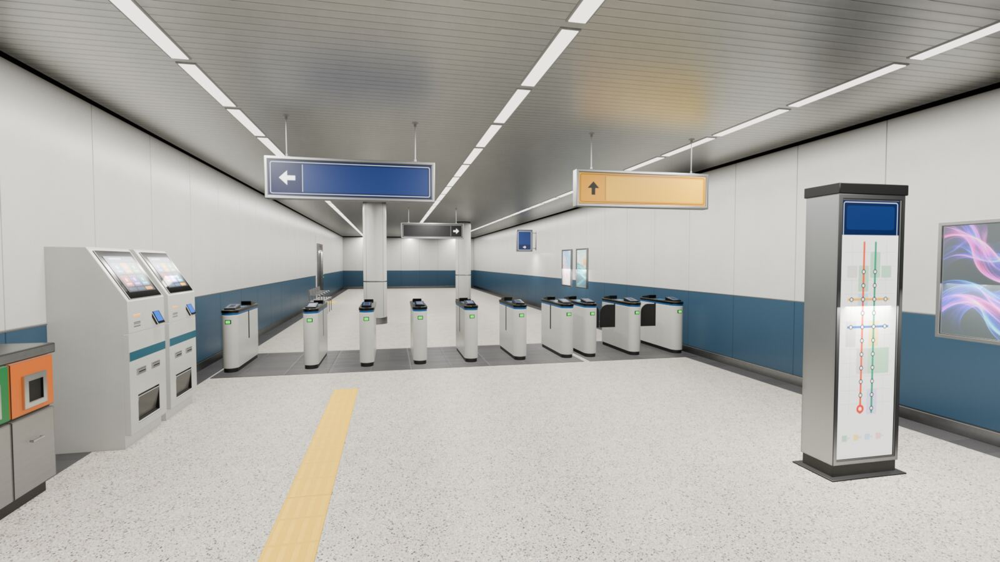
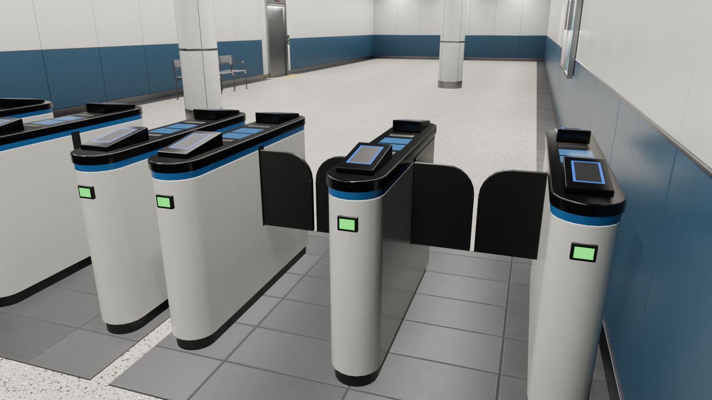

# GTEki station kit — Handoff to station leads

Updated 2026-10-21 · kit `0.1.0` · contract [`gteki-asset/0.1`](asset-contract.md) · lane: Issue #11 (`tools/blender/**`, `assets/library/**`, `docs/assets/**`).

**Status:** a reusable, reproducible kit of 48 station components, built only from repository code plus AI-generated posters whose provenance is recorded (licences decided by the Owner, Issue #123: original assets CC BY 4.0, AI posters CC0 1.0; see PROVENANCE and the root NOTICE). It imports into Web (three.js) and Godot 4.7 with tested parity; evidence is in the [import report](import-report.md). The kit is **generic**: no asset is a measurement of Ikebukuro, Shinjuku or any real station. **Layout, station identity, measured dimensions and routing belong to each station lead.** Merges follow the Issue #6 rules. The licence is decided (code Apache-2.0, original assets CC BY 4.0, AI images CC0 1.0); the machine-readable form is embedded in the GLBs at the next full library rebuild (see [asset-contract.md](asset-contract.md) §3).



**Look:** the whole game targets the look of `vertical_hero` and `concourse_gates_closed`. [style.md](style.md) gives the palette, materials, bevels, signage and lighting rules every piece follows ([#94](https://github.com/nurockplayer/gteki/issues/94)).

## What is in the box

| Family | Assets (`assets/library/glb/`) | Placement |
| --- | --- | --- |
| Passages | `passage_straight_w4_l6`, `_w4_l2p4`, `_w4_l6_tile`, `_w8_l6`, `_w8_l6_open`; nodes `passage_end_w4/_w8`, `corner_w4`, `tee_w4`, `cross_w4` | linear |
| Fare gates | `gate_array_4w1`, `_6w1`, `_2`, `_3w1_oneway` (wide accessible aisle, hinged flaps) | linear |
| Vertical | `stairs_straight_w2400_r3000`, `stairs_landing_w2400_r4000`, `escalator_s1000_r5000_up/_down`, `escalator_s600_r3500_down`, `lift_portal_w1000` | linear / wall |
| Signage | `sign_hanging_*` (4), `sign_wall_*` (2), `sign_totem*` (2), `sign_blade_*` (2) | ceiling / wall / free |
| Props | benches, bin trio, poster lightboxes, vending machines, ticket kiosk, columns, tactile strips, barrier rails | wall / free / linear |

`assets/library/manifest.json` lists every GLB with its sha256, byte size, triangle count, materials and texture plans, bounds, placement, params, sockets (with glTF positions) and collision node names. Read it rather than hard-coding sizes.

## Loading many pieces: use a kit bundle

Each kit GLB is self-contained, so placing 29 items GLB by GLB re-downloads and re-uploads shared textures. On the concourse demo that costs 10.8 MiB and 502 MiB of Godot texture memory, versus **4.25 MiB and 111.5 MiB** with a bundle. Make one bundle of the assets your scene places, load it once, and clone per placement:

```sh
python3 tools/blender/bundle_kit.py bundle --library assets/library --ids gteki_gate_array_6w1,gteki_bench_4seat --out stations/<id>/gteki/assets/kit.glb
```

- three.js: `kit = gltf.scene.children[0]`; `kit.getObjectByName(id).clone()`.
- Godot: `kit.get_node(id).duplicate()`.

Clones share geometry, materials and textures. Inside a bundle, a node name that repeats in another asset gets a suffix on import (`VIS_flap_0_L_1` in three.js, `VIS_flap_0_L2` in Godot). Read the original from `extras.gteki_name`: `userData.gteki_name` in three.js, `get_meta("extras").gteki_name` in Godot. Details are in [contract §7](asset-contract.md#7-kit-bundles--gteki-kit-bundle01-derived-optional), and measurements in [texture-budget.md](texture-budget.md).

## Phones: the mobile tier

`assets/library/mobile/` holds the same 48 assets built with `PROFILE=mobile`, with the same ids, params, sockets, collision and flap nodes. Compared with the full library it downloads 5.86 MiB instead of 21.03 MiB, draws 105 instead of 515 calls for one of each asset, and needs 51 MiB instead of 1153 MiB of estimated GPU texture memory. Colour-only materials share one kit palette (`gteki_palette`). Sign faces and posters keep their own textures. Every visual mesh has a lightmap UV (`TEXCOORD_1`) for baking. Pick the directory by quality tier, for example mobile for `quality: "low"`. Details are in [contract §8](asset-contract.md#8-build-profiles-full-and-mobile).

Measured in your own scenes, on scratch copies of the station branches with probe placements only ([mobile-profile.md](mobile-profile.md#gate-cost-in-the-real-station-scenes)):

- **Ikebukuro** uses 23–28 draw calls on its low tier at the three JR gates. Three naive mobile gate arrays add 13 draws each, which is over your 28-draw budget. One `THREE.BatchedMesh` per material adds **+1** for all three, and the flaps stay animatable. The scene is lit only by its lightmap, so kit props render dark until they are baked (use `TEXCOORD_1`) or given local light.
- **Shinjuku:** the mobile gate array, as a BatchedMesh, replaces the procedural box gates for **2–3 fewer** draw calls, at about 3k triangles per gate in view.

Which gates, how many aisles, and where they stand is the station lead's decision.

## Placing pieces

Units are metres, glTF +Y is up, and the root carries `extras.gteki` (contract, params, `placement`, bounds, licence). The **placement class** tells you where the origin sits:

- **linear** — the entry edge is at z=0, the module runs toward −Z and the walking surface is y=0. Passages, gates, stairs, escalators and tactile strips. Stairs and escalators end at `+rise` in y.
- **wall** — the wall plane is z=0 and the item projects into the room along +Z. Put the origin on your wall surface, with the item's +Z facing into the room.
- **free** — the footprint is centred on the origin, with its base at y=0.
- **ceiling** — the origin is on the floor under the sign, and `mount_height` and `drop` are in params. Hang it from your own ceiling height.

**Snapping with sockets.** `SOCKET_*` nodes point *outward* along their local −Z. Their extras carry `socket`, `width` and `height`, so a w4 module only mates with another w4 opening. To attach module B's `start` to module A's `end`:

```
T_B = T_A · S_A_end · RotY(180°) · inverse(S_B_start)
```

`S_x` is the socket's local transform inside its own GLB. Every linear module's `start` socket sits at the origin with yaw 180°, so for linear pieces this simplifies to `T_B = T_A · S_A_end`.

**Collision.** `COL_*-colonly` nodes become `StaticBody3D` in Godot automatically. In three.js, hide them, or feed them to your physics engine. Stairs and escalators collide as smooth ramps. Gate flaps and hanging signs have no collision. Kit collision is only for character movement; **it is not navigation truth** (`extras.gteki.navigation`). Routes must come from your verified station graph (G2).

**Lights.** `LIGHTHINT_*` empties mark where fixtures are. Their extras give `kind` (`linear_led`, `panel`, `step_light`, `indicator`), `length_m` or `size_m`, `watts` and `colour_temp_k`. The kit exports no lights; spawn whatever your renderer can afford. `tools/blender/render_preview.py` shows one way to map them to area lights.

## Making it look like *your* station

1. **Sign wording.** Each readable face is one quad with a full 0–1 UV and a `gteki_sign_face_*` material. The kit art is only colour fields and arrows. Swap the material, or its texture, by name at runtime for real text and pictograms. Wording, pictograms and typefaces must come from sources your lane has cleared (G0); the kit deliberately contains none.
2. **Material identity.** All materials have stable `gteki_*` names, such as `gteki_wall_panel_enamel`, `gteki_floor_terrazzo` and `gteki_gate_accent`. Override them by name for your station's palette. Or add a spec to `tools/blender/gteki_assets/materials.py` and rebuild, if you want it baked in.
3. **New sizes and variants.** Keep a catalog in **your own lane**, such as `stations/<name>/assets/catalog.json`, in the same format as `tools/blender/catalog/kit_v0_1.json`. Then build into your lane:

   ```sh
   CATALOG=$PWD/stations/<name>/assets/catalog.json OUT=$PWD/stations/<name>/assets sh tools/blender/build.sh
   ```

   Every generator parameter is listed in its family module's `DEFAULTS`, for example the passage width/length/wall/floor/ceiling styles, the gate aisle count and wide aisles, the stair rise and landing, and the escalator step width. If a variant uses sourced measurements, set `"dimension_basis": "station-verified"` and record the evidence in your lane. Never hand-edit GLBs: the generator is the source of truth.
4. **Posters.** `poster_lightbox` takes `poster_image` (a repo-relative JPEG/PNG). An image larger than the build's `tex_res` is downscaled to fit, and each image gets its own `gteki_poster_custom_*` material. Only use images your lane has cleared. The path must stay inside the repository (absolute paths and `..` escapes are rejected), and a custom image needs `poster_provenance` and `poster_license` params: the GLB's `provenance`/`license` and its manifest entry then name the image's own rights instead of the kit's.

## Animating gate flaps

Each `VIS_flap_<aisle>_<L|R>` node's origin is its hinge, and in the exported (open) pose the flap is hidden inside the cabinet. To close a flap, yaw the node about its local +Y by `params.flap_close_yaw_deg[side]` (L = −90°, R = +90°). The leading edges then meet 10 mm short of the aisle centre. `aisle_centers_x_m`, `aisle_widths_m`, `flap_reach_m` and `cabinet_span_z_m` (entry and exit z of the cabinets) are in params, for placing triggers.

```gdscript
# Godot: t = 0 open .. 1 closed; params = root.get_meta("extras").gteki.params
flap.rotation.y = deg_to_rad(params.flap_close_yaw_deg[side]) * t
```

```js
// three.js: params = gltf.scene.children[0].userData.gteki.params
flap.rotation.y = THREE.MathUtils.degToRad(params.flap_close_yaw_deg[side]) * t;
```

The physical position of the flaps never gates passage. Whether a passenger may pass is runtime logic.



## Quality upgrade path (Godot HQ)

- `TEX_RES=2048 OUT=/path/to/hq sh tools/blender/build.sh build` (or 4096) regenerates every texture at higher resolution. It keeps the same physical relief and tiling, with the same geometry and node names. Swap the HQ library in for Godot builds, and keep the 1024 library for Web.
- `--save-blend DIR` writes an editable `.blend` per asset, for hand polish or baking. Keep these out of Git, and redo any hand work as generator changes so it stays reproducible.
- Materials are plain metallic-roughness PBR (albedo, ORM, normal, emissive). They map 1:1 to Godot `StandardMaterial3D` and three.js `MeshStandardMaterial`. A map that carries no visible variation is exported as the material factor, and textures are sized by texel density, so a material may have one to three maps; `manifest.json` lists them per material.

## Commands

```sh
sh tools/blender/build.sh            # build + validate
sh tools/blender/build.sh all        # build + validate + Godot import + Web load test
sh tools/blender/build.sh repro      # two clean builds must match each other and the repo
sh tools/blender/build.sh selftest   # validator, texture budget and bundle self-tests
PROFILE=mobile sh tools/blender/build.sh all   # mobile tier: build + validate + Godot + Web
ONLY=gteki_gate_array_4w1 sh tools/blender/build.sh build
python3 tools/blender/bundle_kit.py bundle --library assets/library --layout <layout.json> --out kit.glb
pnpm --dir tools/blender/web_preview install && pnpm --dir tools/blender/web_preview dev   # viewer: /?mode=gallery, bench: /bench.html
```

## Gate status for this lane

| Gate | Status | Evidence / note |
| --- | --- | --- |
| G0 rights | **PASS (kit) / HOLD (release)** | Geometry and textures are original code output; posters are AI-generated with a recorded provenance. Licence decided by the Owner (Issue #123): geometry and textures CC BY 4.0, posters CC0 1.0 with provenance sidecars ([PROVENANCE](../../assets/library/PROVENANCE.md)). The image provider's terms were not independently re-verified for release. |
| G1 geometry | **PASS (kit level)** | Validator 0 FAIL; Godot 48/48 parity; scale, axes, collision and sockets checked; texture budget check PASS. Station fit is per lead. |
| G2 routing | n/a | The kit carries no navigation; routes come from the station graph. |
| G3 quality | **GAP (station level)** | The kit reads at L2 quality in synthetic demos. L2 itself must be judged on each station's real walkthrough. |
| G4 delivery | **PASS (merge per Issue #6 rules)** | Reproducible build, tests, PR, Handoff and import report. |

## Known gaps / next steps (kit lane)

1. Texture dedupe is **done**: texel-density sizing, flat-map factors, aspect-matched sign faces and kit bundles ([texture-budget.md](texture-budget.md)). Still open: a KTX2 variant (needs `KTX2Loader` in the shared core and a per-map quality gate), and geometry compression (meshopt, needs a Godot test).
2. `passage_straight` wall openings (doorways and shop fronts) for when station leads need cut-outs.
3. More families on demand: platform edge with screen doors, ticket office counter, shop units, ramps, a floor-level transition piece.
4. Vending machine material atlas; glass sorting guidance per engine.

Ask in Issue #11 for new generators or parameters. Small, versioned contract changes go through this lane, so that there is a single writer for shared asset code.
