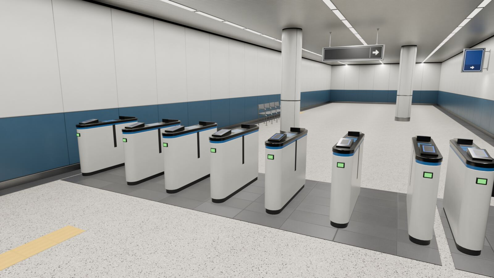
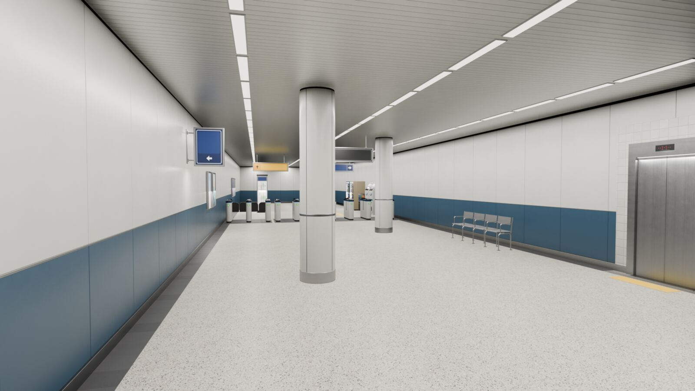
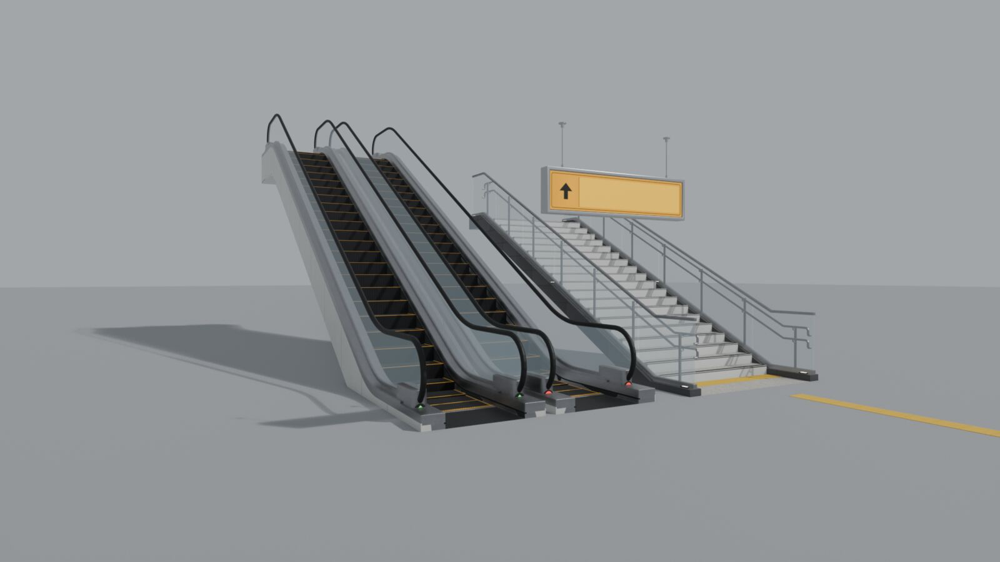
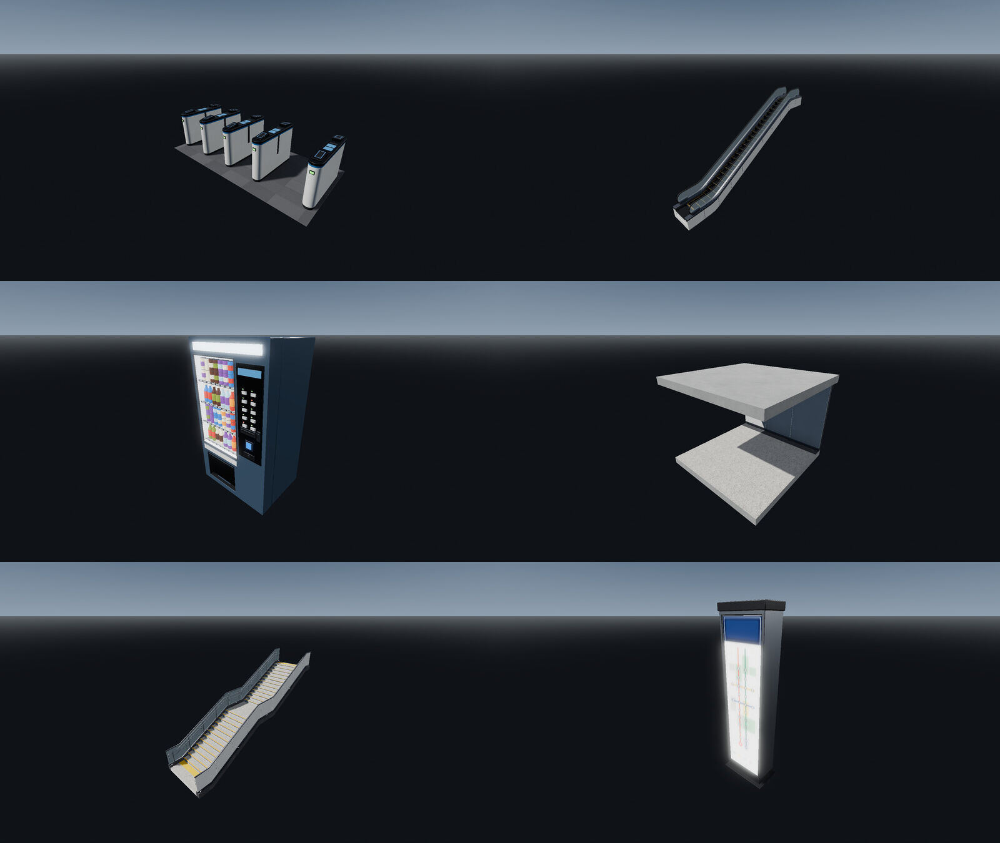
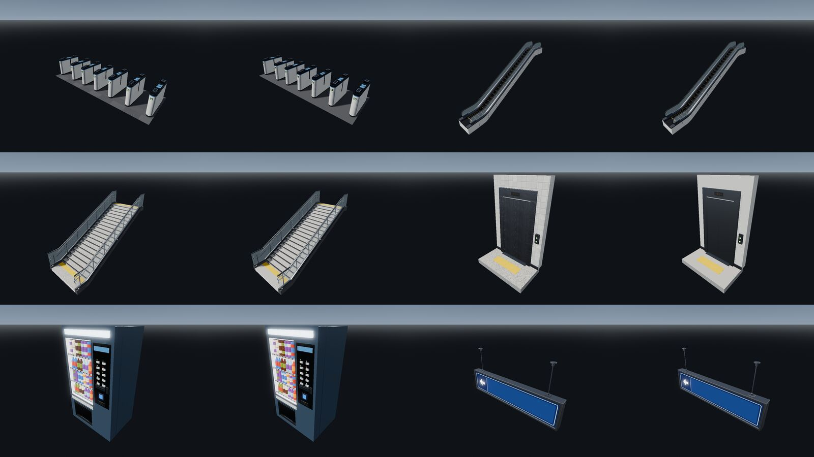
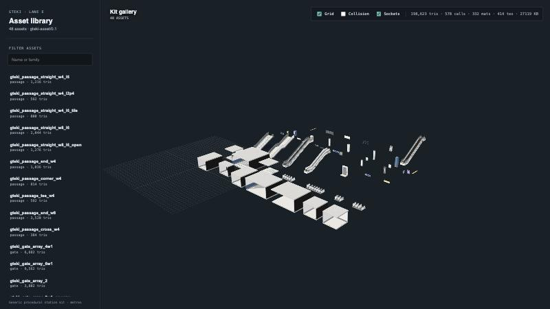
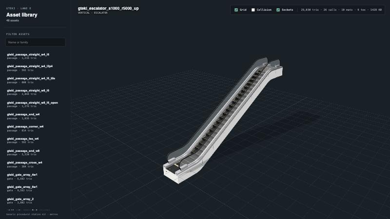

# GTEki kit 0.1.0 — import and quality report

Contract `gteki-asset/0.1` · 48 GLBs · 21.0 MiB (was 26.5 MiB before the texture budget) · 198,623 visual triangles · generated 2026-10-20, texture budget 2026-10-21.

Everything below was measured on the committed library (`assets/library/glb`) with the commands shown. Nothing in this kit is a measurement of Ikebukuro, Shinjuku or any other real station; all assets are `generic-typical` or `synthetic` (see [`PROVENANCE.md`](../../assets/library/PROVENANCE.md)).

## Environment

| Tool | Version |
| --- | --- |
| Blender (headless generator + round-trip renders) | 5.2.2 LTS, `--factory-startup` |
| Godot (import + screenshots) | 4.7.2-stable, Forward+ on Metal (Apple M2 Pro) |
| Web viewer / loader | three.js 0.180, Vite 7, Node 26.10, pnpm 12.11 |
| Validator | `tools/blender/validate_glb.py` (Python stdlib only) |

## Results

| Check | Command | Result |
| --- | --- | --- |
| Batch build, 48 assets, cold texture cache | `tools/blender/build.sh build` | PASS · ~240 s of generator time on M2 Pro (slowest asset 30 s, most of it cold texture synthesis; cached rebuilds take seconds) |
| Contract validator (structure, accessor bounds, index range, NaN, transforms, naming, extras, AABB vs `bounds_m`) | `tools/blender/build.sh validate` | **42 PASS · 6 WARN · 0 FAIL** |
| Texture budget: images vs plan, exact map bindings (extra, missing or unplanned maps fail), duplicates, manifest coverage, byte/GPU limits | `tools/blender/build.sh validate` (`texture_budget.py --check`) | **PASS** · 21.03 MiB, 2.42 MiB unique images, 192 MiB unique GPU est. ([texture-budget.md](texture-budget.md)) |
| Stdlib self-tests (validator, budget checker, bundle tool) | `tools/blender/build.sh selftest` | **PASS** |
| Kit bundle round trip: `bundle --all`, then `extract` each asset | `bundle_kit.py` + `validate_glb.py` | **48/48** extracts validate exactly like their sources |
| Godot 4.7 headless import, with parity against `manifest.json` (StaticBody3D + CollisionShape3D per `-colonly` node, socket position and outward direction, flap nodes per aisle, placement-class origin checks) | `tools/blender/build.sh godot` | **48/48 PASS** · 299 StaticBody3D / 299 CollisionShape3D · 51 sockets |
| Godot negative test (corrupted manifest: socket yaw, collision count, aisle count) | `GTEKI_MANIFEST=bad.json run_import_test.sh` | 3/3 faults reported, exit 1 |
| Web: GLTFLoader parse in Node; the GLB set must match the manifest (a missing or unlisted GLB fails) | `tools/blender/build.sh web` | **48/48 parsed** |
| Web: browser viewer, whole kit | `pnpm --dir tools/blender/web_preview dev` → `/?mode=gallery` | renders; 198,623 tris · 578 draw calls · 414 textures (before the texture budget) |
| Web: load-strategy bench, concourse demo | `/bench.html?strategy=per_instance\|per_asset\|bundle` | see [texture-budget.md](texture-budget.md) (three.js section) |
| Reproducibility | `tools/blender/build.sh repro` | **PASS** · 48/48 GLBs byte-identical across two clean builds (fresh texture caches) and the committed library |
| Mobile tier (`PROFILE=mobile`): contract validator, budget (`budget_mobile.json`), Godot parity, Web parse, reproducibility | `PROFILE=mobile tools/blender/build.sh validate\|godot\|web\|repro` | **42 PASS · 6 WARN · 0 FAIL** · budget PASS (5.86 MiB) · Godot **48/48** · Web **48/48** · repro **PASS**; bundle round trip 48/48 ([mobile-profile.md](mobile-profile.md)) |
| texCoord negative tests: a texture (core or extension slot, or via a `KHR_texture_transform` override) whose `texCoord` is −1 or names a `TEXCOORD_n` the primitive lacks must FAIL; a texture-like object under `extras` must not count; `TEXCOORD_1` must FAIL when it overlaps (as triangles, strip or fan), is NaN, leaves the unit square, or is missing on a mobile asset | `validate_glb.py --self-test` | **PASS** (24 cases, incl. normalized UNORM16 UV1, VEC3, count mismatch, a 10⁶ coordinate and a UV1 triangle collapsed over real geometry); the first mobile build hit the texCoord rule (`texCoord: -1`, 48/48 FAIL) and the first review build hit the overlap rule (5 assets), both fixed |
| Round-trip render (GLB → empty Blender scene) | `render_preview.py` with `tools/blender/showcase/*.json` | images below |

The six validator WARNs are intentional and documented: the four `sign_hanging_*` assets have no collider because they hang above head height, and the two `tactile_strip_*` assets have no collider because they are 4 mm floor overlays.

## Per-family budget

| Family | Assets | Triangles | KiB per GLB | Max materials |
| --- | --- | --- | --- | --- |
| passage (straight + end/corner/tee/cross nodes) | 10 | 384–3,520 | 656–1,234 | 10 |
| gate (fare-gate arrays) | 4 | 3,802–9,562 | 443–652 | 11 |
| vertical (stairs, escalators, lift portal) | 6 | 2,394–29,030 | 988–1,582 | 11 |
| signage | 10 | 244–1,054 | 86–217 | 4 |
| props | 18 | 30–5,896 | 98–782 | 23 |

Since the texture budget, about 62 % of the bytes are embedded JPEG textures (it was 70 %). Textures are sized by texel density (≤ 1024 px), and flat maps are material factors. Each GLB is still self-contained, so a scene that places many GLBs should load a **kit bundle** and clone it: on the concourse demo that is 4.25 MiB instead of 10.8 MiB. See [texture-budget.md](texture-budget.md).

## Visual evidence

Synthetic layouts in `tools/blender/showcase/` are explicitly marked *"SYNTHETIC KIT DEMO — not a station layout"*. They exist to show how the pieces read together, not as a proposal for either station.

| | |
| --- | --- |
|  |  |
| Approach: ticket kiosks, wayfinding totem, hanging signs, tactile guidance, 6+2-aisle gate line | Gates: IC readers, LCD, status lamps, wide accessible aisle |
|  |  |
| Flaps posed **closed** from the GLB's own params (`close_flaps`) | Paid side: columns, bench, lift portal, blade sign |
|  |  |
| Stairs with landing and escalators | Same GLBs imported by Godot 4.7 with default import settings |
|  | |
| Godot 4.7: full (left of each pair) and mobile tier | |
|  |  |
| three.js gallery of all 48 assets | three.js single-asset viewer (sockets on) |

Full-resolution PNGs were rendered to a scratch directory and are deliberately **not** committed. Re-create them with:

```sh
blender -b --factory-startup -P tools/blender/render_preview.py -- \
  --layout tools/blender/showcase/concourse_demo.json --camera gates --res 1920x1080 --out /tmp/gates.png
```

## Import notes for consumers

- **Axes and units:** metres, glTF +Y up. Linear modules start at z=0 and extend toward −Z. Walking surfaces are at y=0. Sockets point outward along their local −Z. Godot and three.js need no rotation or scale fix.
- **Collision:** in Godot, `COL_*-colonly` nodes become `StaticBody3D` with default import settings. In three.js they load as ordinary meshes named `…-colonly`; hide them, or feed them to your physics engine. Stairs and escalators collide as smooth ramps.
- **Materials:** standard metallic-roughness PBR with an ORM texture. `KHR_materials_emissive_strength` is the only extension; Draco and meshopt are not used. Material names (`gteki_*`) are stable, so runtimes can swap materials by name.
- **Glass:** `gteki_glass_*` is alpha-blended. Expect normal sorting artefacts in both engines when you look through two glass layers; for close-up views, set Godot's depth-draw mode or three.js `depthWrite` as you prefer.
- **Exporter warning:** Blender prints "More than one shader node tex image used for a texture" for the ORM packing. The warning is harmless; the glTF uses one ORM texture per material.
- **HQ path:** `TEX_RES=2048 OUT=/path/to/hq tools/blender/build.sh build` (or `TEX_RES=4096`) regenerates every texture at higher resolution, with the same physical relief and seamless tiling. Write HQ builds to a separate `--out`; `--only` refuses to mix resolutions in one manifest.

## Independent review

A fresh read-only GPT-6 Astra (high) review of WIP commit `9d48ca4` found 4 P1 and 4 P2 issues. All eight are fixed in this branch:

| # | Finding | Fix |
| --- | --- | --- |
| P1 | Wide-aisle flaps left ~14 cm gaps when closed; sliding flaps could not hide in a 0.22 m cabinet | Flaps redesigned as hinged fan doors stored along the cabinet face. Each node origin is its hinge, and `flap_close_yaw_deg` swings it across the aisle; verified from GLB vertices to stop 10 mm short of centre in every aisle, wide ones included |
| P1 | Root `extras.gteki.params` turned lists and booleans into JSON strings | Root extras are rewritten after export with exact JSON types |
| P1 | Validator passed GLBs containing NaN positions or out-of-range indices | Validator decodes POSITION and index data; self-test covers both cases |
| P1 | Godot test printed PASS regardless of failed checks | Required checks now FAIL and set a non-zero exit; added parity checks against the manifest and a guard against the runner exiting 0 without a report |
| P2 | Normal relief fell ~4× at 2048 textures | Strength now scales with resolution (tactile slope p99 0.82 at 1024, 0.85 at 2048) |
| P2 | Escalator tread texture had a seam | Periodic pitches snap to whole cycles per tile; wrap step is now 0 |
| P2 | `--only` typos succeeded silently and relabelled the texture resolution | Unknown ids and resolution mismatches abort before anything is written |
| P2 | Provenance overstated poster rights | Wording now limited to the recorded evidence; the Owner confirms provider terms before licensing |

The texture-dedupe follow-up had two fresh read-only Codex reviews. Every finding is fixed in this branch:

| # | Finding | Fix |
| --- | --- | --- |
| P1 | `validate` piped the budget report through `tail`, which hid its exit status | The report goes to a file, which is printed on failure, and `validate` returns 1 |
| P1 | Inside `build.sh all` (an `&&` chain) errexit is off, so a contract-validator failure could pass | Each step in `validate` and `selftest` returns its own failure explicitly |
| P2 | Flat-map statistics used float32 before 8-bit rounding, so one flat map was kept | Statistics come from the exact 8-bit PNG values (`texsynth.quantize8`) in float64 |
| P2 | A manifest entry whose GLB is missing was not reported | `texture_budget.py --check` reports both directions |
| P2 | My docs said Godot keeps node names in a bundle; it uniquifies them across the whole file, as three.js does | Repeated names carry `extras.gteki_name`; `extract` removes the tag; contract §7 documents the lookup |
| P2 | A `--name` equal to a bundled asset id left that asset renamed on load and untagged | `bundle` rejects a wrapper name that collides with any bundled node |
| P3 | The bench kept the PMREM generator and room scene alive, which inflated the resource counters | Both are disposed after the environment map is baked |

## Known gaps / blockers

1. **Texture dedupe for Web: done** ([texture-budget.md](texture-budget.md)). Open follow-ups: a KTX2 variant (it needs `KTX2Loader` in the shared core and a per-map quality gate), geometry compression (meshopt; needs a Godot test), and runtime mipmaps for JPEG in Godot `GLTFDocument` (a Lane C note).
2. **Wall openings.** Passages have solid walls; the lift portal and shop fronts are wall-mounted decorations, not cut openings. Station leads who need a doorway should use a passage node or request a `passage_straight` `openings` parameter.
3. **Glass sorting** is described in Import notes; no fix in the kit.
4. **Vending machine** has 24 material slots (product-face colours) on the full tier. On phones, use the mobile tier: 2 draws ([mobile-profile.md](mobile-profile.md)).
5. **Not measured:** phone GPU frame times (gate cost in both station scenes is measured as draw calls, triangles and memory; see [mobile-profile.md](mobile-profile.md)). The kit ships no scene; frame-time evidence belongs with each station's L2 walkthrough.
6. **Licence:** decided by the Owner (Issue #123): original assets CC BY 4.0, AI posters CC0 1.0. The AO rollout rebuild (#160) writes the decided values into every GLB and manifest ([asset-contract.md](asset-contract.md) §3); libraries built before it still say `UNDECIDED`.
