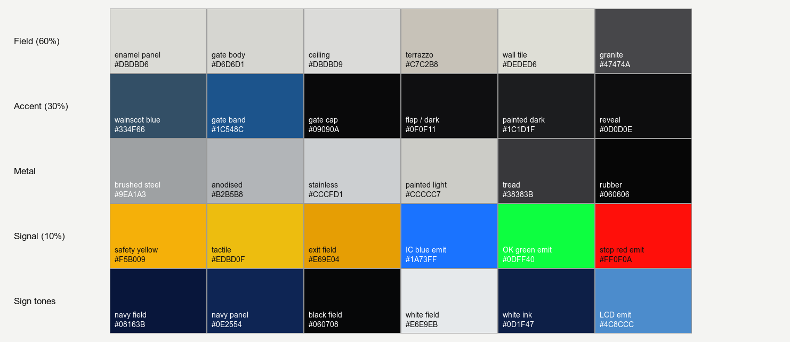
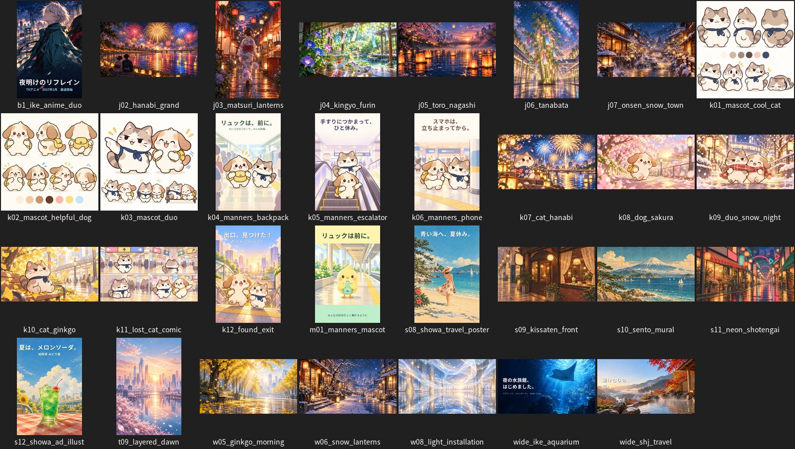

# GTEki style bible

**Status:** v0.1, for Owner review before mass production ([#94](https://github.com/nurockplayer/gteki/issues/94)). It describes the look of two Lane E renders the Owner chose as the target for the whole game. Every value here is read from the generator code (`tools/blender/gteki_assets/`) that produced them, so the renders can be reproduced and new pieces can match them.

| `vertical_hero` | `concourse_gates_closed` |
| --- | --- |
|  |  |

Scope:
- This page is about assets: form, materials, colour and signage, plus the lighting the references were rendered with.
- Matching that lighting in real time is Lane G and Explorer work (#94 part B).
- Placement in a station stays with each station lead.

## 1. The look in five rules

1. **Clean, maintained, slightly stylised realism.** Plain PBR, real proportions, real detail. Nothing is dirty or broken, and nothing is noisy: variation stays at a level you feel, not one you see.
2. **A light field, a dark accent, a small signal.** Large surfaces are warm white and light grey. Structure and equipment read through dark accents (deep-blue bands, black caps and flaps). Saturated colour is reserved for signals: safety yellow, IC blue, status green and red, sign fields. The rough area split is 60 / 30 / 10.
3. **Layered, soft-edged forms.** Equipment is built as a stack (dark plinth, light body, accent band, black cap), with rounded ends and small real bevels that catch a highlight. Flat faces stay flat: no lumpy normals.
4. **Shadow gaps and flush detail.** Panels meet at dark 8–12 mm reveals. Screens, readers and lamps sit flush or slightly recessed, and glow by themselves.
5. **Authentic Japanese station equipment, with no real brands.** IC readers, gate flaps, yellow step edges, tactile strips, blade and hanging signs. No operator logos, liveries, typefaces, station names or real product brands.

## 2. Palette



All values are sRGB authoring colours (the code converts them to linear when it builds materials). On screen they pass through AgX tone mapping, so a render pixel will not match the hex exactly.

| Role | Material (`gteki_…`) | sRGB | Roughness / metal | Used for |
| --- | --- | --- | --- | --- |
| Field | `wall_panel_enamel` | `#DBDBD6` | 0.28 / 0 | upper wall panels, column cladding |
| Field | `gate_body` | `#D6D6D1` | 0.22 / 0 | gate cabinets, equipment bodies |
| Field | `ceiling_spandrel` | `#DBDBD9` | 0.42 / 0.85 | linear metal ceiling, 100 mm strips |
| Field | `floor_terrazzo` | `#C7C2B8` | ≈0.37 / 0 | public concourse floor |
| Field | `wall_tile_white` | `#DEDED6` | 0.22 / 0 | 150 mm tile, lift surrounds |
| Field | `floor_granite_dark` | `#47474A` | 0.30 / 0 | 600×300 tile under gates, 0.30 m border band |
| Accent | `wall_panel_accent` | `#334F66` | 0.30 / 0 | wainscot, 1.1 m high |
| Accent | `gate_accent` | `#1C548C` | 0.30 / 0 | 30 mm band under a cap |
| Accent | `gate_top` | `#09090A` | 0.18 / 0 | gloss black caps |
| Accent | `plastic_dark` | `#0F0F11` | 0.45 / 0 | gate flaps, gaskets |
| Accent | `steel_painted_dark` | `#1C1D1F` | 0.42 / 0 | plinths, bases, frames |
| Accent | `reveal_dark` | `#0D0D0E` | 0.7 / 0 | shadow gaps, backing |
| Metal | `steel_brushed` | `#9EA1A3` | ≈0.35 / 1 | skirting, chair rail, handrails, comb plates |
| Metal | `aluminium_anodised` | `#B2B5B8` | 0.38 / 1 | sign frames, light trims |
| Metal | `stainless_polished` | `#CCCFD1` | 0.24 / 1 | bench frames, corner guards |
| Metal | `steel_painted_light` | `#CCCCC7` | 0.34 / 0 | escalator truss and sides |
| Rubber | `escalator_tread` | `#38383B` | ≈0.51 / 0.9 | cleated treads |
| Rubber | `rubber_black` | `#060606` | 0.55 / 0 | moving handrail, flap edge, pads |
| Signal | `vertical_safety_yellow` | `#F5B009` | 0.48 / 0 | step edges, escalator demarcation, comb teeth |
| Signal | `tactile_dots` / `_bars` | `#EDBD0F` | ≈0.52 / 0 | tactile paving |
| Signal | `emissive_ic_blue` | emit `#1A73FF` ×1.6 | 0.2 | IC reader ring |
| Signal | `emissive_green` / `_red` | emit `#0DFF40` / `#FF0F0A` ×2.5 | 0.2 | status lamps |
| Signal | `screen_lcd` | emit `#4C8CCC` ×1.2 | 0.1 | small LCDs |
| Light | `light_diffuser` | emit `#FFF7EB` ×4.0 | 0.5 | ceiling LED diffusers |
| Glass | `glass_clear` | `#CCE0E6`, α 0.18 | 0.04 | balustrades, guards |
| Glass | `glass_frosted` | `#EBF0F2`, α 0.55 | 0.35 | screens, partitions |

Props, such as bins and vending bodies, may use the secondary colours already in `families/props.py`: bin blue, green, orange and grey; vending slate, graphite, sage and sand.

**Rule:** a new piece uses these materials by name. A genuinely new colour or material is added to this table and to `materials.py` in the same PR, with its role.

## 3. Material library

Every surface is synthesised in code (`texsynth.py`, `TEXSYNTH_VERSION` 4): tileable, seeded and byte-reproducible, with no external images. Each generator makes albedo, ORM (R=1, G=roughness, B=metal) and an OpenGL normal map.

| Generator | Look | Key parameters |
| --- | --- | --- |
| `terrazzo` | polished pale aggregate | 16,000 chips per m² (radii 1.2–5.5 px at 1024, four chip colours); cloud ±4 %; normal 0.6, almost flat |
| `tile_grid` | ceramic or granite tile with grout | `tiles` per repeat; grout 3–5 px; bevel 4–6 px; per-tile tint σ 0.02–0.05; grout roughness 0.85 |
| `painted_metal` | enamel and powder coat | orange peel 0.25 (gate body 0.12); albedo ±2 %; roughness ±0.025 |
| `brushed_metal` | anisotropic steel | 40:1 streaks; roughness 0.32 ± 0.05; metal 1 |
| `linear_spandrel` | linear metal ceiling | 100 mm pitch, 8 mm dark groove; metal 0.85 |
| `tactile` | dots (5×5) or bars (4) per 300 mm block | domes r 11/13 mm; bars 38 mm wide; normal 5.0 |
| `rubber_grip`, `escalator_tread` | ribbed rubber, cleated tread | rib pitch 64 px, cleat pitch 40 px |
| `concrete` | hidden structure only | pitted, roughness 0.82 |
| perforated steel | bench seats | 20 staggered hole columns per 0.3 m |

Texture size follows the repeat length: the smallest power of two that is at least the repeat in metres times `tex_res`, capped at 1024 in the canonical GLB (JPEG q88). Maps flatter than a few 8-bit levels ship as material factors instead of images.

## 4. Relief and wear

The references show **wear level W0, as-maintained**. The code has no dirt, grime, scuff, scratch or decal system, and that absence is part of the look.

| Level | Meaning | Allowed variation |
| --- | --- | --- |
| **W0 (default)** | as the references | albedo ±1–4 % cloud (concrete up to −14 % pits); roughness ±0.025–0.06; normal relief weak on painted and polished faces (≤1.0), strong only where the form is real (tread, tactile, grout, spandrel) |
| W1 (optional, future) | lightly used | roughness polish paths on floors at gate lines and stair feet; kick-plate scuffs ≤5 % albedo; no new colours |
| W2+ | not used | dirt, stains, rust and graffiti are outside the GTEki look |

W1 needs its own generator and an Owner look check before any piece uses it.

## 5. Form and bevels

**Form language**
- **Stack:** dark plinth (14 mm inset) → light body → 30 mm accent band → black cap with an 8 mm overhang. This is the gate cabinet's stack, and the same order works for kiosks, ticket machines and counters.
- **Plan shape:** stadium or rounded rectangle. Gate cabinets have semicircular ends (r = half width).
- **Joints:** panels on a 1.2 m module, 8 mm joints, a 60 mm shadow gap under the ceiling, and a 12 mm gap at wainscot changes.
- **Emissive detail** sits flush or 10–14 mm recessed in a dark frame or gasket.

**Bevels** (full tier; the mobile tier has none). Part bevels use a Blender Bevel modifier (40° angle limit) followed by Weighted Normal, so flat faces stay flat.

| Scale class | Width / segments | Examples |
| --- | --- | --- |
| Equipment shell | 6 mm / 2 | gate cabinet, escalator truss, hanging-sign frame, totem cap |
| Panel and frame | 3–4 mm / 1–2 | wall panels, sign frames, lift portal, call panel, bench seat, column trim |
| Trim and small | 2–3 mm / 1 | chair rail, skirting, light trim, floor plates |
| Fine | 0.8–1.5 mm / 1 | escalator treads, demarcation, stair nosings, gaskets |
| None | n/a | floors, ceilings, tile bands (the edge lives in the texture) |

**Reference dimensions:** synthetic but typical, used across the kit.

| Element | Size |
| --- | --- |
| Gate cabinet | 0.22 × 1.30 × 0.92 m; aisle 0.60 m clear, 0.90 m wide aisle |
| Wainscot | 1.1 m, with a brushed chair rail |
| Stair | riser ≤ 0.16 m, tread 0.30 m, 55 mm yellow nosing strip, handrail Ø36 mm at 0.85 and 0.65 m |
| Escalator | step 1.0 m wide at 30°; rubber handrail Ø72 mm at 0.95 m; 16 mm yellow demarcation |
| Passage | 2.8 m high (3.2 m concourse); skirting 0.12 m |
| Hanging sign | 1.8 × 0.45 × 0.12 m, bottom at 2.3 m |
| Wall sign | 1.6 × 0.4 m at 1.9 m |

## 6. Signage

- A sign face is one emissive quad in a recessed aluminium frame (28–35 mm bar) with a 4 mm dark gasket.
- **No text, digits, pictograms or typefaces are generated.** Art is a colour field, a thin inner rule, an optional geometric arrow block and a blank text panel. Stations add their own wording at runtime (see [HANDOFF](HANDOFF.md)).
- Arrow directions are left, right, up or none. The back face carries the mirrored arrow.
- **Exception: facility pictograms (batch P1).** Approved by the director under the Owner's delegation, 2026-10-22 ([#151](https://github.com/nurockplayer/gteki/pull/151)). This narrow exception covers only the toilet entrance sign (`toilet_entrance`), which carries a procedurally drawn figure:
  - It is GTEki's own geometric figure: a signed-distance texture hand-built from circles, capsules, rounded rectangles and convex polygons in `families/facilities.py`. ISO 7001 and JIS Z8210 are stylistic references only. No artwork was traced, copied or imported.
  - It only restates the facility the source names, with the matching `kind`. A station places it only where the source gives the entrance or door position.
  - A space-representative point alone is not enough, because the piece would imply a door the source doesn't give. This rules out GSI F001 / F002 / F003 by themselves, so Shinjuku does not place it.
  - The `accessible` figure claims an accessible toilet, so it is used only where the source says so.
  - Still no text or digits.

| Tone | Field | Panel | Rim | Ink | Emission |
| --- | --- | --- | --- | --- | --- |
| navy (wayfinding) | `#08163B` | `#0E2554` | `#DBE3ED` | `#F7F7F5` | 2.0 |
| exit_yellow (exits) | `#E69E04` | `#F5BD1A` | `#141412` | `#0F0F0D` | 0.75 |
| black (lines, platforms) | `#060708` | `#111214` | `#A6ABB2` | `#F5F5F2` | 2.0 |
| white (information) | `#E6E9EB` | `#F9FAF9` | `#0D1F47` | `#0D1F47` | 1.2 |

- **Ads and posters:** fictional brands only. Images come from code or from AI generation with recorded provenance (§9).

## 7. Lighting reference

These are the settings the two references were rendered with (`tools/blender/render_preview.py`). They are the target the real-time look is judged against.

| | `concourse_gates_closed` (interior) | `vertical_hero` (studio) |
| --- | --- | --- |
| Engine | EEVEE, 64 samples, ray tracing, GI | same |
| Colour | AgX (base look), exposure −0.35 | AgX (base look), exposure −0.2 |
| World | near-black `(0.02, 0.022, 0.025)` linear | light grey `(0.55, 0.58, 0.62)` linear, strength 0.9 |
| Key light | area lights only, built from the GLB's `LIGHTHINT_*` empties: 0.12 m × length rectangles at 55 W per metre, colour `(1.0, 0.96, 0.9)` linear (warm, about 4000 K), pointing down, shadows on | sun, strength 3.0, 3° angle, rotation (50°, 10°, 35°); 200 m ground plane `(0.32, 0.33, 0.34)` linear |
| Camera | lens 26 mm at 1.45 m, about 19° down | lens 22 mm at 1.7 m, level |

What makes them work, and what real time must keep:
1. **Light comes from the ceiling fixtures,** soft and even. There's no single strong directional light indoors.
2. **Contact shadows and AO are strong** at every foot, joint and under every cap. This is where most of the "solid" feel comes from.
3. **Highlights run along bevels** on glossy dark caps and enamel bodies.
4. **AgX** keeps whites from clipping and saturated signals from going neon.

`render_preview.py` asks for the look "AgX - Medium High Contrast", but Blender 5.2.2 offers no such look, so it falls back to "None". The references are plain AgX.

Every visual mesh in the mobile tier carries a non-overlapping `UVLightmap` (TEXCOORD_1) for baking. Pieces are authored to be lit by the scene, so they carry no baked light themselves.

Reproduce the references:

```sh
blender -b --factory-startup -P tools/blender/render_preview.py -- \
  --layout tools/blender/showcase/concourse_demo.json --camera gates_closed --out gates_closed.png
blender -b --factory-startup -P tools/blender/render_preview.py -- \
  --layout tools/blender/showcase/vertical_demo.json --camera hero --out vertical_hero.png
```

## 8. Tiers and station rules

**Tiers**
- **Full:** the look above.
- **Mobile** (`PROFILE=mobile`, [mobile-profile.md](mobile-profile.md)): same silhouettes, colours and emissive panels. It drops fine detail by design: terrazzo, grout and brushed metal become palette colours, bevels go, and round parts have about half the segments.

**What the stations require of kit pieces** (from the station leads, 2026-10-22):

| | Ikebukuro | Shinjuku |
| --- | --- | --- |
| Lighting | baked only. Large static pieces go through the station's Blender bake with their own UV2; small props may be unlit or emissive | real time: hemisphere light, RoomEnvironment at 0.55, ≤ 8 point lights, ACES at exposure 0.92; GTAO and bloom on high. Pieces must work as plain glTF metal-rough with no lightmap |
| Budget | low tier: ≤ 28 draws and ≤ 129k triangles per frame | phone, today 279 draws and 261k triangles; proposed kit total ≤ +30 draws, ≤ +60k triangles, ≤ +3 MB geometry, ≤ 8 MB GPU textures, measured on the shipped (meshopt + KTX2) variant |
| Batching | merge or instance per material | batch per material or instance, never one mesh per piece; compressed delivery (meshopt or Draco, KTX2) shared across instances |
| Collision | solid props need a walker collider that blocks no verified edge | kit pieces are visual-only; collision stays the station's merged wall collider |
| Textures | ≤ 1k on low, atlased, lazy-load anything big | within the 8 MB above |
| Truth | placement follows surveyed geometry; unknown means not drawn; no invented gates, lifts, stairs or shops; decoration must not imply a route the graph lacks | dress source-backed geometry only; a floor-standing piece in walkable space is a station decision with a replay rerun; no columns where the data has none; a generic piece of the matching category at a GSI facility point (`plan.json`, director ruling) is not invented structure, once its category and licence fields allow rendering |
| Colour | | keep large surfaces out of near-black |

The truth rule shapes the kit. In both stations most screen time is surfaces on source-backed geometry: walls, cladding, floor, ceiling, stairs, escalators, luminaires, gates, lift portals and (Shinjuku) the platform edge. So the kit must offer **finishes and dressing**, not only standalone props. That means panel, cladding, floor and ceiling materials, luminaire modules, and stair, escalator, gate and lift dressing fitted to geometry the station already has.

The canonical kit GLB stays uncompressed (Draco and meshopt fail validation). A compressed web delivery variant (meshopt plus KTX2) is a derived build, not a change to the canonical file. Every piece in a batch is tagged with the station facility category it fits, so leads can map it to their placement sources.

## 9. Making a new piece

Checklist for every piece in a batch PR:
- [ ] Generator code only. No external models, Meshy or scans; geometry is always procedural.
- [ ] Materials from §2, or a new entry added there with its role.
- [ ] Follows the §5 stack, bevel class and joint rules; wear W0.
- [ ] Signage follows §6: no text or brands.
- [ ] Full and mobile tiers both pass `build.sh validate`, `godot` (Godot 4.7 import), `web` and `repro`.
- [ ] Collision, sockets and `LIGHTHINT_*` where the piece emits light.
- [ ] **Contact sheet in the PR**, rendered with `render_preview.py` in the reference setup (§7): EEVEE, AgX, 1600×900. It shows each piece in studio mode at a 22–26 mm lens, plus one in-context interior shot next to existing kit pieces.

**AI-generated images** (Owner rule, [#94](https://github.com/nurockplayer/gteki/issues/94)):
- **Where:** only where procedural synthesis is weak, such as poster and ad-lightbox art, or a concept board.
- **Provenance:** each image has a provenance sidecar, as the existing posters do (`assets/library/source/posters/provenance.json`). Each sidecar entry carries the prompt, generator, date, size and SHA-256, plus the rights fields `license_spdx` (`CC0-1.0`), `ai_generated` (`true`) and `brands` (`none (fictional only)`).
- **Licence:** AI-generated 2D images are CC0 1.0 (Owner decision, Issue #123). Label them AI-generated in the sidecar, and never show a real brand, logo or trademark. New images are mapped to CC0-1.0 in `REUSE.toml`.
- **Brands:** fictional only.
- **Trial first:** the Owner sees a style batch of about 10 images before any mass run.
- **Not for:** never for geometry, and never for anything that imitates a real operator.

## 10. Look direction for 2D art and the whole game (Owner, 2026-10-22)

**Goal:** a visitor should feel 「原來新宿和池袋可以這麼美」 (Owner's words). In English: "so Shinjuku and Ikebukuro can be this beautiful."

**Audience:** mainly women who get lost easily, so the look is cute, warm and reassuring.

**Look families the Owner picked:**
- 唯美: light and seasons.
- Japanese seasonal scenes (花火 and so on).
- Shōwa retro.
- Photographic ads.
- Anime key visuals.
- The guide cat and dog. They are headed for the navigation UI ([#132](https://github.com/nurockplayer/gteki/issues/132)), but until the Owner approves their model sheets they are assets only.

Batch 1 is in `assets/library/source/art2d/` (31 images, [contact sheet](img/art2d_batch1.jpg)); `catalog.json` there says which image fits which slot.



**Rules:**
- AI never draws text. All copy is typeset afterwards in Noto Sans JP (OFL) with `tools/blender/art2d/typeset.py`.
- Fictional brands only. No real brands, operators, liveries or campaign slogans.
- No real landmarks, except Mt Fuji in the bathhouse mural (Owner exception).
- Characters are original and must not resemble existing ones: Capoo/咖波, 臭跩貓, Pusheen, Sanrio, Chiikawa and so on.
- No photorealistic people.
- Tileable surfaces stay procedural, because the AI seamless test failed.
- Batches of at most 30, each with provenance and a reject log (batch 1: `assets/library/source/art2d/rejects.json`).
