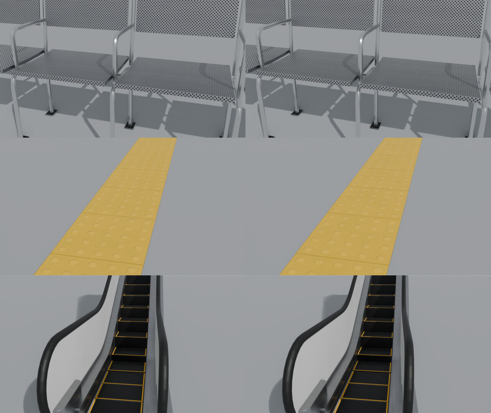

# Texture budget and dedupe — kit 0.1.0

Updated 2026-10-21 · contract `gteki-asset/0.1` (additive changes only) · lane: Issue #11.

**Result:** compared with the previous library (PR #17 at `d77257b`), the kit downloads **21 % less** and needs **56 % less unique GPU texture memory**. Rendered quality is unchanged (SSIM ≥ 0.998 on every showcase and close-up camera). A scene that loads a **kit bundle** and clones it per placement goes further. On the 29-item concourse demo it downloads **4.25 MiB instead of 13.66 MiB** and uses **111.5 MiB of texture memory in Godot instead of 952 MiB**, and loads in about 0.26 s instead of 1.6 s, compared with loading each placement's GLB, which is what the shared core does today. Every GLB is still self-contained, JPEG-only and byte-reproducible, and imports into Godot 4.7 and three.js unchanged.

## What changed

| Lever | Where | Effect |
| --- | --- | --- |
| **Texel-density sizing.** `tex_res` is both the cap and the target texels per metre. A material that repeats every 0.25 m gets a 256 px texture instead of being stored at 4096 px/m. | `materials.texture_res` | 9 of 31 textured materials smaller: steel, tactile, perforated metal and gate bodies at 512; escalator tread and nosing at 256 |
| **Flat-map factorisation.** A map whose per-channel std is below 1 level (albedo), 2 levels (roughness/metal) or 1.5 levels (normal, about 0.7° of tilt) is exported as the material factor, not a texture. The statistics are taken from the exact 8-bit PNG values, in float64. | `materials.texture_plan` | 36 of 93 maps dropped. Sign faces and the UI screen keep albedo only; painted steel and enamel panels lose their flat ORM (and the accent panel its flat albedo); terrazzo loses a flat normal |
| **Aspect-matched sign faces.** A 4.6:1 bar sign gets 1024×256 instead of 1024², and a map totem gets 512×1024, at the same texels per metre. | `signage._face_shape` | 33 MiB less unique GPU memory across the kit |
| **Kit bundle** (`gteki-kit-bundle/0.1`). One GLB per scene, with images, samplers, textures and materials stored once. Placements are clones that share GPU resources. | `tools/blender/bundle_kit.py`, [contract §7](asset-contract.md#7-kit-bundles--gteki-kit-bundle01-derived-optional) | cross-asset dedupe without external files, so the Lane C fence and Godot's self-contained rule still hold |

The manifest records each textured material's plan, for example `"textures": {"gteki_floor_terrazzo": {"res": 1024, "maps": ["albedo", "orm"]}}`, and the validator checks the GLBs against it. An asset with a baked occlusion map ([contract §4](asset-contract.md#4-materials-and-textures)) lists `occlusion` among every material's maps (also factor-only ones, whose `res` is 0) and gives its size as `occlusion_res` (128, 256, 512 or 1024), which the image-size rule checks instead of `res`.

### Options evaluated and not adopted (yet)

| Option | Measured | Decision |
| --- | --- | --- |
| **Shared external textures** (`.gltf` + image folder) | — | Rejected. Godot's `gteki_assets.gd` (Lane C) refuses GLBs that are not self-contained, and the Web fence must map every external URI. The bundle gets the same dedupe inside one GLB. |
| **WebP** (`EXT_texture_webp`, q88) | concourse bundle 3.37 MiB vs 4.25 MiB JPEG | Not now. It re-encodes lossy JPEG (generation loss), GPU memory is unchanged, and Godot's runtime loader gives it no mipmaps, just as for JPEG. |
| **KTX2 / Basis** (`KHR_texture_basisu`: ETC1S for colour and ORM, UASTC + RDO for normals) | concourse bundle **4.75 MiB, 36 MiB GPU est.** (vs 4.25 / 145) in three.js with `KTX2Loader`; `basisu` 2.50 output is deterministic | **Opt-in candidate only.** It needs `KTX2Loader` plus a transcoder in the shared core (Lane C). ETC1S at default settings loses detail on some maps: albedo median 39.6 dB (worst 28.3, terrazzo), ORM median 47.3 dB (perforated-steel mask 19.3), normals median 48.1 dB (worst 42.0). Images must be a multiple of 4 (the 682×1024 posters must be resized). A shippable variant needs per-map settings (UASTC for masks) and a quality gate. |
| meshopt / quantised geometry | — | Not tested. Geometry is now about 8 MiB of the 21 MiB library and about 2 MiB of the 4.25 MiB concourse bundle, so it is the next lever, but it needs a Godot import test first. The contract keeps meshopt out of the canonical GLB. |

## Measurements

Machine: Apple M2 Pro. Blender 5.2.2, Godot 4.7.2 (Metal Forward+), three.js 0.180 in Chromium (Claude's built-in browser), with the GPU synced each frame by a 1-pixel readback. *Baseline* is the committed library at `d77257b`; *now* is this branch. GPU memory "est." is width × height × 4 bytes × 4/3 for mips, per unique image.

### Library (`tools/blender/texture_budget.py`)

| MiB | Baseline | Now | Change |
| --- | ---: | ---: | ---: |
| Download, all 48 GLBs | 26.50 | 21.03 | −21 % |
| Embedded image bytes | 18.46 | 13.01 | −30 % |
| Unique image bytes | 3.88 | 2.42 | −38 % |
| GPU est., all 48 GLBs loaded once | 2203 | 1153 | −48 % |
| GPU est., unique images | 437 | 192 | −56 % |
| Images: instances / unique | 414 / 83 | 320 / 60 | |
| Whole kit as one bundle (`--all`) | 11.84 | 10.37 | −12 % |

### Layouts: cost by loading strategy

`per_instance` loads one GLB per placed item (the shared core's `ctx.loadGlb` and `manifestScene` today). `per_asset` loads each distinct GLB once and clones it. `bundle` loads one bundle and clones it.

| Layout | Strategy | Download MiB, baseline → now | GPU est. MiB, baseline → now |
| --- | --- | ---: | ---: |
| Concourse (29 items, 20 assets) | per_instance | 13.66 → 10.78 | 1266 → 666 |
| | per_asset | 8.26 → 6.19 | 731 → 319 |
| | **bundle** | 5.26 → **4.25** | 315 → **145** |
| Vertical (11 items, 11 assets) | per_instance | 4.46 → 3.48 | 224 → 67 |
| | bundle | 3.96 → 3.37 | 155 → 55 |

### Godot 4.7 runtime (`GLTFDocument.append_from_file`, as `gteki_assets.gd` loads), concourse

RENDER_TEXTURE_MEM_USED after 5 frames, with a window and the Metal renderer. Load time is the median of 3 runs.

| Concourse, 29 placements | Textures | Texture memory MiB | Load ms (3 runs) | Median |
| --- | ---: | ---: | ---: | ---: |
| Baseline, one GLB per placement | 239 | 952.0 | 1698 / 1461 / 1575 | 1575 |
| **Now**, one GLB per placement | 172 | **502.0** | 905 / 1176 / 871 | 905 |
| Baseline bundle + `duplicate()` | 60 | 238.5 | 431 / 530 / 425 | 431 |
| **Now bundle + `duplicate()`** | **43** | **111.5** | 262 / 256 / 247 | **256** |

The editor import of the bundle produces 34 `StaticBody3D`, matching the manifest's `collision_nodes`, and shares its textures across assets. `Node.duplicate()` of an asset root adds no textures or meshes. Godot's runtime glTF loader creates JPEG textures **without mipmaps**, so measured memory sits below the estimate. That is also an aliasing risk (see Lane C notes below).

### three.js (`tools/blender/web_preview/bench.html`), concourse, 1280×720

| Strategy | Requests | Download MiB | GPU textures | GPU est. MiB | Load ms | First frame ms |
| --- | ---: | ---: | ---: | ---: | ---: | ---: |
| per_instance, baseline | 29 | 13.66 | 232 | 1265.8 | 1009 | 3231 |
| per_instance, now | 29 | 10.78 | 169 | 665.8 | 396 | 1669 |
| per_asset, baseline | 20 | 8.26 | 133 | 730.7 | 1925 | 4574 |
| per_asset, now | 20 | 6.19 | 91 | 318.7 | 320 | 803 |
| bundle, baseline | 1 | 5.26 | 61 | 314.7 | 465 | 1022 |
| **bundle, now** | 1 | **4.25** | 44 | **145.3** | 324 | 755 |
| bundle, now, WebP q88 (not adopted) | 1 | 3.37 | 44 | 145.3 | | |
| bundle, now, KTX2 + `KTX2Loader` (not adopted) | 1 | 4.75 | 44 | 36.3 | | |

All rows draw 244 calls. "GPU textures" is `renderer.info.memory.textures`; it includes the one environment map (the bundle row is 43 kit images + 1). The KTX2 estimate counts 1 byte per texel (ETC1S/UASTC transcoded to a compressed GPU format).

The bytes, texture counts and GPU estimates are deterministic. The timings are medians of 3 runs on the library just before the final flat-map statistics fix (bytes within 1 %); they come from a shared dev machine with other jobs running, so read them as ranges. Re-runs on the final library in a background (throttled) browser pane are not comparable and are not shown. Frame time is the same for every strategy (same 244 draw calls in view), because the gain is memory and load, not shading.

### Image quality

Renders are Blender EEVEE round-trips of the GLBs (`render_preview.py`, 1920×1080, 64 samples), compared with `magick compare` against the baseline renders. Close-ups are 1280×720.

| Camera | SSIM | PSNR dB |
| --- | ---: | ---: |
| concourse_approach | 0.9988 | 42.4 |
| concourse_gates | 0.9989 | 42.5 |
| concourse_gates_closed | 0.9983 | 40.4 |
| concourse_paid_side | 0.9984 | 46.3 |
| vertical_hero | 0.9997 | 57.7 |
| closeup_gate | 0.9996 | 56.0 |
| closeup_escalator | 0.9987 | 51.9 |
| closeup_tactile | 0.9987 | 51.0 |
| closeup_column | 0.9990 | 54.0 |
| closeup_bench | 0.9986 | 42.9 |
| closeup_wall | 0.9998 | 61.0 |
| closeup_totem | 0.9989 | 47.6 |
| closeup_vending | 1.0000 | 75.3 |
| closeup_kiosk | 0.9995 | 53.6 |
| sign_hanging | 0.9991 | 43.9 |
| sign_wall | 0.9994 | 48.6 |
| sign_totem | 0.9988 | 49.5 |



The lowest close-up scores belong to the bench (perforated steel at 512) and the tactile and tread textures (512 and 256). At pixel level they are indistinguishable in side-by-side crops: no moiré, no lost holes or dots.

## Finish pack limits (provisional)

The finish pack ([contract §9](asset-contract.md#9-finish-packs--gteki-finish01)) is checked by the same command: `texture_budget.py --check` reads `limits.finishes_mib` (loose map bytes) and `limits.finishes_gpu_mib` (estimated GPU memory, each unique file once) from the budget file of the library it checks, and fails if the pack is of the other tier. **Both tiers' finish limits are provisional until the first measured build.** The pack has not been built yet; the numbers below are derived from the sizes and maps the generators will produce, and are to be replaced by measured values plus about 5 % headroom (like the kit limits) in the PR that commits the built pack.

The director approved keeping the mobile granite-tile and tile600 normals at 512 px as lossless PNG (`mobile_normal_format: "png"`; see §9). Blender's JPEG encoder always uses 4:2:0, which breaks the wrap of thin grout on the texture edge at 512 px. The loose normal and sample GLB embed the same cached PNG bytes. PNG increases download slightly and leaves the RGBA8 GPU estimate unchanged. Other finish maps and the full tier stay JPEG; the download estimates below need a measured build with the two PNGs. No budget limit changes with this exception.

| Tier | Map size per finish (px) | Worst-case maps | GPU est. | Download est. | Limit |
| --- | --- | --- | ---: | ---: | --- |
| `full` (`--tex-res 1024`) | 1024 for terrazzo, granite, tile, both panels and the spandrel; 512 kick plate; 256 tint band | 3 per finish, 24 | 101 MiB | 0.98 MiB | `budget.json`: 1.6 MiB, 100 MiB |
| `mobile` (`--tex-res 512`) | 512 for the same six; 256 kick plate; 128 tint band | 3 per finish, 24 | 25.25 MiB | 0.33 to 0.49 MiB | `budget_mobile.json`: 0.6 MiB, 28 MiB |

Arithmetic, for the phone pack. The size follows `materials.texture_res`: the smallest power of two giving `repeat_m` x 512 px, from 128 up to 512 (repeats 1.0 or 1.2 m give 512, the kick plate's 0.5 m gives 256, the band's 0.25 m gives 128).

- **GPU:** width x height x 4 bytes x 4/3 per map = 1.333 MiB for 512 px, 0.333 MiB for 256 px, 0.083 MiB for 128 px. Six 512 px finishes with three maps each: 18 x 1.333 = 24.0 MiB. The kick plate adds 3 x 0.333 = 1.0 and the band 3 x 0.083 = 0.25. Worst case 25.25 MiB, and 23.8 MiB with the maps the contract already drops (terrazzo has no normal, the tint band's ORM is flat). The limit is 28 MiB, 11 % above the worst case.
- **Download:** the kit's own full-tier JPEGs for the same materials (terrazzo 361 KB, granite 155, tile 104, the two panels at most 96 each, spandrel 126, kick plate 34, band at most 30) sum to about 0.98 MiB; that is the basis of the full limit, which has about 60 % headroom. A 512 px map has a quarter of the pixels; JPEG noise textures do not compress better at lower resolution, so the phone estimate takes one third to one half of the full bytes: 0.33 to 0.49 MiB. The limit is 0.6 MiB.
- The full tier's GPU limit (100 MiB) sits 5 % above the expected 95.3 MiB (maps dropped as documented) and just under the 101 MiB worst case, so a build that ships every map of every finish fails it on purpose.

## AO pilot (2026-10-22)

The pilot bakes AO into `gteki_gate_array_2` and `gteki_escalator_s1000_r5000_up` only, and adds one occlusion PNG to each. Full-tier unique image bytes go from 2.5x to 2.65 MiB, so `budget.json` `unique_image_mib` rises from 2.55 to 2.8 MiB, the measured value plus about 5%. Library download is 21.92 MiB against the 22.0 limit. The AO rebuild of the whole library adds a PNG to every asset, so it re-measures every limit on both tiers and raises them in the same PR.

Assets with a bounds extent of 6 m or more get a third AO size on full, 1024 px (`ao.HUGE_EXTENT_M`). Mobile starts at 128 or 256 px and steps up (to 1024 px at most) only when the charts do not fit with 4 px gaps (rule in [mobile-profile.md](mobile-profile.md#ao-map-size-rule)); nine assets use 512 px, see the integration rebuild below. The escalator's many small parts share one atlas. At 512 or 256 px with 5 px margins, they pack so small that thin bevel slivers collapse in UV1 and fail `validate_glb`. The lightmap layer is also quantised on a 2^-20 grid instead of 2^-16. That is still 16 float32 ULPs below 1.0, so byte reproducibility holds. UV0 keeps the 2^-16 grid.

## Regression tests

- **`tools/blender/build.sh validate`** runs `texture_budget.py --check tools/blender/catalog/budget.json` after the contract validator. It fails when:
  - an image is larger than its material's planned `res`;
  - a planned `res` is above the library's `texture_resolution` (supplied poster images are planned too, capped at `tex_res`);
  - a material samples more or fewer images than its plan keeps, or samples images without a plan;
  - a GLB embeds the same image bytes twice;
  - a GLB and the manifest disagree (missing on either side, or a different `sha256` or byte size);
  - the committed library exceeds the byte or GPU limits.

  The limits only apply to the library they were measured on (`kit_v0_1.json` at 1024, profile `full`), so station catalogs and HQ builds are checked by the rules alone. The mobile tier has its own limits in `budget_mobile.json` ([mobile-profile.md](mobile-profile.md)), the finish pack's included (provisional, see above). Raise a limit deliberately, in the PR that needs it, with numbers.
- **`tools/blender/build.sh selftest`** runs the stdlib self-tests: the validator, the budget checker (each rule plus the scoping), and the bundle tool. The bundle tool's test covers dedupe, the material-name conflict, repeated-name tags, determinism, extraction fidelity, alternate image sources and image headers.
- **`tools/blender/build.sh repro`**: two clean builds (fresh texture caches) are byte-identical to each other and to the committed library.
- **Bundle round trip:** `bundle --all`, then `extract` for each of the 48 assets. Every extract validates exactly like its source (`validate_glb.py` reports identical apart from file size), with identical node names, extras and TRS.

## Using a bundle (station leads)

```sh
python3 tools/blender/bundle_kit.py bundle --library assets/library \
  --ids gteki_gate_array_6w1,gteki_bench_4seat,gteki_sign_totem --out stations/<id>/gteki/assets/kit.glb
```

```js
// three.js — load once, clone per placement (clones share geometry/material/texture)
const kit = (await ctx.loadGlb('assets/kit.glb')).scene.children[0];
const byId = new Map(kit.children.map((c) => [c.name, c]));        // asset roots keep their ids
const gate = byId.get('gteki_gate_array_6w1').clone();
const contractName = (o) => o.userData.gteki_name ?? o.name;        // repeated names are suffixed on load
```

```gdscript
# Godot — duplicate() shares meshes and materials
var kit := (load("res://.../kit.glb") as PackedScene).instantiate().get_child(0)
var gate := kit.get_node("gteki_gate_array_6w1").duplicate()
func contract_name(n: Node) -> String: return n.get_meta("extras", {}).get("gteki_name", n.name)
```

Build the bundle from the assets your scene places, rather than `--all`. A bundle holds every listed asset whether or not the scene places it.

## Notes for Lane C (shared core); proposals only, no core code changed

1. **URI cache in `ctx.loadGlb`.** `manifestScene` and scene modules that place one GLB several times load and upload it each time. On the concourse demo that is 10.78 MiB vs 6.19 MiB download and 666 vs 319 MiB GPU with the same library. A per-URI promise cache plus `clone()` needs ref-counted disposal. Scene modules can do this themselves today, or load a bundle.
2. **KTX2.** Adding `KTX2Loader` and the Basis transcoder behind the asset fence would cut GPU texture memory about 4× (145 → 36 MiB est. on the concourse bundle) for about 12 % more download. That is the core's decision. The kit will ship a KTX2 variant only after the core can load it and a per-map quality gate exists.
3. **Godot runtime mipmaps.** `GLTFDocument` at runtime leaves JPEG textures without mipmaps, which means aliasing on floors at distance. Calling `generate_mipmaps()` on loaded images, or using KTX2, would fix it at about +33 % memory.

## Reproduce

```sh
sh tools/blender/build.sh && sh tools/blender/build.sh selftest && sh tools/blender/build.sh repro
python3 tools/blender/texture_budget.py assets/library --compare /path/to/old/library \
  --layout tools/blender/showcase/concourse_demo.json --layout tools/blender/showcase/vertical_demo.json
python3 tools/blender/bundle_kit.py bundle --library assets/library --layout tools/blender/showcase/concourse_demo.json \
  --out tools/blender/out/bundles/kit_concourse.glb
GTEKI_COMPARE_LIBRARY_DIR=/path/to/old/library pnpm --dir tools/blender/web_preview dev   # then /bench.html?strategy=bundle
```

The old library is `git show d77257b:assets/library/...`. The Godot runtime probe is a 60-line `SceneTree` script and is not committed; its method is described above.

## Integration rebuild, 2026-10-23 (Lane E PRs #133 #143 #145 #151 #152 #153 #160 #167 #196)

Integration input: the Lane E integration build (local `scratch/lane-e-integration` at `ae7e50d`: main at `9ffa1e3` plus the listed Lane E PRs), compared with the library on main. The earlier measurements above describe the previous rebuild. MiB = 1,048,576 B. GPU estimates use RGBA8 × 4/3 for mipmaps; they are not runtime measurements.

### Budget checks

Each tier has 48 → 91 kit GLBs (43 added, none removed). The finish pack is separate: 8 finishes, 22 loose maps and 8 sample GLBs; it is excluded from the four kit metrics. Baseline has no finish pack, so its finish costs are 0. All caps apply to these inputs.

| Tier | Metric | Main → integration → cap (MiB) | Result |
| --- | --- | ---: | --- |
| full | `library_mib` | 21.03 → 35.19 → 22 | OVER |
| full | `unique_image_mib` | 2.42 → 6.31 → 2.8 | OVER |
| full | `gpu_unique_mib` | 192.32 → 368.32 → 202 | OVER |
| full | `gpu_all_glbs_mib` | 1152.99 → 1625.66 → 1210 | OVER |
| full | `finishes_mib` | 0.00000 → 1.48878 → 1.6 | PASS |
| full | `finishes_gpu_mib` | 0.00 → 95.33 → 100 | PASS |
| mobile | `library_mib` | 5.86 → 8.32 → 6.2 | OVER |
| mobile | `unique_image_mib` | 0.89 → 1.55 → 0.95 | OVER |
| mobile | `gpu_unique_mib` | 46.72 → 89.22 → 49 | OVER |
| mobile | `gpu_all_glbs_mib` | 50.99 → 101.09 → 54 | OVER |
| mobile | `finishes_mib` | 0.00000 → 0.60427 → 0.6 | OVER |
| mobile | `finishes_gpu_mib` | 0.00 → 23.83 → 28 | PASS |

Both checks exit 1 because of the overages shown; neither reports image/plan, duplicate-image, manifest-integrity or finish-tier rule failures. Mobile `finishes_mib` is 633,621 B against 629,145.6 B (0.6 MiB), an excess of 4,475.4 B that disappears when rounded to two decimals.

### Attribution

Counts come from manifest IDs and image bufferViews; AO is identified by material `occlusionTexture`, counted once per embedded image even when many materials sample it. Content hashes determine unique costs. These snapshots support source attribution, but not a separate byte total for each PR.

| Source | Full | Mobile |
| --- | ---: | ---: |
| 43 added kit GLBs, including their AO | 8,381,308 B (7.993 MiB) | 2,183,204 B (2.082 MiB) |
| #160 baked AO, all 91 kit GLBs | 91 maps; 4,119,348 B; 176.333 MiB GPU | 91 maps; 600,225 B; 36.083 MiB GPU |
| AO after content dedupe | 81 maps; 3,958,281 B; 166.000 MiB GPU | 81 maps; 536,961 B; 32.500 MiB GPU |
| AO within the 43 added GLBs (included above) | 1,671,601 B; 78.333 MiB GPU | 214,110 B; 13.583 MiB GPU |
| AO within the 48 existing GLBs | 2,447,747 B; 98.000 MiB GPU | 386,115 B; 22.500 MiB GPU |
| Existing GLBs: non-AO embedded-image delta | +0 B; +0.000 MiB GPU | +912 B; +0.000 MiB GPU |
| Existing GLBs: non-image delta | +4,019,061 B (3.833 MiB) | +16,209 B (0.015 MiB) |
| #133 finish pack: loose maps (separate budget) | 1,561,100 B; 95.333 MiB GPU | 633,621 B; 23.833 MiB GPU |
| Finish pack: 8 sample GLBs (outside kit caps) | 1,640,716 B; 104.000 MiB GPU | 676,256 B; 26.000 MiB GPU |

The download increase reconciles without double-counting: added GLBs + AO on existing GLBs + existing non-AO image delta + existing non-image delta = **14,848,116 B full / 2,586,440 B mobile**. Non-image data includes geometry, accessors, GLB JSON and padding. The full-tier remainder (+3.83 MiB on the 48 existing GLBs) matches #160's lightmap layer: full GLBs gain a `TEXCOORD_1` accessor on every visual vertex, plus vertices split at the new chart seams. Mobile already carried UV1 (§8), so its remainder is only +0.015 MiB. This scan does not split the remainder further by PR. The 912 B mobile non-AO change is measured but its cause is not established. Finish costs are additional, not part of that equation.

| Increase explaining kit texture caps | Full | Mobile |
| --- | ---: | ---: |
| `unique_image_mib`: AO + newly unique non-AO images | 3.775 + 0.116 MiB | 0.512 + 0.148 MiB + 19 B existing-image delta |
| `gpu_unique_mib`: AO + newly unique non-AO images | 166.000 + 10.000 MiB | 32.500 + 10.000 MiB |
| `gpu_all_glbs_mib`: AO + non-AO images in added GLBs | 176.333 + 296.333 MiB | 36.083 + 14.021 MiB |

Thus all four kit overages are accounted for by added assets, AO and the measured non-image remainder. The finish pack passes both full caps and mobile GPU; only mobile loose-map bytes exceed their cap. The two mobile PNG normals total 179,076 B. Against the director-supplied q88 JPEG sizes (28,642 B combined), they add **150,434 B loose + 150,434 B embedded in samples = 300,868 B (0.287 MiB)** of image payload, with no GPU increase. Without that loose-map substitution the pack would be 483,187 B, below 0.6 MiB. The JPEG counterfactual comes from the supplied table, not a re-encode in this run; GLB JSON/padding changes are not included in that substitution delta.

The nine mobile 512 px AO maps total **208,451 B (0.199 MiB)** and **12 MiB GPU**. Their 256 → 512 step adds **9 MiB GPU when each of the nine GLBs is loaded once**, already included in the AO rows. Two vending variants share an AO image, so after content dedupe this subset is 8 images / 181,351 B / 10.667 MiB GPU, and the resolution step adds 8 MiB unique GPU. A valid 256 px build is unavailable for these charts; the download step cannot be measured, only bounded above by 208,451 B.

### Director tables (verbatim)

| Asset | Largest extent | occlusion_res before → after | AO PNG (download) |
| --- | --- | --- | --- |
| gteki_gate_array_6w1 | 5.54 m | 256 → 512 | 56.9 KiB |
| gteki_stairs_straight_w2400_r3000 | 7.10 m | 256 → 512 | 17.6 KiB |
| gteki_stairs_landing_w2400_r4000 | 10.40 m | 256 → 512 | 13.3 KiB |
| gteki_escalator_s1000_r5000_up | 12.66 m | 256 → 512 | 12.7 KiB |
| gteki_escalator_s1000_r5000_down | 12.66 m | 256 → 512 | 13.0 KiB |
| gteki_escalator_s600_r3500_down | 10.86 m | 256 → 512 | 17.7 KiB |
| gteki_escalator_dress_s1000_r4000_glass_treads | 10.93 m | 256 → 512 | 19.3 KiB |
| gteki_vending_machine | 1.83 m | 256 → 512 | 26.5 KiB |
| gteki_vending_machine_sand | 1.83 m | 256 → 512 | 26.5 KiB |

No asset needed 1024 px. GPU (texture_budget.py's RGBA8 + mips rule): +1.0 MiB per asset, +9.0 MiB for all nine. Download: the nine 512 px AO maps total 0.20 MiB; a 256 px baseline cannot be built for them (the charts do not fit), so the download delta is an upper bound of 0.20 MiB.

Mobile finish normals (5c), lossless PNG at 512 px instead of JPEG (director-approved):

| Finish | normal.jpg (q88) → normal.png | Δ download (loose + sample GLB) | Δ GPU |
| --- | --- | --- | --- |
| gteki_finish_floor_granite_tile | 16,316 B → 89,815 B | +147 KB | 0 |
| gteki_finish_floor_tile600 | 12,326 B → 89,261 B | +154 KB | 0 |

Total +0.29 MiB download for the library (+0.14 MiB for a station that loads only the loose maps); GPU unchanged (same 512² RGBA8 decode).

### Transfer time

Ideal download seconds = **bytes × 8 / rate**, with rate in bit/s (1 Mbit/s = 1,000,000 bit/s), no protocol overhead, decoding or import time. All rows use integration bytes. `per_instance` means one GLB download per placement, summed over the layout, not a per-item average. Concourse has 29 placements / 20 assets; the current vertical demo has 5 / 5. Bundle download is the tool’s geometry + unique-image estimate; no bundle was built. Layouts load kit GLBs and do not include loose finishes or sample GLBs.

| Tier | Download scope / strategy | Bytes | MiB | At slower rate | At faster rate |
| --- | --- | ---: | ---: | ---: | ---: |
| mobile | Library: all 91 kit GLBs | 8,729,080 | 8.325 | 6.983 s (10 Mbit/s) | 2.328 s (30 Mbit/s) |
| mobile | Library: kit + loose finishes + 8 finish samples | 10,038,957 | 9.574 | 8.031 s (10 Mbit/s) | 2.677 s (30 Mbit/s) |
| mobile | Entire tier directory (including metadata/source) | 10,270,710 | 9.795 | 8.217 s (10 Mbit/s) | 2.739 s (30 Mbit/s) |
| mobile | Concourse `per_instance` | 3,390,564 | 3.233 | 2.712 s (10 Mbit/s) | 0.904 s (30 Mbit/s) |
| mobile | Concourse `bundle` | 2,588,573 | 2.469 | 2.071 s (10 Mbit/s) | 0.690 s (30 Mbit/s) |
| mobile | Vertical `per_instance` | 1,621,792 | 1.547 | 1.297 s (10 Mbit/s) | 0.432 s (30 Mbit/s) |
| mobile | Vertical `bundle` | 1,618,220 | 1.543 | 1.295 s (10 Mbit/s) | 0.432 s (30 Mbit/s) |
| full | Library: all 91 kit GLBs | 36,901,400 | 35.192 | 9.840 s (30 Mbit/s) | 2.952 s (100 Mbit/s) |
| full | Library: kit + loose finishes + 8 finish samples | 40,103,216 | 38.245 | 10.694 s (30 Mbit/s) | 3.208 s (100 Mbit/s) |
| full | Entire tier directory (including metadata/source) | 46,828,089 | 44.659 | 12.487 s (30 Mbit/s) | 3.746 s (100 Mbit/s) |
| full | Concourse `per_instance` | 13,472,304 | 12.848 | 3.593 s (30 Mbit/s) | 1.078 s (100 Mbit/s) |
| full | Concourse `bundle` | 5,816,269 | 5.547 | 1.551 s (30 Mbit/s) | 0.465 s (100 Mbit/s) |
| full | Vertical `per_instance` | 5,876,368 | 5.604 | 1.567 s (30 Mbit/s) | 0.470 s (100 Mbit/s) |
| full | Vertical `bundle` | 5,763,410 | 5.496 | 1.537 s (30 Mbit/s) | 0.461 s (100 Mbit/s) |

The entire-directory row counts each file once, excluding the nested mobile tier from full. Full includes authoring `source/` files, provenance and metadata; those are not required consumer downloads. The kit + finish row counts runtime media only, excludes metadata, and intentionally includes both loose maps and embedded sample copies. Actual station downloads depend on which assets and finishes it requests.

### Full-tier UV1: what it is for

The full tier's `TEXCOORD_1` (+3.83 MiB) is the UV set of the baked AO map. The occlusionTexture in the core glTF material reads it (`texCoord` 1), as do three.js's `aoMap` and Godot's AO import. It is also the second UV set that Ikebukuro's lightmap bake uses. It ships because the AO map cannot be sampled without it. A full-tier build without AO would drop it.

### Getting the mobile tier back under its cap (follow-up, #276)

The mobile library is 34 % over the provisional 6.2 MiB line (8.32 MiB, about 7 s at 10 Mbit/s). Where the 8.32 MiB goes (stdlib scan of the 91 mobile GLBs): vertex data 5.44 MiB (POSITION 1.65, NORMAL 1.65, TEXCOORD_0 1.10, TEXCOORD_1 1.04), indices 0.52 MiB, images 1.72 MiB (AO 0.57 MiB), JSON and padding about 0.6 MiB. `library_mib` is a catalog total, not a user download; the user-facing number is a station's first load (the layout rows above). Quantization and URI dedupe are the levers to lead with. Savings are estimates, not yet built:

| Candidate | What changes | Estimated saving (mobile library) | Cost and risk |
| --- | --- | --- | --- |
| URI dedupe in the runtime loader | A phone never downloads the library: a station fetches only the URIs its manifest or scene module asks for. But `loadGlb` fetches, parses and uploads every placement separately (no URI dedupe; the HTTP cache may help, and concurrent first requests are not coalesced). So `per_instance` is today's honest first load. Deduping by URI makes the first load the unique-asset cost | concourse 3.23 → 2.47 MiB first load (−24 %), vertical 1.55 → 1.54 MiB; `library_mib` unchanged | small core change (Explorer can take it); streaming within a station is not proposed, because ray trees, colliders and labels are built once at load |
| AO: 128 px or a shared map for low-frequency assets | small flat pieces (trim, tactile strips, signs) get 128 px, or one shared neutral map | ≤ 0.15 to 0.25 MiB of the 0.57 MiB AO, plus a few MiB of GPU | lower AO detail on small pieces; the nine stepped-up assets cannot go lower (their charts do not fit) |
| Atlas packing efficiency | fewer, larger lightmap charts mean fewer UV1 seam splits, and so fewer duplicated vertices in every attribute | not measured; seam duplicates are a share of the 5.44 MiB vertex data | needs a per-asset seam count before it is worth doing |
| Vertex quantization (`KHR_mesh_quantization`) | POSITION int16, NORMAL int8, UVs uint16 normalised | ≈ 2.7 MiB (vertex data 5.44 → about 2.7 MiB), which would bring the library to about 5.6 MiB, under 6.2 | an exporter option plus validate_glb, web and Godot checks; three.js supports it, Godot import still to be verified |

Target: back under the cap after #46 recalibrates it. Not part of this PR.

**Until the mobile tier is back under its cap**, any PR that adds mobile texture or geometry lists the matching saving in the #275 table, or says explicitly "no offset, reason: …".

### Offsets ledger

| PR | change | mobile delta | offset | reason |
| --- | --- | --- | --- | --- |
| this PR | Ikebukuro catalog: 5 wide stair nosings AO 128 -> 256 px (both tiers) | about +1.25 MiB AO per tier | none | 128 px gives < 8 px/m on these strips (Lane E #335 trial on 7a1db59: 24-43 px/m at 256, no LightmapOverflow) |

### Not changed

Caps are unchanged per the director’s ruling on #275. Mobile caps are a provisional warning line; calibrate after #46. Being over budget does not block merges. The checker still reports the numerical failures above.

**Reproduce** (stdlib only; run from a checkout of the integration build, with `BASE` pointing at a checkout of main; each command exits 1 for the caps above):

```sh
python3 -I tools/blender/texture_budget.py assets/library --compare "$BASE/assets/library" \
  --check tools/blender/catalog/budget.json \
  --layout tools/blender/showcase/concourse_demo.json --layout tools/blender/showcase/vertical_demo.json
python3 -I tools/blender/texture_budget.py assets/library/mobile --compare "$BASE/assets/library/mobile" \
  --check tools/blender/catalog/budget_mobile.json \
  --layout tools/blender/showcase/concourse_demo.json --layout tools/blender/showcase/vertical_demo.json
```

The attribution tables come from a stdlib scan of the same GLBs (image bufferViews, `occlusionTexture` references, content hashes) and the manifests.
