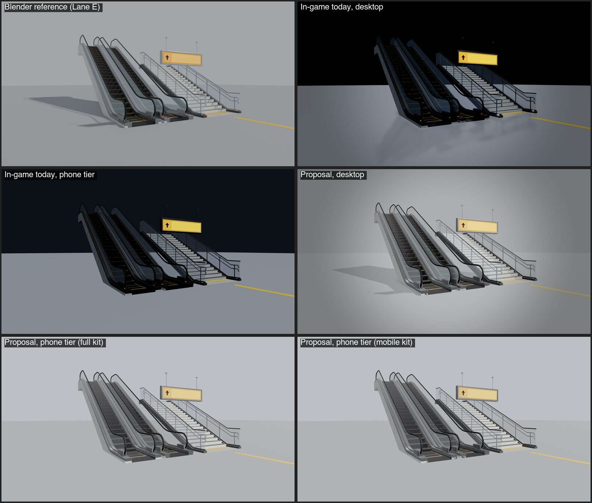
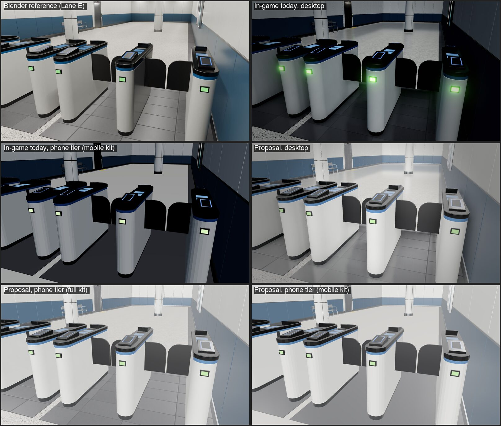
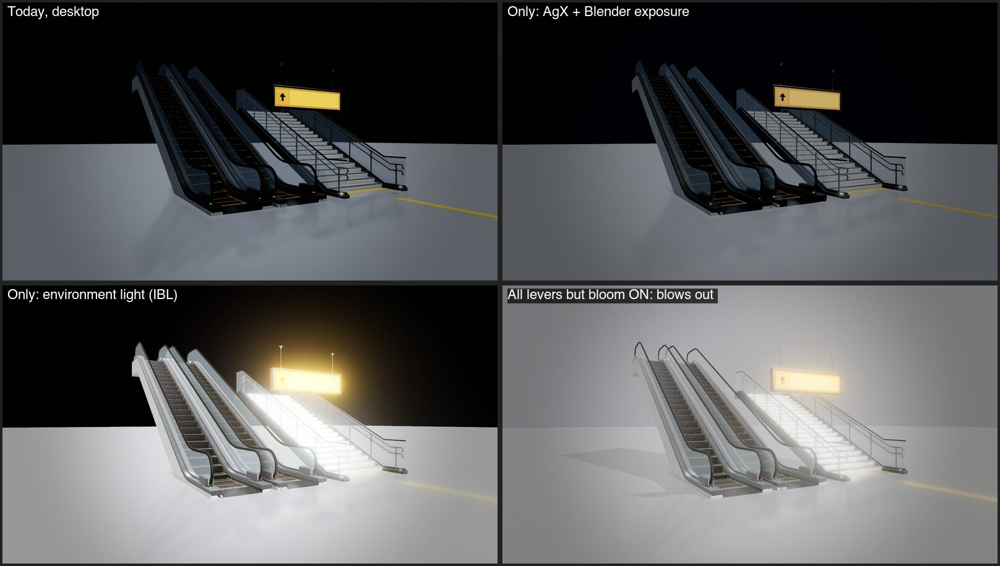
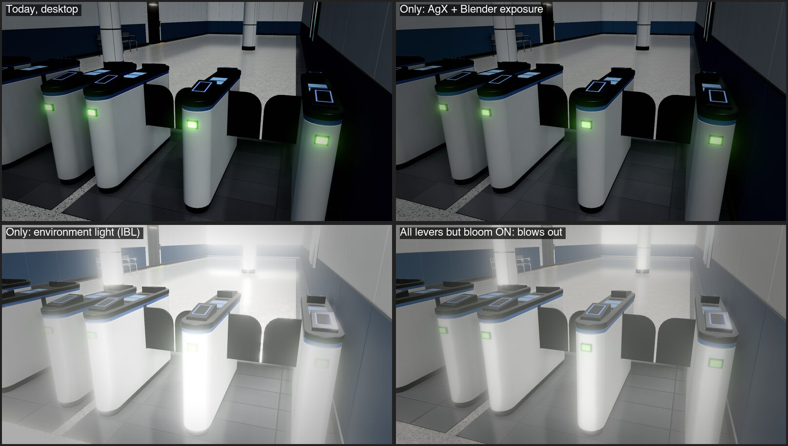

# #94 Part B, step 1: Blender render vs in-game (web explorer)

Date 2026-10-22, main `15cf589`. Measurement only: nothing in the game changes in this step. The Owner reacts before any implementation.

## Method
- **Harness.** `apps/web/qa/look.html` (dev only, never in `pnpm build`) builds the game's real `Explorer`. That gives it the same renderer, default lighting and post-FX chain.
- **Scenes.** It loads Lane E's showcase layouts (`tools/blender/showcase/vertical_demo.json`, `concourse_demo.json`) from `assets/library`, using `render_preview.py`'s placement, hidden collision nodes and closed flaps.
- **Camera.** The camera is pinned to the exact Blender camera (`hero`, `gates_closed`), with Blender's 36 mm sensor-fit FOV, at 1600×900 to match the JPGs.
- **Walk-mode look.** Explorer's walk-mode look is used, not overview's.
- **Candidate changes.** Each one is a URL switch (`env`, `tm`/`exp`, `shadows`/`sun`, `bloom`, `hemi`, `bg`, `quality`, `tier`), so it can be judged alone. The header of `apps/web/qa/look.ts` lists them.
- **Capture.** ego-lite on an M2 Pro: DPR 1, desktop = `high` quality, phone tier = `quality=low`, which is what phones get (no post-FX and no shadows).
- **RMSE.** `magick compare -metric RMSE` against the reference JPG, 0 to 1, lower is closer. It is the same framing pixel for pixel, so it is a fair "distance to the render", though crude.
- **Frame time.** The median of 40 synchronous frames with a 1 px readback. It is relative, measured on a desktop GPU. Phones are slower in absolute terms, so treat it only as the change in cost.

## Side by side
**Escalators and stairs (`vertical_hero`):**

**IC gate line (`concourse_gates_closed`):**

**What single changes do (desktop):**

## Measurements

| Capture | Escalators RMSE | Gates RMSE | ms (desktop GPU, relative) | Draw calls (esc / gates) |
|---|---|---|---|---|
| Today, desktop (high) | 0.450 | 0.325 | 11.0 / 15.1 | 156 / 295 |
| Today, phone tier (low) | 0.399 | 0.273 | 2.2 / 2.4 | 67 / 136 |
| Today, phone tier, mobile kit | — | 0.275 | — / 1.2 | — / 34 |
| AgX + Blender exposure only | 0.449 | 0.322 | ±0 | same |
| Environment light (IBL) only | 0.421 | 0.254 | ±0 | same |
| Proposal, desktop | **0.102** | **0.169** | 9.1 / 14.4 | 263 / 914 |
| Proposal, phone tier | 0.109 | 0.205 | 2.3 / 2.6 | 67 / 136 |
| Proposal, phone tier, mobile kit | 0.109 | 0.205 | 1.6 / 2.0 | 13 / 34 |

Proposal parameters:
- **Escalators:** `env=room:0.6&tm=agx&exp=blender&shadows=1&sun=blender&sunI=4&hemi=0.6&bg=world&bloom=0&refl=0`.
- **Gates:** `env=room:1.3&tm=agx&exp=0.3&shadows=1&hemi=0.3&bloom=0`.

The escalator background (`bg=world`) is a studio backdrop and not a game setting. It inflates the escalator RMSE gain, but not the gate one.

## Gap analysis

| Area | Blender (Lane E renders) | In-game today | Effect on screen |
|---|---|---|---|
| Environment light | World colour (studio) or 36 ceiling area lights from the kit's `LIGHTHINT_*` (interior), plus EEVEE GI | Hemisphere 1.1 plus one sun 1.4. **No `scene.environment`** | Glossy and metal parts (escalator balustrades, gate tops, steel) go near-black. Walls facing away from the sun are dark. The navy wainscot reads as black. This is the largest single gap. |
| Tone mapping | AgX, "Medium High Contrast" look, −0.2 / −0.35 EV | ACES, exposure 1, then a contrast 1.08 grade | AgX alone barely moves the numbers, but once the scene is lit properly ACES clips and hue-shifts highlights. AgX holds the whites, which carry the look. |
| Bloom | None | UnrealBloom, threshold 1.0, strength 0.32 | Green IC indicators glow heavily. With correct lighting, white stairs and panels bloom into fog ("All levers but bloom ON"). |
| Shadows | Ray-traced sun shadow plus contact shadowing | Sun shadow covers ±150 m (about 0.15 m per texel); **station and kit meshes never cast** | No shadow under escalators or gates, so objects float. |
| AO | EEVEE GTAO and ray tracing at render time | GTAO on desktop only, none on phones | Phones lose all contact darkening. The kit has no baked AO (`occlusionTexture`), and the full-tier kit has no UV1. The mobile tier has a UV1 layout but nothing baked into it. |
| Camera | 22 and 26 mm, which is 49° and 43° vertical | Follow camera 60° vertical | The renders feel more architectural. The harness matched the FOV, so the game camera itself was not judged. |
| Mobile kit | — | One palette material, faceted normals on rounded gate cabinets | Visible faceting on cabinets at phone tier (bottom-right gate tile). That is for Lane E. |

## Proposal: smallest set to close the gap
Order is gain per cost. Items 1–4 are explorer-side, about a day's change, and land on both stations at once. Items 5–6 are asset or bake work for Lane E and the station lanes.

1. **Environment light (IBL), both tiers.** Set `scene.environment` to a PMREM'd neutral studio environment (three's `RoomEnvironment` in the harness), with a per-station `environment.envIntensity` next to the existing `exposure`.
   - Gain: largest single lever (gates 0.325 → 0.254 alone).
   - Phone cost: a one-time PMREM at station load (a few ms), and one more IBL lookup per lit pixel. Measured +0.2 ms on the phone tier (2.4 → 2.6). Shader programs 9 → 12.
2. **AgX tone mapping and per-station exposure, both tiers.** Use `AgXToneMapping` instead of ACES. Retune each station's exposure, since Blender used −0.2 / −0.35 EV and the game will need its own values. Add a contrast step in the grade to stand in for "Medium High Contrast" (desktop only; phones have no grade).
   - Phone cost: none, because tone mapping is already in the shader.
3. **Bloom only on real emitters, desktop.** Raise the threshold well above white (or drive it from emissive only) and lower its strength, so signs and indicators glow and white surfaces don't.
   - Phone cost: none (phones have no bloom).
4. **Shadows where the walker is, desktop.**
   - Kit, prop and station meshes cast and receive shadows.
   - The sun's shadow camera follows the avatar (about a 30 m box) instead of covering the whole station at ±150 m, which gives sharp contact shadows. Use PCF soft filtering.
   - Desktop cost: the shadow pass redraws casters. Gates went from 295 to 914 draw calls and +0.7 ms in total.
   - Phone cost: phones keep shadows off. Contact darkening for phones comes from item 5.
5. **Baked AO in the kit (Lane E), both tiers, most important for phones.**
   - Bake AO per piece in the Blender pipeline and ship it as glTF `occlusionTexture`. three maps it to `aoMap` by itself, so the explorer needs no change.
   - The UV set differs by tier: the mobile tier already has a UV1 layout, and the full tier would need UV1 or a UV0 bake.
   - Phone cost: one texture fetch per pixel and no extra pass. This is the only way phones get the "strong contact shadows and AO" the Owner wants.
6. **Interior light for stations (station lanes).** The gate render is lit by 36 area lights and global illumination. Real time can't do that live. Bake it into lightmaps on UV1, as Ikebukuro already does (`ikebukuro_b1_lightmap`), and keep IBL from item 1 for glossy parts.
   - Phone cost: one lightmap fetch.
   - Kit instances placed in stations need either the bake or item 5's AO; `docs/assets/mobile-profile.md:100` already notes this.

**Not proposed:**
- Runtime area lights: too costly, and they don't map to phones.
- A narrower follow-camera FOV: this changes how the game plays, so it is the Owner's call. The renders use 43–49° and the game uses 60°.
- Copying Blender's studio background: that is a presentation choice, not station lighting.

## Limits of this measurement
- **Lighting not recreated.** The harness keeps the explorer's own sun and hemisphere. It does not recreate the `LIGHTHINT_*` area lights, so the gate gap after the proposal (0.169) is mostly interior lighting (items 5–6).
- **Rough tuning.** Proposal parameters were tuned by eye in a few iterations, not fitted. The navy wainscot still reads lighter and less saturated than Blender's.
- **No real phones.** Timings are relative and from a desktop GPU. Lane F's phone profiles (and `PROFILE=mobile`) should confirm items 1, 2 and 5 on real devices before rollout.
- **Kit only.** Only the kit was measured, not today's station scenes. Shinjuku is procedural and Ikebukuro uses its own lit GLB. Items 1–4 apply to them too, but the station GLBs need their own before/after when implemented.
