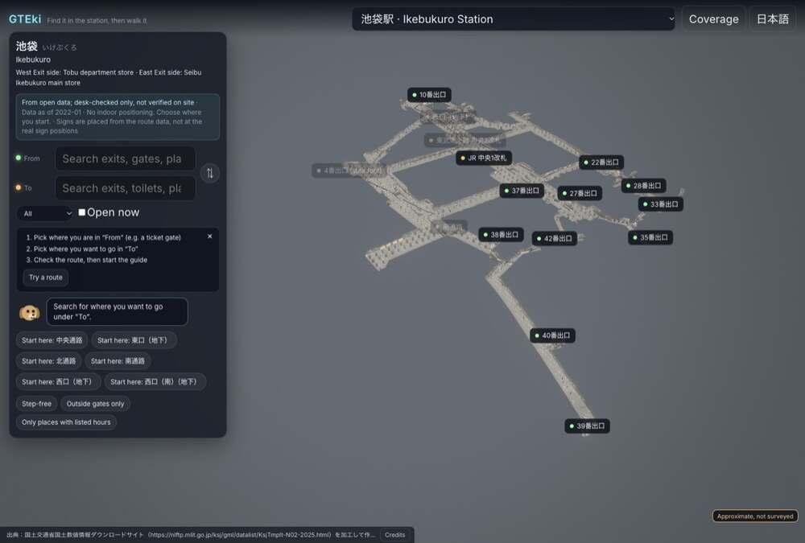
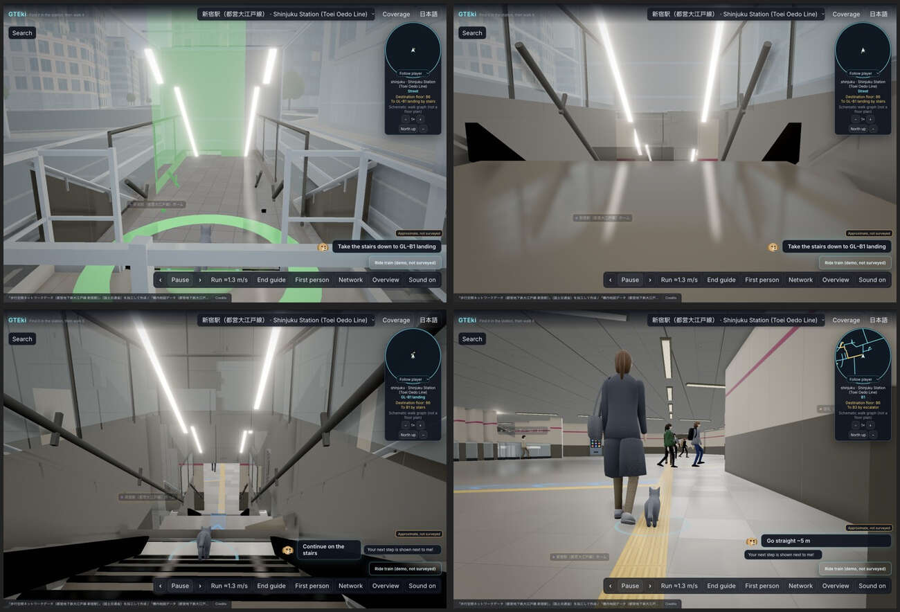
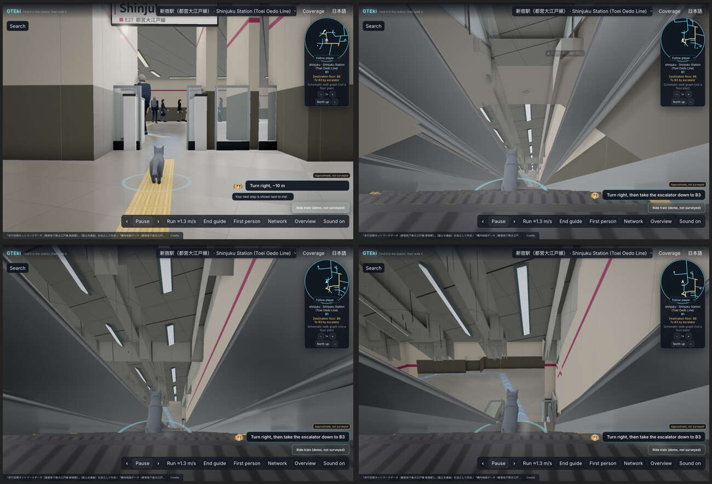
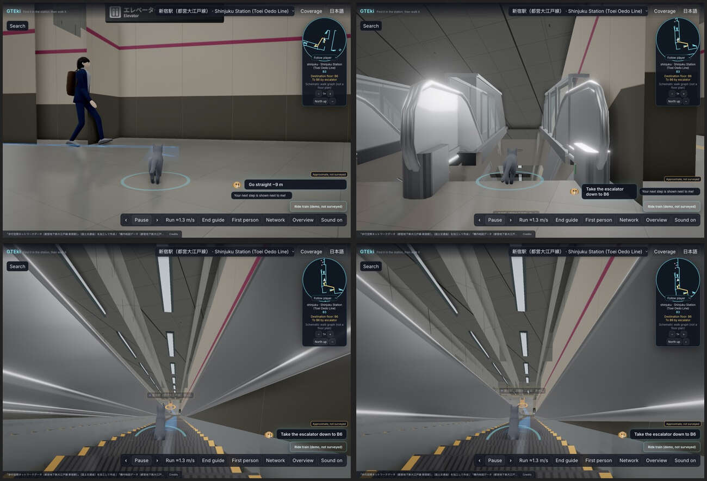
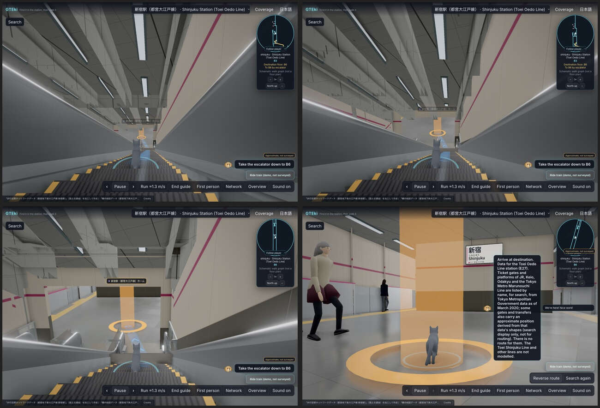
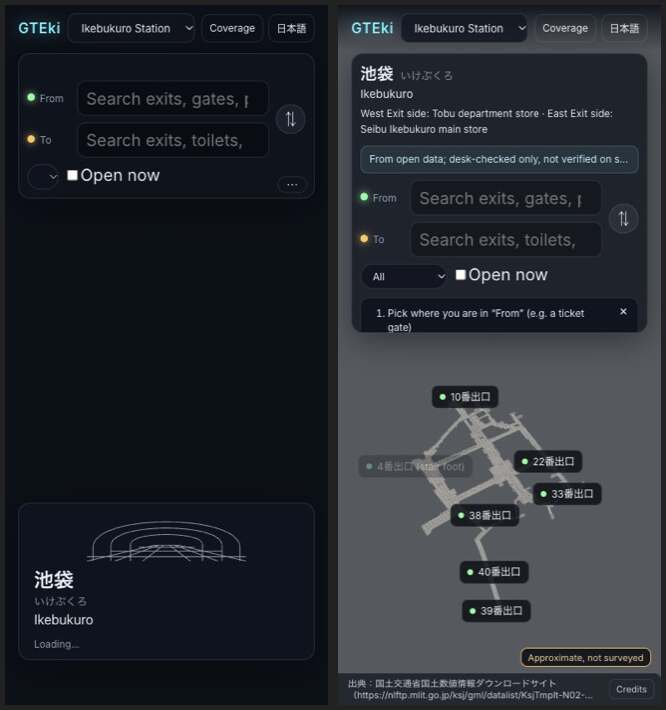
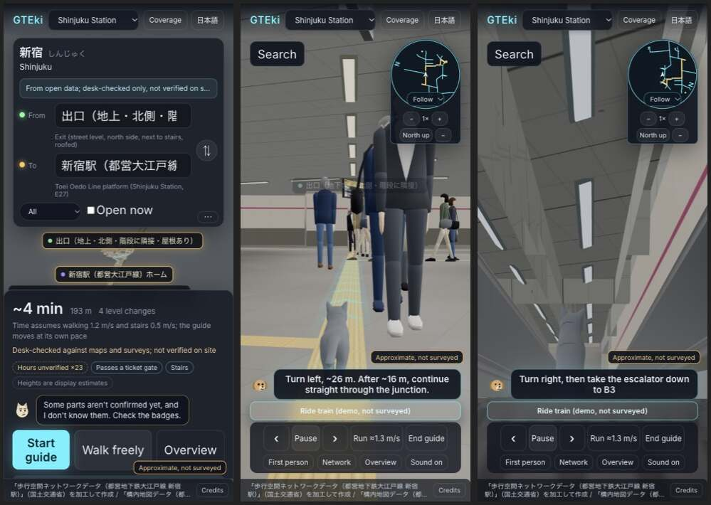

# Release journey: first open → the Oedo platform

The acceptance table for the first production release (v1.0) of the Shinjuku slice, and the working method that goes with it. Owner goal (2026-11-12): a person who opens GTEki should feel they are in the station straight away.

This table is what "done" is measured against until v1.0. [acceptance.md](../acceptance.md) (G0–G4) stays the station contract and still applies; its rows are too coarse for a single PR to move, so day-to-day work is steered by the rows below. The look is decided in [direction.md](../visual/direction.md) and judged against [the hero targets](../visual/targets).

## Why this table exists

Baseline play of production (`gteki.pages.dev`, main 8b111c1f, 2026-11-12 08:27–08:37 JST, desktop 1476×996 and phone 390×844, real GPU):

- Opening the site lands on Ikebukuro: a search form over a small model on a grey field, 24 MB and about 11 s to settle. Reaching the slice takes four actions (station, from, to, start). 
- The guided walk exit 1 → platform lasts about 160 s. About 35 s of it reads as a station (B1 concourse, gate, B3). At 6 s the camera sits inside a slab, at 14 s black stair wedges hide the cat, and both escalator rides (about 75 s together) show splayed, torn ceilings from a camera that fights the shaft. The arrival is covered by a paragraph of data notes.    
- Phone: the same form on opening; in the guided walk the overlay covers 35% of the view and NPC legs hide the cat.  

None of this was a failing check. The golden cameras look from fixed nodes with the UI hidden, the walk scan measures floor hits only, and no row covered what a visitor sees first. The checks sampled something other than what the player sees.

## The table

Rows are in playhead order: the time a first-time visitor reaches them. "Script" rows are judged by the journey spec in CI (job `journey (shinjuku)`, since #1196; a row the reel does not measure yet is judged by hand from a play of production like the baseline above, and stays FAIL or "not judged" unless that play shows it passing); "person" rows by the art director on the journey reel, and finally by the Owner on the walk video. Times are for the guided walk at its default pace.

| # | When | What the player gets | Judged by | 2026-11-14, reel at 15ef23e8 (desktop / phone) |
|---|---|---|---|---|
| J1 | 0–2 s | A designed first frame (title and progress), never a bare form on black | script: screenshot at 1 s | FAIL: opens on the Ikebukuro search form |
| J2 | ≤ 5 s desktop, ≤ 8 s phone | Without any input: in the station as the cat, at the exit 1 mouth, stairs ahead (hero H1). Download to that frame ≤ 6 MB | script: mode, pose, time, bytes | FAIL: Ikebukuro overview; 13.0 / 13.0 MB to ready |
| J3 | first frame | The world owns the frame: overlay ≤ 20% desktop, ≤ 30% phone, one primary action | script: DOM overlay grid | FAIL: overlay 45% / 51% |
| J4 | first tap | One tap starts the walk and the sound | script: one click → guide mode, audio running | FAIL (4 actions; by hand, the reel does not take this path) |
| J5 | whole walk | No void, no black holes, the camera never inside geometry | script: every 2.5 m with the guide camera | FAIL: 1 / 2 of 39 samples. Near clip on the first escalator at 48 s (0.13, desktop) and at 68 s and 76 s (0.20, phone); void ≤ 0.15% |
| J6 | whole walk | The cat is always in view | script: avatar visible in ≥ 95% of samples | FAIL: visible in 87% / 90% of samples (34 / 35 of 39). Only geometry hides the cat now, the guide HUD no longer does (#1269): the exit stairs (desktop 8–16 s, phone 12–16 s) and the foot of each escalator run (84 s and 148 s, behind the greybox shell, 0.22; #1285) |
| J7 | escalators | The ride reads as a ride: camera on the escalator axis (D2), ceiling intact | person on the reel; script: axis angle | FAIL (the person judgement on the reel is outstanding). The pitched shaft ceilings are the default since #1263, accepted by the art director on GPU frames (2026-11-14). Script: axis median 0° over 20 ride samples, 31° entering the first ride; no axis lock in the default mode |
| J8 | whole walk | Guidance stays quiet (D1): overlay ≤ 20% / 30%, no debug text, small markers | script: overlay and visible strings | PASS since #1269 (the quiet walk HUD is the default; accepted by the art director on 2026-11-14): overlay median 7.3% (max 15.6%) / 3.9% (max 10.7%), under the limit in every sample, and the string check passes. One repair is open: on phone the open arrival menu squeezes the instruction card (#1294, PR #1296) |
| J9 | arrival | Arrival is a moment: platform and name sign in view, data notes one tap away | script: overlay at arrival; person | FAIL: the script part passes since #1269 (overlay 6.0% / 1.0% at arrival). The person part is open: the authored platform arrival shot (#1253) is behind `?next=1` and its flip has not been accepted |
| J10 | whole walk | It looks like a Tokyo subway: hero frames H1–H4 accepted against the targets | art director, then Owner | not judged |
| J11 | whole walk | It sounds like one: ambience that changes with depth, escalator, distant train | script: audio state; person | not judged (the reel records no audio state) |
| J12 | whole walk | It holds frame rate: ≥ 50 fps desktop (M2), ≥ 30 fps on a mid-range phone | GPU measurement | not measured (CI renders in software) |
| J13 | always | Truth kept: "approximate, not surveyed" visible, data scope one tap away, nothing invented (D3) | person: truth review | PASS: the "Approximate, not surveyed" badge is on screen in 39 of 39 samples on desktop and on phone. The exception of the last reading (desktop at 152 s, the arrival data note pushed the badge off screen) is closed by the quiet arrival HUD (#1269) |
| J14 | always | Release hygiene: no console errors, a message when WebGL is unavailable, credits, ja and en | script | not judged (the reel records no console state) |

Pass count 2026-11-14: **2 / 14** (default: J8 and J13); `?next=1` passes 5 rows by script. J8 flipped with #1269 (the quiet walk HUD); the pitched shaft ceilings (#1263) are part of J7, which has not flipped.

Read on 2026-11-14 12:57 JST from the reel of main 15ef23e8 (E2E smoke run 43551377106, dispatched on main: 39 samples over a 154 s, 204 m walk on each project). It is the default experience; what sits behind `?next=1` is read separately below. CI renders in software at the low tier, so its load and frame times say nothing about a real GPU (the time in J2, J12). J13 is read from the reel's badge check (the badge element is shown and inside the viewport in each sample) and from the frames.

## `?next=1` reading

Same run, the reel's `next` mode (44 samples, desktop / phone). It shows what the flip PRs would deliver. A row changes in the table above only in its flip PR, with the art director's acceptance (token-rules 26 c).

| # | `?next=1`, 2026-11-14, reel at 15ef23e8 | Open before the flip |
|---|---|---|
| J1 | not read (the reel captures the ready frame, not 1 s) | cold open: one more round (D11 1) |
| J2 | Shinjuku, walk mode, 5.9 / 5.9 MB to ready (time is software rendering) | authored H1 pose (D11 1); time on a GPU |
| J3 | script passes: overlay 12.0% / 15.4%, one primary action ("Walk to the platform") | cold open round (D11 1) |
| J5 | script passes: no near clip, void ≤ 0.4% | none |
| J6 | fails at one sample: 148 s, the foot of the last escalator, cat behind the greybox shell (0.44 on desktop and phone) while the escalator lock still holds | the geometry at the escalator foot (#1285; the default mode reads 0.22 there and at 84 s); escalator camera reframe (D11 4, PR #1293) |
| J7 | axis lock median 1, below 0.99 only entering the two rides (40 s, 96 s), axis max 12° | reframe to H3 (D11 4, PR #1293); person on the reel |
| J8 | flipped: the default since #1269. Overlay median 7.3% (max 15.6%) / 3.9% (max 13.0%) | none |
| J9 | script passes: overlay 6.0% / 1.0%, cat in view | own platform arrival shot (#1253, phone pose chosen 2026-11-14); person. The badge fix merged (#1277) |
| J13 | passes: the badge is on screen in 44 of 44 samples on both | none by script; the badge and "Coverage" overlap at arrival was addressed in #1277 and has not been re-judged live |

By script `?next=1` passes J3, J5, J8, J9 (script part) and J13. Before #1236 part of the default J5/J6 "known" failures was the route ribbon, and the default mode's near-clip numbers on the escalators vary from run to run, so compare modes per row, not by counts.

## Release

- Main deploys to production on every merge, so a change that alters what a first-time visitor sees ships behind a URL flag until its row is accepted, then becomes the default in the PR that flips the row.
- Release candidate: J1–J14 PASS at one SHA on desktop and phone. Evidence: the CI journey reel for the script rows, a GPU reel for J7, J10 and J12.
- v1.0: the Owner watches the candidate's walk on a phone and approves (acceptance.md G4). Tag `v1.0.0`. Breadth (other routes, Ikebukuro) resumes after that, each new route with its own copy of this table.

## Method

1. **Playhead first.** Work the earliest failing row. A defect at second 3 outranks one at second 70: every visitor sees second 3. Breakage (token-rules 24) keeps its priority and is ordered the same way.
2. **The reel is the evidence.** The journey spec (`tests/e2e/specs/30-journey.spec.ts`, CI job `journey (shinjuku)`) plays the real guided walk with the real follow camera and the real UI, on desktop and phone, and writes frames, contact sheets and per-sample numbers. The reel runs with `?qaTimeBand=morning` (the fullest crowd band), so readings do not depend on the time of day. Still cameras stay as the technical gate; they are not evidence that the walk is good. Evidence images go in `docs/release/evidence/<date>/`, one station per file, named `ikebukuro-*` or `shinjuku-*` (the prefix selects the rights annotation in `REUSE.toml`).
3. **Every PR names its row** (`Row: J5`), or says none. A PR that changes what the player sees carries the reel sheets for its row, before and after.
4. **Verify in CI.** e2e and visual specs run in GitHub Actions (7–9 min) on the draft PR. The Mac's GPU lock is for the art director's renders. Local runs are for unit specs.
5. **Lead decides, Codex builds.** The project lead reads the reel, decides the change and writes the brief; Codex implements; the art director owns the look and accepts visual PRs on the reel. A hard problem goes diagnose (read-only) → decide → implement.
6. **Re-score daily.** The table's last column is rewritten from the newest reel on main. The lead's handoff starts with the pass count.
