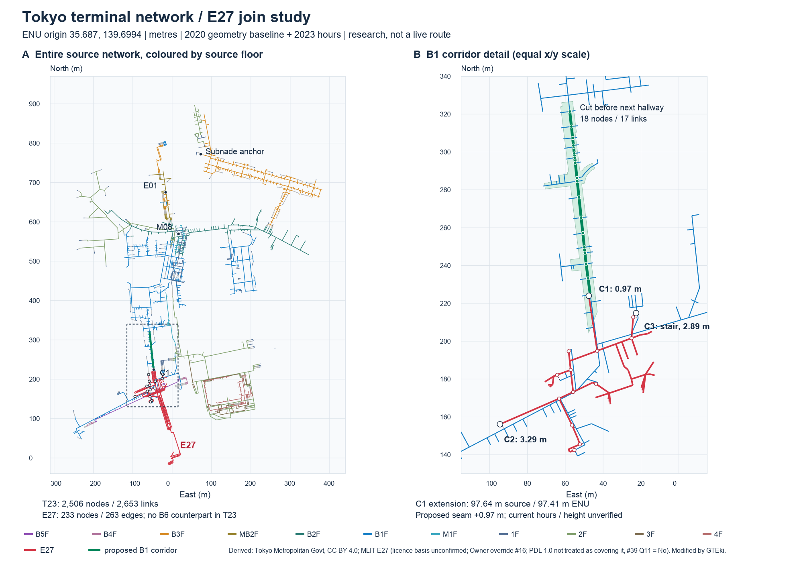

# Tokyo terminal network ↔ E27 join study — 2026-10-21

**Recommendation: investigate and import one short B1 corridor from E27's northern graph boundary into the southern 京王モール corridor, using Tokyo hallway `28993486`.** The strongest seam is E27 `n:c01041e096fe4f6c8ed23520375ef2fd` → Tokyo `11110367`: **0.973 m horizontal separation**, consistent B1 labels, **1.025° heading difference**, and overlapping public-concourse/hallway geometry. The proposed extension is **18 Tokyo nodes, 17 existing links, 97.635 m of source network**, plus one explicitly evidenced seam edge. It would let a player continue out of the current E27 graph without pretending that the entire terminal is already connected.

This is a **strong historical connection candidate, not a currently verified public route**. Passage hours, changes since the 2020 geometric baseline, and the physical height at the seam remain unverified. Do not enable an automatic nearest-node stitch or claim a completed transfer to S01, JR, M08, サブナード or E28.

## Resumed state, inputs and acquisitions

After the host restart, this worktree was clean at `cbec97e` on `claude/shinjuku-s2-w5-research`; the first-round survey and raw archives survived, but no round-two report/scripts were present. The work below re-establishes the analysis against the checked-in `stations/shinjuku/gteki/{graph,station,pois}.json`, not an older exported graph. No runtime, package, app, scene or station-contract files were changed.

| Input | Identity / dates | Use |
| --- | --- | --- |
| Tokyo `shisetsu_root.zip` | 2,317,035 bytes; SHA-256 `fc3466270c08593a300e652c7997021f85151bf0f435e17ee9fcb7935ed4ba31`; originally acquired **2026-10-20T16:18:28.918832+00:00** | Reused and rehashed; not falsely recorded as a new download. 2,506 nav nodes / 2,653 links / 11 source floors; map version 62, entity version 42. |
| E27 checked-in graph | SHA-256 `37a24b303828755fbdbdb76f59d1b1a529e535cc16e9e3c19424468771cf928b` | 233 nodes / 263 edges; six exit POIs; nine `toei-nwd-*` levels. Exact station/POI/geo-implementation hashes are in the summary. |
| E28 ほこナビ network, newly acquired | 48,671 bytes; SHA-256 `817183f3c32b8a5f777a4ee2386f26a17306e0140a3a53004736762cc0428bbf`; acquired **2026-10-20T21:49:33.218665+00:00** | Additional corridor-context check, not joined to E27. 270 nodes / 307 links. |
| 京王/都営 exit-2 closure PDF, newly acquired | 364,366 bytes; SHA-256 `b0270c590ce60bcab2368f9c2ac3e6280ef858ff80a4f3de60a23d2194a70a7b`; acquired **2026-10-20T21:49:00.936552+00:00** | Reference-only dated closure evidence; no map tracing or redistribution in the figure. |

The [acquisition manifest](acquisitions-2026-10-21.json) has an appended `followUpRounds` entry dated 2026-10-21. Earlier records and their original acquisition times remain intact. It records the reused Tokyo ZIP, new E28 catalogue/network, the closure notice, robots file and refreshed Tokyo licence metadata. Original/raw and full intermediate data remain under `~/Developer/gteki-raw/shinjuku/`; the repository contains only this report, a [summary JSON](2026-10-21-tokyo-terminal-join-summary.json), reproducibility helpers and a derived figure.

Primary Tokyo sources: [publication page](https://www.toshiseibi.metro.tokyo.lg.jp/kotsu_butsuryu/kotsuseisaku/kotsu_suishin/shinjuku_shisetsu), [catalogue](https://catalog.data.metro.tokyo.lg.jp/dataset/t000008d0000000037), [exact ZIP](https://www.toshiseibi.metro.tokyo.lg.jp/documents/d/toshiseibi/zip_kiban_shinjuku_terminal_pdf_shisetsu_root), [February 2023 specification](https://www.toshiseibi.metro.tokyo.lg.jp/documents/d/toshiseibi/pdf_kiban_shinjuku_terminal_pdf_shisetsu_siyousho). Publisher: 東京都都市整備局. Licence: **“クリエイティブ・コモンズ 表示（CC BY）”**, catalogue `CC-BY-4.0`, [CC BY 4.0](https://creativecommons.org/licenses/by/4.0/deed.ja). Attribution, licence notice and change notices are required. March 2020 is the geometric baseline; February 2023 adds entrance-hours information. A later catalogue timestamp is not a new survey.

Ego-lite was attempted using the installed skill but could not start within this sandbox. Public source text and normal HTTPS downloads were used; no login, CAPTCHA bypass, TLS weakening or alternate private endpoint was attempted. The derived PNG does not depend on the lead's `.qa/shoot.request` service. No app screenshots were requested or are claimed: there is no implemented expansion to playtest in this research-only branch.

## Coordinate and floor treatment

The Tokyo specification states that standard GeoJSON without `crs` uses **WGS84 longitude/latitude**. `v5_nav.json` instead stores `mx/my` in its own Mercator coordinate system; its large values must **not** be passed directly to an EPSG:3857 inverse.

For every navigation node:

1. Apply `v5_nav.json.d[0].t` as `[a,b,c,d,e,f]`: `u=a*mx+c*my+e`, `v=b*mx+d*my+f`.
2. Apply `com-map.geojson.drawings[0].ref_frame.transform` in the same coefficient order to `(u,v)`, obtaining `(longitude,latitude)`.
3. Apply the exact geodetic → ECEF → ENU equations from `@gteki/geo` **EnuFrame**, GRS80 `a=6378137`, `f=1/298.257222101`, origin `{lat:35.687,lon:139.6994,h:0}`. Set source height to zero **only for this horizontal calculation**; retain physical node height as unknown.
4. Compare ENU `(x east,y north)` to the checked-in E27 positions. The renderer mapping remains `(x,z,-y)`; symbolic rendering height must not enter the horizontal metric.

The source's WGS84 coordinates are provisionally used with the JGD2011/GRS80 frame for this comparison. **No WGS84-realization/epoch → JGD2011 datum correction was established**, and no shift/rotation/scale was fitted to make the networks agree. The residuals therefore combine surveying, source cartography, node-placement and datum/epoch uncertainty; they are not a survey accuracy certificate. The actual shared TypeScript `EnuFrame` agrees with the Python calculation for all 2,506 nodes within **3.20×10⁻⁹ m** horizontally. Independently reprojecting the 233 original E27 nodes reproduces the shipped, centimetre-rounded coordinates within **0.006954 m**.

| Tokyo source label | Level ID | Source `zlevel` | Comparison ordinal | Tokyo nodes |
| --- | ---: | ---: | ---: | ---: |
| B5F | 64672 | -7 | -5 | 27 |
| B4F | 64673 | -6 | -4 | 50 |
| B3F | 64674 | -5 | -3 | 420 |
| MB2F | 64688 | -4 | -2.5 | 52 |
| B2F | 64675 | -3 | -2 | 278 |
| B1F | 64676 | -2 | -1 | 710 |
| M1F | 64689 | -1 | -0.5 | 97 |
| 1F | 64677 | 0 | 1 | 363 |
| 2F | 64678 | 1 | 2 | 295 |
| 3F | 64679 | 2 | 3 | 96 |
| 4F | 64680 | 3 | 4 | 118 |

These are **label/order-derived comparison ordinals**, not measured elevations or a universal cross-operator floor map. `M1F`/`MB2F` are placed between their neighbours in the published ordering. E27 `toei-nwd-0` (Street) and `toei-nwd-1` (1F) may both compare to Tokyo 1F, but the former is explicitly reported as `street-1F-equivalence`, not exact label equality. Tokyo B1F maps to ordinal -1, **not source zlevel -2**. Known counterexamples prevent global acceptance: Tokyo M08 gates use B2F while the construction portal calls the frontage B1; サブナード source anchors use B3F while the facility describes its shopping floor as B1. E27 B6 and -4.5 have no same-label counterpart in this Tokyo inventory.

## Exhaustive 60 m comparison and alignment

The primary endpoint set contains **11 distinct nodes**: every graph `kind=exit`, `inOut=outside|boundary`, and every exit-POI connector. Checking only the six POIs would miss clipped underground continuations. A second structural set contains all **20 degree-one nodes**. Their union has **24 nodes**; a degree-one node is merely a possible clipped endpoint until its geometry/access evidence is examined.

For each of the 24 endpoints, every Tokyo node at horizontal distance `hypot(Δeast,Δnorth) ≤ 60 m` was retained, across **all floors**, with deltas and floor agreement. This produces **1,610 pairs**: 651 equal-label, 18 Street↔1F-equivalent and 941 mismatched-label pairs. The 11 primary endpoints account for **521 pairs**: 86 equal-label, 18 ground-equivalent and 417 mismatches. All pairs are in external raw analysis file `w5-tokyo-join-2026-10-21/all-boundary-pairs-within-60m.json`; its hash is in the summary. The summary stores each endpoint's counts, nearest candidates and complete IDs, without a raw geometry dump.

**Matched-pair statistic:** independently choose the nearest compatible-floor Tokyo node for each E27 node, require that it also chooses that E27 node as its nearest compatible-floor E27 node, then keep pairs within 5 m. No fitted correction is applied. This gives **15 reciprocal pairs**, median **1.854 m**, p90 **3.367 m**, maximum **3.418 m**. Fourteen are B1↔B1 (median 1.927 m, p90 3.379 m); one is Street↔1F. Percentiles use linear interpolation at `(n−1)*p`.

This selected sample measures local overlap, **not all-station coverage and not 15 accepted joins**. Sensitivity: 1 m threshold → 4 pairs; 2 m → 8; 3 m → 12; 5 m → 15. Only four of the 11 primary endpoints have any compatible-floor neighbour within 60 m; their nearest-compatible median is **33.086 m**, p90 **56.390 m**. For all 24 structural/primary endpoints, 11 have a compatible neighbour within 60 m (median **11.549 m**, p90 **56.044 m**). Large unmatched distances cannot be hidden behind the favourable overlap statistic.

In the table, `m1/m2/m3` abbreviate `toei-nwd-m1/m2/m3`, `0` is Street and `1` is 1F. Short IDs are unique prefixes; full IDs are in the summary. “Exit 1–6” means the **app's internal POI numbering**, not official exit numbers. The nearest-any column deliberately includes neighbours beyond 60 m to distinguish absence from zero distance. “Compatible” is still only label-compatible.

| E27 node prefix | Floor | POI or structural kind / degree | Tokyo nodes ≤60 m | Nearest any: m / floor | Nearest compatible ≤60 m: m / Tokyo ID |
| --- | --- | --- | ---: | --- | --- |
| `032cf295` | m1 | exit 5 | 176 | 10.13 / B1F | 10.13 / 11110360 |
| `17e7f081` | m1 | junction / 1 | 160 | 4.32 / B5F | 12.18 / 11126969 |
| `1dda661f` | m3 | junction / 1 | 37 | 41.48 / B1F | — |
| `33910baa` | 0 | escalator_end / 2 | 0 | 150.94 / 2F | — |
| `3af66366` | 0 | stair_end / 2 | 0 | 151.61 / 2F | — |
| `3c15d8b3` | m2 | junction / 1 | 0 | 77.01 / B1F | — |
| `3c5c2ccd` | m3 | junction / 1 | 8 | 49.99 / B1F | — |
| `439c8890` | m2 | junction / 1 | 0 | 99.50 / B1F | — |
| `4423521d` | 0 | exit 2 | 103 | 5.38 / B1F | 56.04 / 11115179 |
| `46962c38` | m1 | junction / 1 | 94 | 3.29 / B1F | 3.29 / 11110322 |
| `4eb0fed0` | m1 | junction / 1 | 154 | 6.20 / B5F | 18.70 / 11110361 |
| `57ea2c8b` | m1 | junction / 1 | 168 | 3.34 / B5F | 11.55 / 11110361 |
| `5cbcddf0` | m1 | exit 6 | 0 | 147.08 / 2F | — |
| `6dff9add` | m1 | stair_end / 1 | 169 | 2.89 / B1F | 2.89 / 11110360 |
| `6f508a29` | 0 | exit / 1 | 0 | 129.49 / 2F | — |
| `71a6a392` | m1 | stair_end / 1 | 149 | 4.31 / B5F | 15.85 / 11115119 |
| `a038802f` | m2 | junction / 1 | 0 | 75.45 / B1F | — |
| `a06f3d19` | 0 | exit 1 | 139 | 1.66 / 1F | 1.66 / 11115537 |
| `b019a547` | m3 | junction / 1 | 23 | 45.34 / B1F | — |
| `c01041e0` | m1 | junction / 1 | 127 | 0.97 / B1F | 0.97 / 11110367 |
| `e075f813` | 0 | stair_end / 2 | 103 | 4.32 / B1F | 56.54 / 11115179 |
| `e4cfe61e` | 0 | exit 4 | 0 | 148.75 / 2F | — |
| `e6feaa2c` | 1 | exit 3 | 0 | 142.52 / 2F | — |
| `e835e35a` | 0 | exit / 1 | 0 | 147.33 / 2F | — |

Examples of dangerous false joins: `17e7f081` is 4.32 m from a **B5F** node despite being E27 B1; internal `poi:exit:2` is 5.38 m from Tokyo **B1F** but is at street level, with its nearest ground-equivalent node 56.04 m away. Neither becomes a connector. Southern E27 exits have no Tokyo nodes within 60 m; this is a coverage gap, not proof that those exits closed.

## Physical connection candidates and destination reach

| Candidate | Measured / semantic evidence | Disposition |
| --- | --- | --- |
| **C1 north B1:** `n:c01041e096fe4f6c8ed23520375ef2fd` → `11110367` | 0.973 m; Δeast +0.781 m, Δnorth +0.580 m; B1 on both sides. E27 incoming walk edge `e:ef8f83872c854175880bcd5df168109e` is unpaid and bidirectional. Endpoint lies inside E27 GSI space `5487253f58914d5aba4ec85ee824f167`, `category=B029` walkway, `toll=3` free, `restricted=2` unrestricted, `nonpublic=2` publishable. Tokyo geometry `28993486` is `facility=hallway`; all 21 evenly spaced seam samples lie inside it. E27 approach and Tokyo north continuation differ by 1.025°. | **Best historical physical seam.** Recommend the bounded north corridor, subject to present access/height checks. GSI codes were checked against the preserved 2019 specification (`spec/gsi_indoor_spec_2019.pdf` / `spec/gsi.txt`) and the [current E27 importer](../../../../stations/shinjuku/tools/import-e27.ts). No claim that a tiny offset alone proves current access. |
| **C2 west B1:** `n:46962c38fa2e4473b092d83fa804d6c5` → `11110322` | 3.290 m, B1 labels; E27 approach `e:b80b3f4aef474ac2aa25c6680b26177a` is unpaid walk. Tokyo node belongs to hallway `28993474`, which has shop branches and routes toward 京王新線 / 新都心口; source entities include 京王モールアネックス tenants. | Plausible Annex/western continuation, weaker geometric coincidence. Do not extend to 都庁/E28 without the missing corridor evidence. |
| **C3 north-east B1 stair:** `n:6dff9addf7384aaabbbe0742d2e5a1ce` → `11110360` | 2.886 m; E27 terminal edge is stairs, Tokyo geometry `28993999` is `facility=step`. Nearest is **not reciprocal**: another E27 stair node is closer to the Tokyo point. Same source floor contains multiple stair positions. | A stair-landing correspondence candidate, **not a flat/wheelchair seam**. Verify which landing and the 2024 exit-closure relationship before connecting it. |
| **C4 north street:** `n:a06f3d191885497bac197b666c4daef9` → `11115537` | 1.664 m; E27 Street vs Tokyo 1F. Tokyo geometry `28994916` is a nonphysical entrance marker named `B`, with a source stair continuation. | Useful entrance control point; neither official E27 exit identity nor hours established. The marker alone is not a new walkable floor. |
| Internal POI exit 5 | Nearest B1 point is the C3 stair node, **10.128 m** away. | Not an acceptable automatic seam. A generic “B1 exit” cannot be merged with a nearby stair landing. |

The coded GSI values above are also explicitly decoded by the current E27 importer (`toll: 2=paid, 3=free, 1=unknown`). The inspection uses the acquired specification and exact source-space ID, rather than a guessed floor/access interpretation.

Starting at C1's Tokyo node, unfiltered directed source paths exist to the following geometry-associated targets. These are **context paths, not approved public/step-free routes**; they can enter paid gates or use stairs. A labelled facility such as a fire centre is an identity anchor, not a public door.

| Destination context | Tokyo target geometry | Source path from C1 | What it establishes |
| --- | ---: | --- | --- |
| 京王新線口 / S01 frontage context | 28993983 | 6 links, 44.51 m, source B1F | Existing gate-associated topology south of C1; S01 platform connection is outside the recommended slice. |
| JR 西口 gate | 28993975 | 48 links, 346.66 m, B1F | Historical onward terminal graph, not today's fare-free route. |
| M08 west gate / 西口地下広場 context | 28993451 | 58 links, 406.15 m, B1F/B2F | Historical connection to the Metro gate. No separately verified current plaza boundary/temporary alignment. |
| E01 JR方面 gate | 28993091 | 77 links, 513.66 m, four source labels | E01 is a distinct northern station; floor reconciliation remains necessary. |
| サブナード identity anchor | 28993261 | 149 links, 1,022.31 m, B1F/B2F/B3F | Network reach to the labelled 防災センター, **not a public entrance/waypoint recommendation**. |
| 新都心口 / 都庁方向 | 28993987 / 28993988 | 300.65 / 285.70 m, B1F | Gate context only; does not prove a through route to 都庁前 E28. |

E28's newly inspected NWD is EPSG:6668, with 270 nodes / 307 links, all links maintained 2025-10-17. Its bbox is `[139.6903443224,35.6900763596,139.6934403978,35.6907885921]`; numeric floors are `0,-0.5,-1,-1.5,-2,-2.5,-3`. The minimum **any-floor node-to-node** distance to E27 is **485.549 m**, not a plausible seam. The E28 package does not fill that gap by sharing the word 都庁 with a passage direction.

## Changes after the 2020 baseline: known conflicts versus unproven causes

A spatial residual alone cannot establish that construction caused a mismatch. The 941 floor-disagreeing pairs mostly expose stacked floors and source-label differences, not 941 construction changes. No current surveyed geometry was available to attribute a measured displacement to a specific rebuilding event. The following are independently documented **freshness conflicts to resolve**, not invented node-level change matches.

| Change / primary evidence | Consequence for the proposed joins |
| --- | --- |
| **S01/京王新線 official exit 2 closed from 2024-03-30 first train**, for ミヤコ新宿ビル demolition: [Toei notice, 2024-01-29](https://www.kotsu.metro.tokyo.jp/pickup_information/news/subway/2024/sub_i_2024012911347_h.html), [acquired joint 京王/都営 PDF](https://www.keio.co.jp/news/update/announce/announce2023/20240129_oshirase.pdf). Its map places the closure on the south side of 甲州街道 near the 京王新線 approach. | Do not reopen the historical exit as part of an import. **The app's `poi:exit:2` is an internal north-west street POI and is not identified as official exit 2.** None of the generic Tokyo entities named “2” was accepted as this exit. C3/exit-5 correspondence needs an exact map/operator binding; no reopening evidence was established. |
| [Tokyo current construction portal](https://www.shinjuku-kojiinfo.metro.tokyo.lg.jp/), page update 2026-09-29 in the preserved HTML: west-plaza passage change 2026-06-23, surface change 2026-02-17, earlier rotary/taxi changes. | A T23 route reaching JR/M08 is not proof of the current western alignment. C1 stops well before the west-plaza expansion scope; the absence of a corridor-specific closure notice is still not proof that it is unchanged. |
| [京王新線 current work notice](https://www.keio.co.jp/assets/pdf/dousen_shinsen.pdf), preserved in round one: September 2026 stair restrictions/escalator changes; B4 passage work scheduled to mid-October. | No completion was confirmed by this study. Do not extend the B1 pilot down into the S01/E27 vertical-transfer construction area. |
| [JR 2020 announcement](https://www.jreast.co.jp/press/2020/tokyo/20200602_to01.pdf): 東西自由通路 opened 2020-07-19, with gate relocation and renaming. | The Tokyo March-2020 geometry cannot establish the new east-west route. MLIT's 2020 revised release advertises it, but its archive/licence PDF still requires login. |
| [Shinjuku UD newsletter 18, updated 2025-09-30](https://www.city.shinjuku.lg.jp/kusei/toshikei01_002100_00018.html): describes サブナード's 2023 renovation and a new lift connecting it with メトロプロムナード. | This supersedes older material describing the missing accessible connection. Exact opening date, lift location and current hours are not established here; do not assume the 2020 geometry contains it. |

## Other underground passages: source and rights catalogue

**T23** means the Tokyo CC BY 4.0 dataset linked above: public download successful, 2020 geometry / 2023 hours, actual GeoJSON + navigation JSON. **M20** means [MLIT Shinjuku 2020 indoor release](https://www.geospatial.jp/ckan/dataset/mlit-indoor-shinjuku-r2): public catalogue, advertised Shapefile/GeoPDF and walking network; payload and [specific licence PDF](https://www.geospatial.jp/ckan/dataset/mlit-indoor-shinjuku-r2/resource/e3b28fde-5546-4c9d-956b-69363d707835) require login; catalogue says “政府標準利用規約”, exact version/exclusions **UNKNOWN**. No login was performed. Reference maps below have **no established derivative geometry grant**; their availability does not transfer T23's licence to them.

| Passage | Source, date and geometry availability | Rights / access status and limitations |
| --- | --- | --- |
| 京王モール | T23 actual B1 hallway `28993486` plus shop entities, including 京王モールサービスセンター and 京王モール tenants; [current operator site](https://ekishop.keio-sc.jp/keiomall-keiomallannex/) and [アシックスウォーキング shop record](https://ekishop.keio-sc.jp/keiomall-keiomallannex/shop/detail/?scd=000779), checked 2026-10-21, underlying map date UNKNOWN. | T23 geometry: CC BY 4.0 conditional redistribution. Operator [site policy](https://www.keiosc.co.jp/sitepolicy/) explicitly restricts reproduction/secondary use and includes `ekishop.keio-sc.jp`; reference-only. Public web text readable, no login; current tenant existence does not validate corridor hours or footprint. |
| 京王モールアネックス | T23 B1 geometry around C2 / hallway `28993474`; named `ファミリーマート 京王モールアネックス店` source entity anchors the area. Same current mall site; M20 potential. | Same T23/strict operator-map split. No independently current open Annex graph. C2 is a candidate, not selected for this pilot. |
| 新宿西口地下広場 / 4号街路 | T23 partial terminal-west geometry; [Tokyo road-administrator page, updated 2023-06-27](https://www.kensetsu.metro.tokyo.lg.jp/jimusho/sanken/izi_hosyu/hosyu_shisetsu/hosyu_shisetsu_nishiguchi) describes B1 plaza and separate No.4 pedestrian/vehicle space; current construction portal above. | T23 CC BY; administrator/reference map geometry licence **UNKNOWN**, no specific reusable tunnel graph established. Public pages readable without login. T23's west bound does not cover the entire 都庁 corridor. |
| サブナード | T23 actual shop/anchor geometry on source B3F; [operator access](https://www.subnade.co.jp/access/), [company building description](https://www.subnade.co.jp/company/about/), [ward newsletter 2025-09](https://www.city.shinjuku.lg.jp/kusei/toshikei01_002100_00018.html). [Tokyo underground-street CSV catalogue](https://catalog.data.metro.tokyo.lg.jp/dataset/t000003d1700000034), resource date 2018-04-13, is non-geometric. | T23/CSV CC BY 4.0; operator [terms](https://www.subnade.co.jp/legal/) prohibit unauthorised reuse beyond legal exceptions. HTML/reference images readable through public web; direct TLS failure in round one was not bypassed. Local shopping B1 and source B3 are not interchangeable. Parking 24-hour availability does not prove all passage hours. |
| メトロプロムナード | T23 western portion only; [ward physical/network study](https://www.city.shinjuku.lg.jp/content/000308147.pdf) distinguishes existing passages, planned links and stair barriers; publication date UNKNOWN from this PDF extract. [2025 newsletter](https://www.city.shinjuku.lg.jp/kusei/toshikei01_002100_00018.html) confirms the later Subnade lift. | T23 CC BY; ward PDF derivative geometry rights **UNKNOWN** (also contains an approved-base-map credit). Public PDF/text, no login observed. Do not reuse planned links as present geometry. M20 is a login-gated candidate, not an acquired answer. |
| 新宿三丁目 connection, M09/F13/S02 | [Ward station-area study](https://www.city.shinjuku.lg.jp/content/000319156.pdf), drawing marked January 2021, shows promenade at B1 and directions to F13/S02 gates at B2; [later planning material](https://www.city.shinjuku.lg.jp/content/000334215.pdf) describes constraints on connections. These describe passage/concourse levels, not platform elevations. | Reference PDF only; geometry redistribution **UNKNOWN**. No F13/S02-labelled platform or complete end-to-end promenade graph verified in T23. Tokyo Metro direct page requests returned 403 in round one; no bypass or login. Public ward documents remain readable. |
| 都庁前 E28 / 都庁方向 passages | **Newly checked** [ほこナビ E28 catalogue](https://ckan.hokonavi.go.jp/dataset/station_oedo_tochomae), catalogue modified 2026-10-20; [NWD GeoJSON ZIP](https://ckan.hokonavi.go.jp/dataset/0497448d-15ca-44be-b27b-89d99f83c85d/resource/34a413dc-2859-4cb8-b460-b0216d646c5d/download/nwd_oedo_tochomae_geojson.zip), links 2025-10-17; [GSI geometry ZIP](https://ckan.hokonavi.go.jp/dataset/0497448d-15ca-44be-b27b-89d99f83c85d/resource/30a2e7a1-bfdc-45a5-b502-dac80950f936/download/stationmap_oedo_tochomae_geojson.zip), not acquired this turn. [Road administrator](https://www.kensetsu.metro.tokyo.lg.jp/jimusho/sanken/izi_hosyu/hosyu_shisetsu/hosyu_shisetsu_nishiguchi) distinguishes ワンデーストリート, シーズンロード and タイムズアベニュー; [Toei E28 page](https://www.kotsu.metro.tokyo.jp/subway/stations/tochomae.html) provides reference station information. | E28 catalogue declares **“公共データ利用規約(第1.0版）”** ([PDL 1.0](https://www.digital.go.jp/resources/open_data/public_data_license_v1.0)); that is the package's declaration, per-resource licence unverified, and not applied to E27 (#39 Q11 = No); direct catalogue/NWD download succeeded without login/bot check. Public reference text readable; reference diagram geometry licence UNKNOWN. E28 network remains 485.5 m from E27 at its closest node pair; no connecting corridor inferred. |

The [first-round survey](2026-10-21-network-survey.md) retains the broader source inventory: H18/H21 area walking networks, PLATEAU CC BY underground physical model, OSM cross-check-only, N02 station identity and operator-specific ODPT restrictions. None resolves the intervening corridor merely through overlapping bboxes or matching station names. The existing E27 post-publication reuse inquiry/HOLD remains unchanged; ほこナビ's 2027-03-12 publication window must remain separate from licence duration and navigation freshness.

## One proposed implementation slice and its acceptance gates

**Scope:** preserve the existing E27 graph; connect its C1 boundary to Tokyo `11110367`, then follow only the northbound spine of hallway `28993486` to `11110419`, stopping before the next hallway/junction. Use a source-ID allowlist, not a distance flood-fill that includes shops or fare gates. This is the southern portion of the 京王モール corridor, not the full mall or an S01 platform import.

- **18 added source nodes / 17 source links / one B1 label.** All 17 links are source-bidirectional with `dz=0`; all 18 nodes reference `facility=hallway`. Sum of source `dm`: **97.635 m**; sum of transformed horizontal segment lengths: **97.409 m**. All **220 samples** along the centreline at ≤0.5 m spacing lie in the source hallway polygon. Neither test proves current absence of shutters, steps or works.
- **One proposed seam edge** adds 0.973 m without moving either source node. Retain separate provenance and stable IDs; do not silently snap or overwrite E27. The explicitly additive pilot would total **251 nodes / 281 edges / nine existing floors** if approved. No new physical floor height is known. Reusing the B1 display plane is a documented rendering assumption, not a measurement.
- **Exclude** shop-door branches, stair branches, paid gate crossings, extensions to JR/M08/西口広場, and westward 都庁 connections from this first import. Show a coverage boundary at the northern cut, not a fictitious destination or passage closure.
- **Rights path:** Tokyo geometry/graph under CC BY 4.0; the E27 source (ほこナビ) has an unconfirmed licence basis: it is published under the Owner's override (#16), and PDL 1.0 is not treated as covering its resources (#39 Q11 = No). Attribute both, mark transformations/clipping/added seam, retain source hashes and source/observed dates separately. Operator PDFs and shopping-site maps are references only. The current release HOLD and unresolved hours are not removed by this research.
- **Staleness:** high enough to require a current site/manager check before release. The pilot avoids the deep S01 construction zone and distant west-plaza works, but that does not establish it is unchanged. Verify the full 98 m corridor, public/fare-free status, vertical discontinuities and shutters in both directions; record date and operating window.

### Exact future-importer inputs

From `~/Developer/gteki-raw/shinjuku/w5-tokyo-routes/shisetsu_root.zip` (hash above), read these **exact member basenames**, asserting uniqueness and their IDs because the archive's Japanese directory name has legacy encoding artefacts:

| Archive member / existing file | Purpose |
| --- | --- |
| `com-map.geojson` | Drawing 35814 transforms; B1F level ID 64676 and source floor metadata. |
| `v5_nav.json` | Source nodes, links, directions, `dm`, `dz`; nav version 62. |
| `geojson-level-geom-B1F.geojson` | Hallway polygon feature **28993486**, in WGS84 longitude/latitude; clip the pilot/overlap deliberately. |
| `com-entity.geojson` | Entity-to-geometry identities/context; do not infer public routes from tenant names. |
| `stations/shinjuku/gteki/{graph,station,pois}.json` | Existing IDs, frame, floor contracts, fare semantics and POI associations. Read-only in this round. |
| `~/Developer/gteki-raw/shinjuku/e27/map/Shinjuku_B1_Space.geojson` | Source concourse boundary/publication/fare codes for the C1 seam. |
| `~/Developer/gteki-raw/shinjuku/w5-tokyo-routes/spec.pdf` and catalogue receipt | Schema, coordinate and licence evidence. Do not load `path-level-geom-B1F.geojson` as a second copy of the geometry. |

Node allowlist in route order:

```text
11110367 11110369 11110278 11110375 11110377 11110380
11110400 11110398 11110388 11110386 11110403 11110413
11110405 11110415 11110407 11110409 11110411 11110419
```

Link allowlist in route order:

```text
18763767 18763768 18763775 18763778 18763782 18763812
18763813 18763811 18763793 18763816 18763831 18763832
18763834 18763835 18763825 18763828 18763839
```

### Minimal acceptance tests for that future importer

1. **Identity and reproducibility:** verify ZIP hash/member uniqueness/versions, unchanged E27 input hashes, exact allowlist counts and dangling-edge absence. Run twice and compare derived output bytes; catalogue metadata updates must not silently replace geometry.
2. **Coordinates and floors:** parity with `EnuFrame` below `1e-7 m`; origin and renderer axes correct; physical z stays null. Assert B1 mapping by source label/ID, not `zlevel=-2`. Reject floor-mismatched nearest candidates and unknown height transitions.
3. **Explicit seam:** bind the two full IDs, verify both endpoint floor/geometry associations, public/free GSI codes and supporting current observation. Preserve the measured 0.973 m offset; require human/owner disposition if geometry changes, rather than applying an automatic snap tolerance.
4. **Topology and policy:** new graph is connected through exactly the approved seam; existing E27 nodes/edges remain identical; no shop, gate, stair or closed exit imported. Routing remains fail-closed for required-known hours. Do not infer wheelchair access from `hallway` or `dz=0`; test access according to new evidence.
5. **Walk/collision:** continuous navigable ground over seam and all selected links; no wall across the seam, duplicate coplanar floor, unmarked drop, or walkable corridor outside the licensed/validated footprint. Run player-size sweeps in both directions. A current entrance-side walk must reach the cut from ordinary E27 gameplay without teleportation.
6. **Presentation and rights:** source attribution and change notices visible, source-date/freshness distinct, unknowns preserved, coverage cut labelled. Obtain screenshots/walkthrough of the seam and northern cut in the implemented app; those shots are intentionally absent from this research-only delivery.

## Overlay and validation



*Derived figure: 東京都都市整備局「新宿ターミナル屋内地図及び施設・経路データ」, [CC BY 4.0](https://creativecommons.org/licenses/by/4.0/deed.ja), and 国土交通省 ほこナビ E27 (licence basis unconfirmed; published under the Owner's override #16; PDL 1.0 not treated as covering the resources, #39 Q11 = No); transformed, selected and plotted by GTEki. Tokyo source floor colours are not a reconciled global floor model. Panel B shows B1 only. No operator-map screenshot, OSM geometry or raw data archive is embedded.*

Re-establishment checks: **11 shared geo tests passed**; E27 `import:e27 --check` reproduced the current data with **0 validation errors / 2 existing landing-floor warnings**; independent TypeScript parity checked all **2,506** transformed Tokyo nodes; source ZIP CRC, counts and endpoint references passed; proposed seam/corridor containment checks passed. The PNG was generated and visually inspected. Browser source rendering remained unavailable through Ego-lite; public-source checks and the deterministic overlay do not constitute app QA.

Reproduce from the repository root with the preserved external inputs:

```sh
pnpm exec vitest run packages/geo/src/geo.test.ts
pnpm --filter @gteki/station-shinjuku import:e27 --check
python3 -I docs/stations/shinjuku/research/tools/analyze-tokyo-join.py
pnpm exec tsx docs/stations/shinjuku/research/tools/check-tokyo-enu.ts
python3 -I docs/stations/shinjuku/research/tools/plot-tokyo-join.py
```

The analysis uses Python standard-library JSON/ZIP/math; the independent transform check uses the project's pinned pnpm/tsx and actual `@gteki/geo` implementation. The plotting helper uses the already installed macOS Cairo/FreeType libraries and Arial fonts through `ctypes`; it installs nothing. Full transformed coordinates, every 60 m pair and temporary vector plot remain outside the repository. The helpers read station contracts and shared geo code but write only research outputs and the external raw-analysis directory.
