# Art direction log: the Shinjuku slice

The persistent decision log for the look of the 2026-11-22 slice (token-rules 25): Shinjuku, Toei Oedo E27, street exit 1 → B1 concourse → escalators → B7 platform (Toei B7F, ruled 2026-11-11; data id `toei-nwd-m6`, render −42.87 m). Viewpoints and the four hero moments: [slice-views.md](slice-views.md). References, hero target frames and paint-overs: [references.md](references.md).

Owner: gteki-visual (art director, Opus 5.5, confirmed by the Owner after audition round 2; D11). Every AI verdict here is **provisional** until the Owner has seen the walk video for it (token-rules 25 g). Read this file first after every /clear.

## Status (2026-11-13 08:3x JST)

- Seat: confirmed, Opus 5.5 (audition round 2, Owner-approved; D11). D1–D7 came from round 1's proposals A and B.
- `?next=1` verdicts (D11): #1240 cat on stairs flips; cold open, compact HUD, escalator camera and arrival get one more round against the D11 targets.
- First judged render: the D6 blind test (D7, preset B). The first golden render of the 12 slice cameras (after #1170) is the baseline for everything else.
- Hero target frames H1–H4 accepted (D8).
- Preset B v4 is the default escalator light (D9, #1184).
- Release steering (token-rules 26): `docs/release/journey.md`; my rows are J10 and the flip acceptances of `?next=1` work, judged live on gteki.pages.dev/?next=1.

## Visual thesis

You are a small cat carried down into a tall, clean, humming machine. Each level down is cooler, brighter and more enclosed than the one above, and the drama is vertical. The station's own light and signs show the way. The guidance UI stays quiet. The magenta Oedo line colour is the one warm thread you follow from the street to the platform.

## Style guide

**Light.** Fixtures light things. Troffers and linear soffit lights are emissive (≥ 2.0) and leave pools on the floor: an analytic pool in the floor shader or a decal, not one real light per fixture. Signs are the brightest objects in frame (emissive about 1.5, top 2% of frame luminance). ACES filmic tone mapping. Bloom on the high tier only (threshold about 0.85–0.9, strength about 0.35). The low tier gets the same emissive strips and baked gradients, with no post-processing. Tokyo subways are bright: no noir grading, and no god rays underground (at most daylight spill at the exit 1 mouth).

**Colour.** Neutral grey, stone and steel. Magenta (#E8318A family) is reserved for the line colour: a waist-height wall band plus sign icons, never climbing pillars or ceilings. Warmer near the street, cooler and brighter with depth.

**Materials.** There are five families, and each surface belongs to one of them:
- polished stone tile floor, roughness 0.3–0.4 with variation, no mirror;
- enamel wall panels with joints, a baseboard and a shadow line;
- brushed stainless on the escalator skirts and decks, metalness 1, roughness about 0.3, anisotropic along the run;
- glass balustrades;
- black rubber handrails, roughness about 0.5.

Escalator steps are dark aluminium with a ribbed normal and yellow demarcation edges. One PMREM env map, captured from the station itself at load. Cleanly stylised PBR, no photo-scanned textures.

**Life.** Sparse and well placed rather than dense: standing riders on the escalators (the up-run beside the cat), one or two figures ahead silhouetted against the bright landing, walkers with offset gait phases and speeds of 1.1–1.5 m/s. No two NPCs in lock-step, and no NPC facial detail.

**Sound.** Original or synthesised only: escalator motor drone, step ticks, and reverb plus a low-pass that change with depth, with a distant train rumble opening up near the platform. No recorded announcements or real chimes.

**UI in walk mode.** A diet:
- one card with a one-line imperative, the rest behind a tap;
- the duplicate mascot tip shown once only;
- the bottom bar cut to the essentials plus "…";
- the overlay covering ≤ 20% of the viewport on desktop and ≤ 30% on phone, and never the cat.

The route is drawn as depth-tested floor decals (chevrons), never at handrail height and never through a ceiling. On an escalator the route line disappears (the escalator is the route). The card becomes a pill "↓ platform · ~40 s", the minimap shrinks, and floating rings and labels hide. The floor readout ticks over at the landing.

## Decisions

Each entry: date, decision, reason, how it is checked. Rejected options stay listed.

### D1 (2026-11-11) High-confidence list, adopted from both proposals
Adopted:
- the walk-mode UI diet above;
- signs emissive about 1.5;
- light pools from troffers, with ACES and bloom on the high tier;
- stainless, glass and rubber escalator materials with a station PMREM;
- a lower camera plus an escalator-axis descent camera;
- riders on the up-escalator.

The first 3-variant blind test is the light gradient from the top of the escalator to the landing (D6).

Check: the unobstructed viewport from DOM overlay rects; canvas readback showing floor luminance spread ≥ 2× today in slice-03/04; sign pixels in the top 2%; no route pixels above 1.2 m.

### D2 (2026-11-11) Camera: narrower, lower, axis-locked on escalators
- Desktop vertical FOV goes from 60° to **55°** in walk and descent, and does **not** widen on the escalator. Rejected: A's 60 → 70 on descent. A wider lens splays the walls and makes the run read short (B's reading of shot6, where the horizontal FOV is about 85° at 16:10). The run should read deep.
- Phone portrait keeps a vertical FOV of 65°.
- On flat ground the camera follows at about **0.9 m** above the floor, 2.2 m behind (between A's 0.7 m and B's 0.9 m; 0.9 m keeps signs and ceiling in frame).
- *(Escalator numbers superseded by D11: frame targets from H3.)* On the escalator the camera eases in over 0.6–1.2 s to the escalator axis: 1.4 m behind, 0.9 m above the cat's step, pitch about −12°. The cat sits on the lower third (left side, the Tokyo standing side) and the landing on the upper third.
- Camera collision against the balustrades fixes the dark near-plane wedge at the escalator top.

Check: camera-y minus floor-y logged per golden camera; zero near-plane clips against the balustrades on the scripted walk; cat at 8–12% of frame height; ceiling plus far wall ≥ 35% of the slice-04 frame.

### D3 (2026-11-11) Props: incidental only, nothing that states a fact
Allowed, as non-interactive and non-searchable dressing set against walls off the walk paths:
- platform benches;
- bins;
- fire extinguisher or hydrant boxes;
- pillar guards;
- blank, softly lit lightbox panels (no ads).

Rejected:
- ticket machines, fare adjustment machines and vending machines, which tell a user where to buy something;
- extra exit or direction signs, shops, kiosks, doors and corridors, which imply a navigable connection or a station-specific fact.

This follows the truth rule: incidental objects may be artistic, station facts may not. B proposed ticket machines, vending machines and a generic exit sign; A forbade them.

Check: the props live in a dressing layer with no POI, graph or search entries; truth review in the PR.

### D4 (2026-11-11) Glass: cheap rim, not transmission
Balustrade glass is opacity about 0.12, plus a Fresnel rim (`pow(1 − N·V, 3) × 0.5`), plus env reflection, on both tiers; the low tier uses opacity only. Rejected for now: `MeshPhysicalMaterial.transmission` on the high tier (B's choice). It adds a transmission render pass of the opaque scene on a frame that is already GPU-bound. The opposite wall should read through the glass either way. Transmission comes back only if it wins a variant within +1.5 ms of M2 Pro frame time.

Check: the opposite wall is legible through the balustrade in slice-10 and slice-11, and frame time is ≤ main + 1.5 ms.

### D5 (2026-11-11) No global fog; shaft haze only as a test arm
No `FogExp2` over the station. Density 0.012 dims anything 50 m away to about 55%, which would wash out the long B1 corridor (slice-04) and its signs. A depth haze confined to the long escalator shaft, tinted to the landing, is variant C of D6 and nothing more.

### D6 (2026-11-11) First blind test: light gradient on the long escalator (slice-10 → slice-11)
Three presets behind a URL flag, all with the magenta landing accent:
- **A**: even 5000 K;
- **B**: warm 4000 K shaft, dimming to about 0.6× mid-run, then a cool 5500 K landing pool at about 1.6× the shaft luminance;
- **C**: dim shaft at 0.4×, a hard landing pool and shaft haze.

Render four poses per preset on both tiers: escalator top, mid-run, bottom approach and dismount. UI hidden, fixed NPC seed, files renamed at random. Critics are models that did not build it, scoring 1–5 on "where would you go next?", "how deep does this feel?" and "does this look like a Tokyo subway?". Numeric guards: the landing/mid-shaft luminance ratio and frame time on both tiers. Prior: B. A B/C tie goes to B, because C risks phones and plausibility. The pick is provisional until the Owner sees the walk video.

### D7 (2026-11-11 18:1x JST) D6 result: preset B wins; haze rejected
The D6 blind render ran on 2026-11-11 (job `d6-blind`, `orb-test --heavy --host`, exit 0 at 17:49 JST): 4 poses × 3 presets × 2 tiers, UI meant to be hidden, files renamed at random, sheets shuffled per pose. Three critics that did not build it (Sonnet 5.5, Fable 5.1, Gemini via Antigravity) scored each variant 1–5. Averages per preset over mid, bottom and dismount on both tiers; the top pose is left out because it shows the B3 concourse wall, not the escalator, and the three presets look the same there:

| preset | Sonnet: where / depth / Tokyo | Fable | Gemini |
|---|---|---|---|
| A even 5000 K | 3.00 / 3.00 / 3.00 | 3.33 / 3.33 / 3.17 | 3.83 / 3.50 / 3.50 |
| **B warm shaft, cool landing** | 3.67 / 3.33 / **3.67** | **3.67 / 3.67 / 3.50** | **4.83 / 4.33 / 4.83** |
| C dim shaft, hard pool, haze | **4.00 / 4.17** / 2.83 | 2.83 / 3.17 / 2.00 | 1.83 / 1.67 / 1.33 |

High tier, left to right A, B, C:

Low tier, mid-run: 

Decision:
- **B is the escalator light for the slice.** All three critics score it highest on "looks like a Tokyo subway"; two of three score it highest overall. It matches the director's own read, written down before the scores came in.
- **C is rejected.** Its haze pulls the eye (Sonnet's top score on where and depth) but whites out the landing and turns the walls muddy grey ("steam pipe", "white hole"). This confirms D5: no haze, not even confined to the shaft. Sonnet's idea of a faint glow at the landing end only is folded into B v2 as light, not fog.
- A stays in the code as the neutral reference arm.

B v2, before B becomes the default (one brief, then a rerun of the same render):
- make the landing pool read as cool: today it barely does (landing/mid luminance ratio at the bottom pose 1.98 high, 1.78 low). Target ≥ 2.2 high and ≥ 2.0 low, with a visibly cooler tint than the shaft;
- lift the darkest mid-shaft wall by about 15% (Fable: the right wall goes nearly black);
- tone down the handrail highlight streaks (two critics).

Render fixes for the rerun:
- the top pose must look down the escalator from its top;
- hide all UI, including the "Search" and "Approximate, not surveyed" pills and the ring markers, which leaked into every shot;
- measure frame time uncapped: every shot logged a vsync-capped 16.7 ms, so the frame-time guard said nothing. Draw calls were equal across presets.

Not a lighting matter: two critics flagged stepped, floating ceiling slabs above the bottom pose on both tiers. That is breakage and goes to #1086.

The console showed no errors or warnings for any preset on either tier, so #1177 is closed. Provisional until the Owner sees the walk video.

### D8 (2026-11-12 05:4x JST) Hero target frames H1–H4
The four hero moments of [slice-views.md](slice-views.md) now have target frames: [references.md § Hero target frames](references.md#hero-target-frames-2026-11-12). Each is an AI paint-over of a 2026-11-12 GPU capture of the game (preset B, high tier, UI hidden), so camera and layout are the game's own. Prompts and provenance: [targets/provenance.md](targets/provenance.md).

The brief asked for two variants of each frame, a staying close to the base and b pushing the light further. Base | a | b:

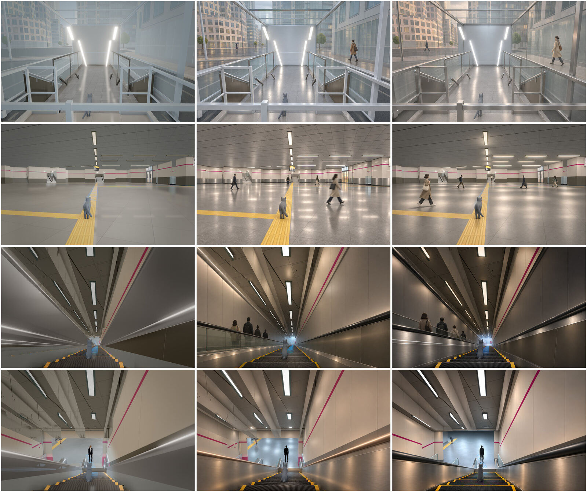

| Hero | Chosen | Why | Rejected variant |
|---|---|---|---|
| H1 exit 1 mouth | **b** | warm street and cool, bright stairs read at once: the thesis's "warmer near the street" | a: a wet, rainy street (weather is not decided) and a weaker warm–cool split |
| H2 B1 corridor | **b** | soft, separate troffer pools on stone that is not a mirror; the overhead signs carry | a: the floor drifts towards a mirror |
| H3 escalator run | **a** | keeps the glass balustrade with the up-run riders behind it; the right lower wall is dim but readable; the cool landing glow pulls the eye | b: turns the glass balustrade into a solid steel wall (a geometry change) and is darker than "Tokyo subways are bright" allows |
| H4 B6 landing | **b** | black rubber handrails, a distinctly cool landing with floor pools, and a clean silhouette | a: copper-lit handrails (wrong material) |

Batch 2 kept the geometry where batch 1 did not, because the brief locked every edge and banned new magenta. These four frames are therefore **layout and light targets**, not only mood boards. Known drift:
- H4 b straightens the magenta band's jog on the left wall, and the game keeps its own jog;
- the street façades in H1 are invented detail (allowed as background, never a landmark).

Each frame's "what must change" list in references.md is the work order. The hero scene repair list (day 4) and the B default PR are judged against these frames. Check: the golden cameras slice-01/04/10/11 side by side with the targets at each art acceptance. Provisional until the Owner sees them.

### D9 (2026-11-12 09:4x JST) Preset B v4 becomes the default
B went through three rounds after D7, each rendered as the same 16 A/B shots (GPU heavy jobs `d6-bv2`, `d6-bv3`, `d6-bv4`; v4 at 09:28 JST, console clean):
- v2 (`28fbe133`): a cooler B tint and a pool gain of 1.9. The pool was too small (7 m) and too faint.
- v3 (`a72cc24d`): the pool widened to 12 m, B landing tint [0.8, 0.9, 1].
- v4 (`4a6eecc4`): the mid-run dip went from 0.3 to 0.18.

**Measurements.** All values are linear luminance on fixed patches of the 1600×1000 frames. The workers' "landing box" turned out to see mostly warm wall, so it was replaced. Two patches are used:
- the landing floor (bottom pose `80x40+720+690`; dismount pose `140x120+520+650`);
- the dark right lower wall at mid-run (`240x120+1320+720`).

The first bottom patch (`90x40+600+690`) caught a walking NPC in v4, so a clear patch beside it is used.

| | target (D7) | v3 | **v4** |
|---|---|---|---|
| landing floor, B ÷ A, bottom pose | ≥ 1.25 | 1.35 high, 1.33 low | **1.35 high, 1.33 low** |
| landing floor, B ÷ A, dismount pose | ≥ 1.25 | 1.38 high, 1.35 low | **1.36 high, 1.35 low** |
| landing tint | cooler than the shaft | blue > red | **blue > red** (sRGB 141/148/151 at the dismount) |
| darkest mid-run wall, B ÷ A | lift about 15% from v1's 0.77 | 0.74 | **0.79 high, 0.82 low** |

High tier, A left, B right:

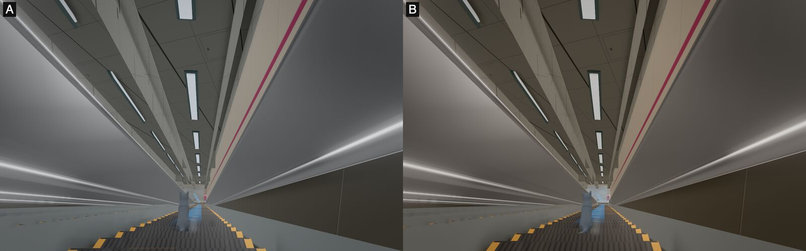
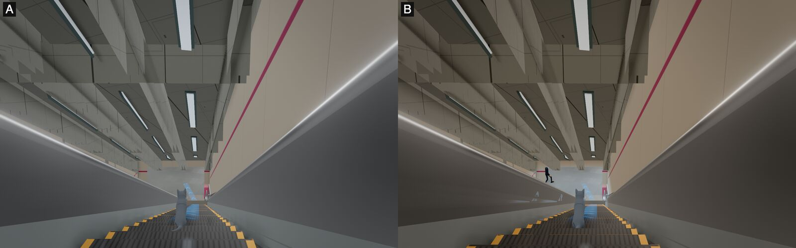
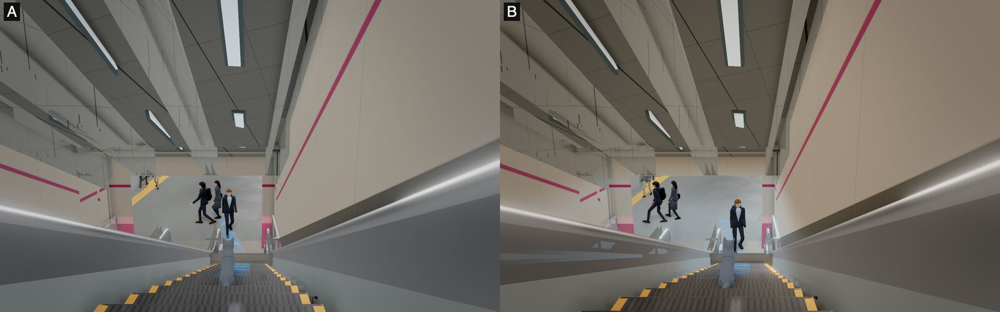

Low tier, mid-run: 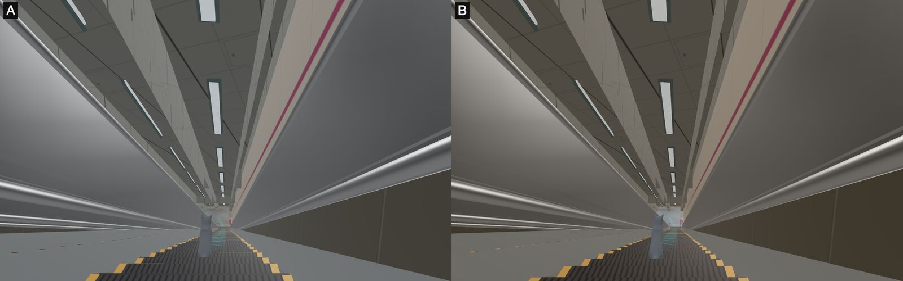

**Decision: B v4 is the default** (no parameter; `?lightpreset=a|c` keep the reference arms, `?lightpreset=off` turns the grade off).

The landing now reads as a bright, cool goal at the end of a warmer shaft, which is the D6 thesis and H3/H4's light. The mid-run wall is short of the 15% lift, but its panel joints now read, so it is no longer black. What is left comes from the warm tint on a dark wall albedo. Lifting the light further would flatten the mid-run dimming that the frame wants. The fix belongs to H3's material list: an enamel and stainless wall in place of the dark brown panel.

Not done by the light:
- the handrail highlight streaks (the handrail material is outside the preset's selection): H3/H4 "what must change";
- C's pool edge, which v3 widened for every preset (review major on #1184): a follow-up issue, since C is rejected.

Provisional until the Owner sees the walk video.

### D10 (2026-11-12 09:5x JST) Live check of the B default on gteki.pages.dev
The first live judgement under token-rules 26. It was made on the production deploy of `2bc75aeb` (#1184) in ego-lite, desktop at 1476×996, through `__gteki.setView` at the slice cameras, with no parameter (B) and with `?lightpreset=off`.

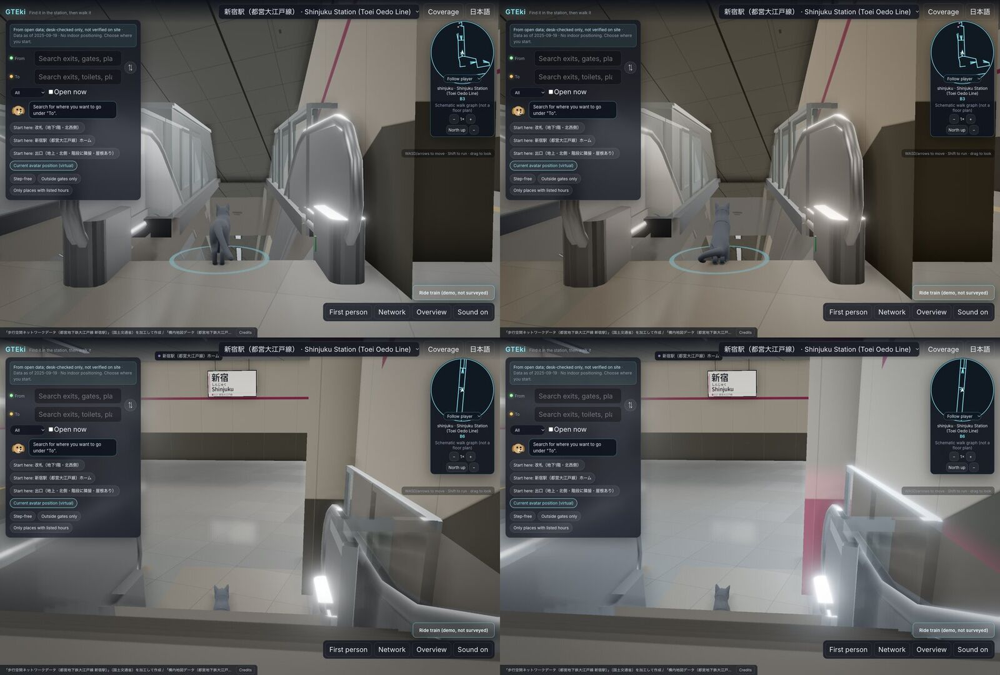

- **B is live and matches the renders.**
  - At slice-11 (the B6 landing), the floor reads as the bright, cool pool; with `off` it is flat grey.
  - At slice-10, the upper walls take the warm shaft tint.
  - slice-01, slice-04 and slice-12 look the same as with `off`, so the grade does not leak outside the shaft and landing.
- **No light correction.** The faint magenta accent at the foot of the landing walls stays: it reads as the line colour at waist height, not a wash.

Corrections logged for other rows (not light):
1. **slice-12 (platform)** shows almost only floor tiles: the follow camera looks down (raise 0.87 rad), and the platform, the track edge and the name sign are out of frame. The arrival frame (J9, hero H4) must show the platform and its name sign.

   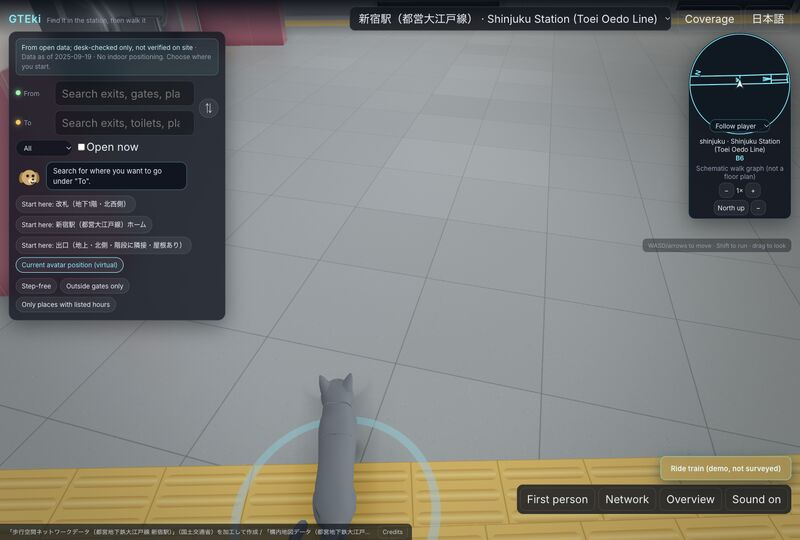

2. **The UI overlay** (search panel, chips, minimap and bottom bar) covers roughly a third to two fifths of the desktop frame at every slice camera. That is J3/J8 (D1 diet), already in flight behind `?next=1`.
3. **At slice-10**, a dark brown wall wedge fills the right side of the escalator head. That is material and geometry, and it goes to the hero scene repair list.

Provisional until the Owner sees the walk video.

### D11 (2026-11-13 08:3x JST) Seat confirmed; five verdicts on the `?next=1` work; D2 rewritten
**Seat.** Audition round 2 closed. The Owner approved Opus 5.5 as art director (decision on #1244). Four candidates answered the same packet of five real judgements: Opus 5.5, Fable 5.1, Fable 5.2 and GPT-6. Three blind judges ranked the answers (Borda 10/8/7/5, in that order). The packet, answers and judge notes are in `.claude/director/drafts/audition-r2/`. This log's verdicts are mine from here on. Fable 5.2 (`claude -p --model claude-fable-5-2`) is the blind critic; it critiques, it does not co-direct. Every verdict stays provisional until the Owner sees the walk video (25 g).

The frames are CI captures in software rendering (SwiftShader) from the real guided walk with `?next=1`: run 43210708781 (before #1240) and run 43222933757 (#1240 head 0ce340f9). Desktop 960×600, phone 412×839. They settle composition, camera, UI and what is in view. They do not settle light or material.

**Measured on the targets** (s6 sheet, H panels 800×500, read 2026-11-13). These numbers replace the guesses in my audition answer:

| frame | cat height | cat centre x | vanishing point / far end (y from top) |
|---|---|---|---|
| H1 exit 1 mouth | ~20%, feet behind the front rail | ~46% | ~53%, camera near level |
| H3 escalator run | ~17% | ~46% | ~79% (landing glow just above the cat) |
| H4 escalator foot | ~15% | ~46% | ~70% (landing opening) |

**The five verdicts** (all three judges agreed on each):

1. **Cold open (J2, J3): ONE MORE ROUND.** J3 passes on numbers (overlay 11.2% desktop, 15.4% phone). The camera does not match H1: it is raised 20° and looks down onto the cat. Floating POI labels show in the first frame. The phone shows a bare loader at 1 s, and the desktop 1 s capture is missing. Correction to my audition numbers: H1's cat is ~20%, not 10–12%. My proposed pose (2.4 m back, 1.4 m up, −6°, 55°) would put the feet at ~93%, not 80%. Targets:
   - desktop: far end at 50–56%; cat x 45–50%, height 18–22%; feet ≤ 90% (clear of the attribution strip); street ≥ 20% of the frame top;
   - phone: feet ≤ 68% (above the card); horizon 30–40%;
   - where they conflict, keep the feet and the far end and let the cat height give, down to 14%;
   - starting values: camera 1.3 m above the floor (above the 1.1 m rail), pitch −3° desktop / −12° phone, distance tuned for the cat height;
   - no floating labels or rings before the walk starts;
   - a poster of this pose from first paint, cross-faded into the canvas over 400 ms at ready.
2. **Cat on stairs, #1240 (J6): FLIP NOW.** Accepted on #1240 (comment 6839006042).
   - #005 and #007 before: the cat is hidden on both aspects. After: it is in view, clear of the card (0.22 → 0.55, 0.44 → 0.77).
   - #041 (escalator, skipped by design) is unchanged.
   - Condition for the flip PR: the walk video shows the 10° steps easing (≤ 3° per frame).

   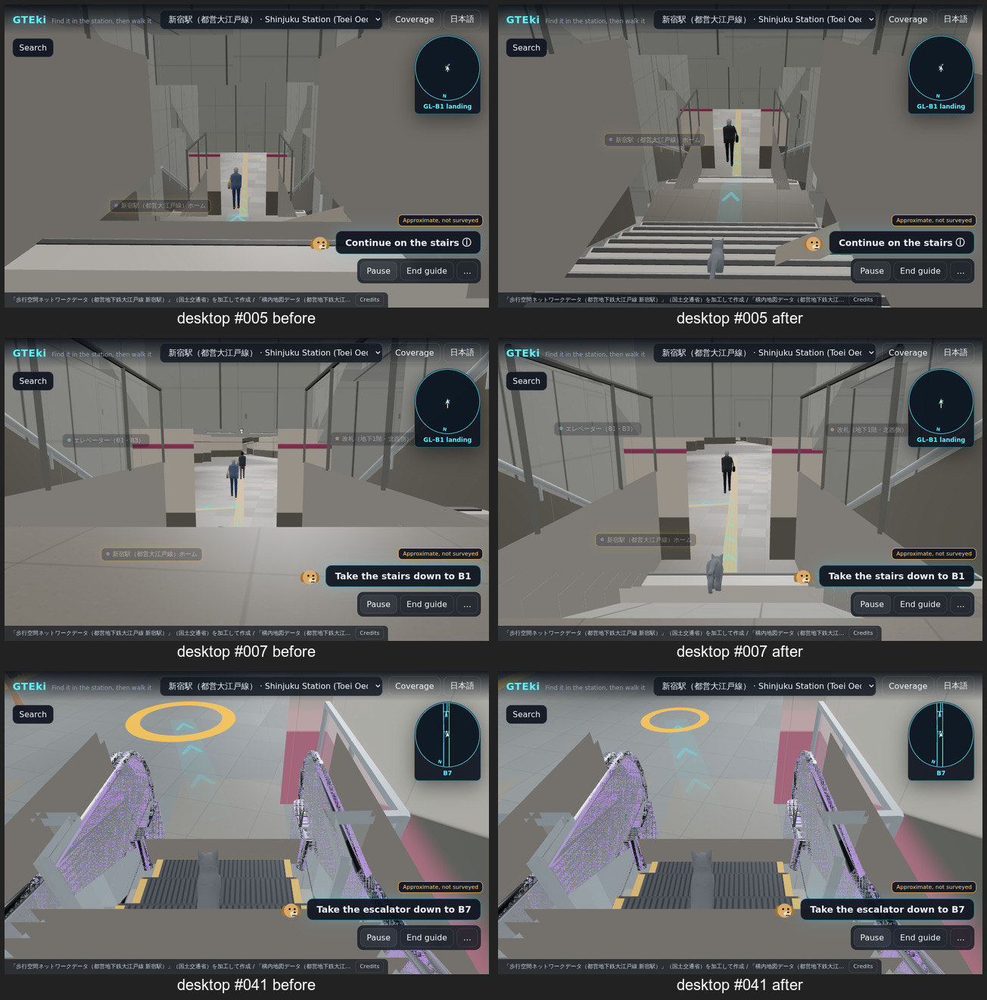

3. **Compact HUD (J8): ONE MORE ROUND.** Overlay passes on numbers (desktop 16.6–19.2%, phone 16.1–24.7%), but it fails D1:
   - the card is truncated and is not a one-line instruction;
   - there is no escalator mode: the stale "Turn right…" card and the floating chevrons stay up during the ride (#016, #022, #024);
   - the mascot icon sits on the cat (#010, #024, #016, #022; on the cat's head at #042);
   - "GL-B1 landing" is an internal code shown to the visitor;
   - the B3 concourse shows a "B4" label.
4. **Escalator camera (J7): ONE MORE ROUND.** The axis lock works. The composition is the opposite of H3: the cat fills ~35% of the frame height on desktop and ~27% on phone, and the run's far end sits in the top ~35%. The shot looks down a chute; H3 is a tall shaft with the landing low and the ceiling filling the frame. At #022 the upper centre is a featureless slab with chevrons floating in it (ceiling, #1086).

   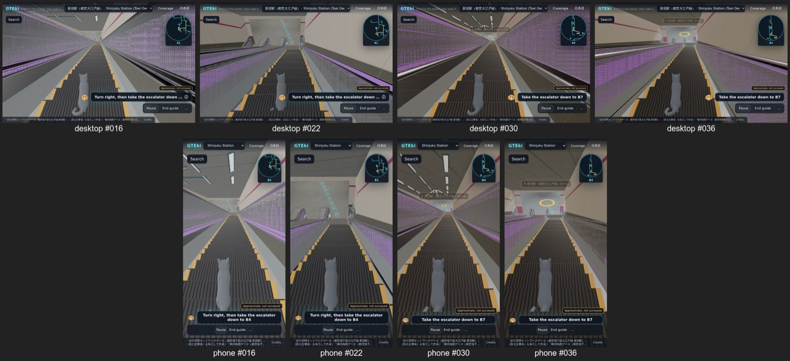

5. **Arrival (J9): ONE MORE ROUND.** The name sign is in frame but small, on a blank slab. The platform edge (4.2 m away, bearing 259°) and the rail (5.0 m, bearing 253°) are out of frame, because the walk ends at heading 147.7° (#1208). The arrival stack shows five actions and a bubble, a large yellow ring, and desktop overlay at 21.0% (fails J8 by 1 pt). **H4 is the escalator foot, not the platform.** The arrival shot gets its own composition, and H4 is delivered by the escalator camera on the last run.

**D2 rewritten (escalator part).** D2's "1.4 m behind, 0.9 m above the step, pitch about −12°, landing on the upper third" contradicts H3 (D8). D2's cat target of 8–12% is also below H3's ~17%. The escalator camera is now specified by frame targets; camera numbers are only starting values:
- desktop (vFOV 55°): far end of the run at 70–78% of frame height; cat height 14–17%; cat centre x 45–50%; feet ≤ 92%; ceiling and walls above the far end ≥ 50% of the frame;
- phone (vFOV 65°): far end at 58–62%; cat height 12–15%; no intersection between the cat's box and the overlay rects;
- starting values for a 30° run (computed, consistent with the targets):
  - desktop: boom 2.6 m uphill along the axis, camera 0.7 m above the step surface beneath it, pitch −18° (far end ≈ 70%, feet ≈ 92%);
  - phone: boom 3.2 m, same height, pitch −24° (far end ≈ 58%, feet ≈ 72%);
  - tune the boom for the cat height and the pitch for the far end;
- keep the 0.6–1.2 s ease and the balustrade collision. Start the ease 2 m before the comb plate (fixes #041's steep look at the escalator head). The lock already holds at #022; that frame's problem is the ceiling, not the camera.

D2's flat-ground and FOV rules stand.

Check: walk frames #016, #030, #036 and golden cameras slice-10/11 measured against the targets above, on desktop and phone.

### D12 (2026-11-14 05:2x JST) Four verdicts: pitched ceilings, phone arrival pose, exit 1 wedges, `?next=1` HUD live
1. **#1263, pitched escalator ceilings, default-on (J7): accepted.** GPU journey and golden shots at 8bfea48d. Both rides now read as one continuous pitched ceiling, with the troffers following the plane (the H3 shaft read). The crossing strips at the B3→B6 lower landing are fixed. They still splay at two or three angles where the planes meet the landing; that is J10 material work.
2. **#1253, phone arrival pose (J9): the 165° pose ships.** On this platform the screen doors and the tactile strip are the visible edge. The phone requirement becomes: name board fully in frame, plus doors or the tactile strip over ≥ 10% of the frame width. Of the two candidates, the board matters more: 200° shows the doors but no board. Desktop (200°) accepted as is.
3. **#1206, exit 1 black wedges (J5): passed and closed** on GPU slice-01/02 at ad5decf2. The remaining gap to H1 is the camera (J2) and the end-wall light strips (J10), not breakage.
4. **`?next=1` HUD, judged live on production (acae1552, ego-lite GPU):**
   - **#1249 escalator HUD (J8): accepted.** One fix before the flip: the minimap shows "Floor unknown" on the second ride.
   - **#1256 arrival HUD (J9): accepted.** One fix before the flip: the "Approximate, not surveyed" badge overlaps Coverage.
   - "B4" on the intermediate concourse is correct (Toei B7F→B4F→B1F). This withdraws D11 item 3's label complaint.
   - The escalator camera is still the chute; D11 item 4 stands.

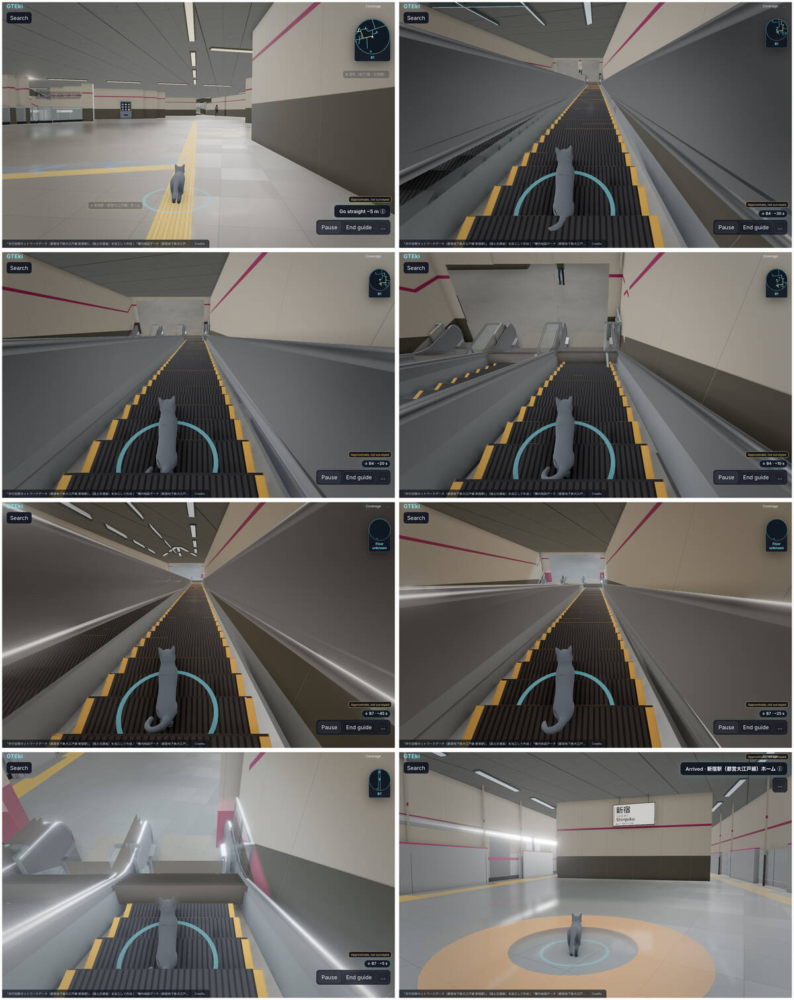
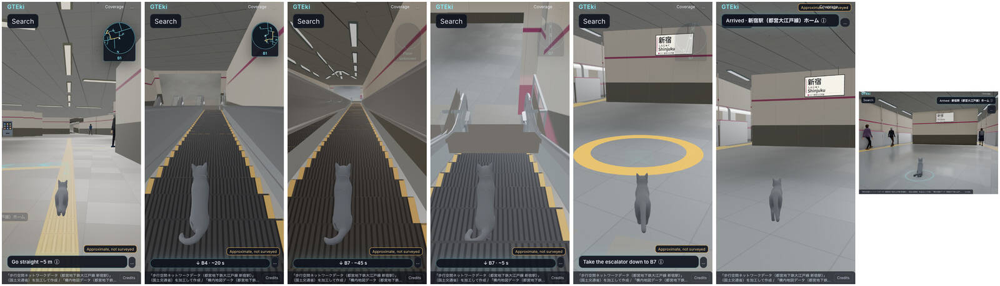

Provisional until the Owner sees the walk video.

### D13 (2026-11-14 14:5x JST) Escalator H3 camera live (#1293); D11 targets revised
**#1293, escalator camera reframed to H3 (J7): the camera is accepted live on GPU.** Judged on production `?next=1` at e8a38776 (ego-lite, ANGLE Metal / M2 Pro), the real guided walk stepped like the journey reel (2 s to 20 s, then 4 s; 1 s steps around both ride entries). Desktop 1440×900, phone 412×839 @2×.
- Both rides read as the H3 shaft: far end low (desktop ~72%, phone ~58–60%), the ceiling and the magenta band carry the upper half, the cat sits centred just under the landing glow (visible cat ~17% desktop, ~10–11% phone). Lock holds through both runs; yaw drift ≤ 4.4°.
- Entries (37–43 s, 93–99 s): the ease starts on the concourse and lands on the axis by the second step. At 97–100 s the neighbouring balustrade glass and the B4 landing soffit cross the frame for one sample; transitional, not a blocker.
- **The J7 flip waits for two fixes, both geometry, not camera:**
  1. **#1285**, the escalator foot: at 148 s the landing shell hides the cat from the chest down (J6), on both aspects.
  2. **#1237**, the troffers on the second ride (B4→B7): from 108 s to 128 s the ceiling strips splay at several angles instead of running down the pitched plane. D12 item 1 placed this under J10 material work; with the H3 camera the ceiling is half the frame, so it now blocks the flip.
- Not blocking, J10 material work (H3 list): the balustrades are solid grey wedges filling both sides of the frame where H3 has glass and a black handrail; specular streaks on the inner panels.

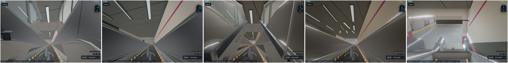
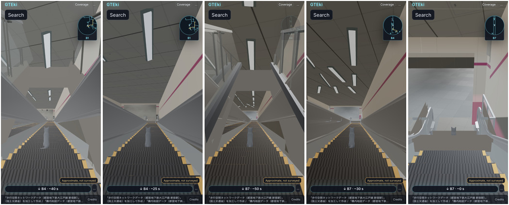

**D11 targets revised** (measured on the live frames, not the projected cat box, which includes the cat hidden by the step behind it):
- D11 item 1 (cold open), desktop far end: **44–56%** (was 50–56%). The #1279 cold open sits in this band and matches the J1 posters.
- D11 escalator camera, phone cat height: **10–15%** (was 12–15%). A taller phone cat pushes the feet into the card; at 10–11% the cat reads and the far end stays at 58–62%.

Provisional until the Owner sees the walk video.

## Current weaknesses (from the 2026-11-09 GPU shots; both proposals agree)

1. Flat ambient light: fixtures light nothing, there are no floor pools or contact shadows, and pillars, walls and floor share one value band.
2. UI covers 40–45% of the frame and the cat; the card lags the cat's position on the escalator; the floor readout doesn't update at the landing.
3. The route ribbon reads as debug geometry (stacked cyan outlines, z-fighting); it floats at handrail height and is drawn through the ceiling near the platform.
4. The escalator hero is empty: matte grey balustrades, opaque milky glass, nothing lit at the landing, no riders.
5. NPCs: lock-step clones, rigid standing poses.
6. Known breakage, fixed separately: the torn soffit at the B1 → B3 escalator top and the magenta stripe climbing a pillar.
7. Overview: depth doesn't read (all levels one beige tone on a void, no street plane).
