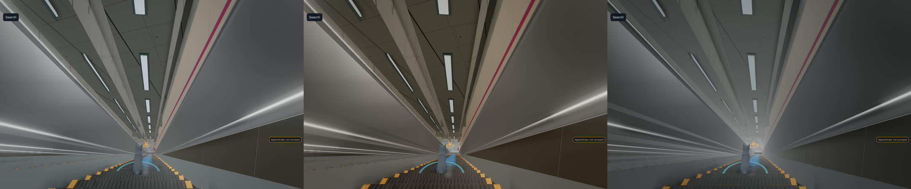
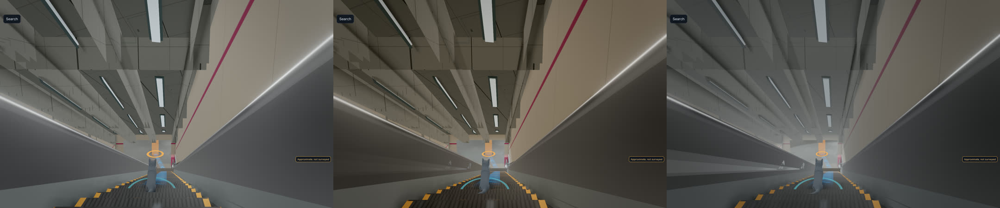
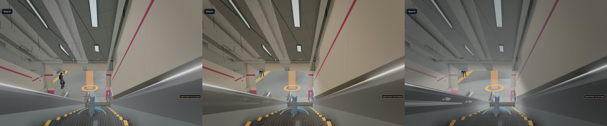
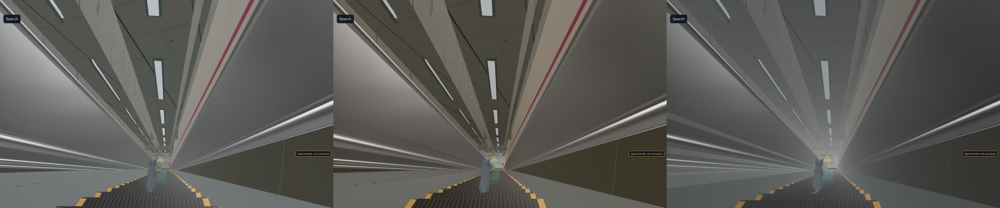

# Art direction log: the Shinjuku slice

The persistent decision log for the look of the 2026-11-22 slice (token-rules 25): Shinjuku, Toei Oedo E27, street exit 1 → B1 concourse → escalators → B6 platform (`toei-nwd-m6`, render −42.87 m). Viewpoints and the four hero moments: [slice-views.md](slice-views.md). References, hero target frames and paint-overs: `references.md` (to come).

Owner: gteki-visual (art director, provisional until the audition closes). Every AI verdict here is **provisional** until the Owner has seen the walk video for it (token-rules 25 g). Read this file first after every /clear.

## Status (2026-11-11 18:1x JST)

- Seat audition: two proposals in (`.claude/director/drafts/audition/direction-A.md`, `direction-B.md`, anonymous), the GPT one still to come. The decisions below take what A and B agree on and rule on where they differ. When the third proposal lands, anything it changes is logged as a new entry, not edited in place.
- First judged render: the D6 blind test (D7, preset B). The first golden render of the 12 slice cameras (after #1170) is the baseline for everything else.
- Next: the B v2 brief and its rerun (D7), then B as the default behind an art-acceptance PR.

## Visual thesis

You are a small cat carried down into a tall, clean, humming machine. Each level down is cooler, brighter and more enclosed than the one above, and the drama is vertical. The station's own light and signs show the way. The guidance UI stays quiet. The magenta Oedo line colour is the one warm thread you follow from the street to the platform.

## Style guide

**Light.** Fixtures light things. Troffers and linear soffit lights are emissive (≥ 2.0) and leave pools on the floor: an analytic pool in the floor shader or a decal, not one real light per fixture. Signs are the brightest objects in frame (emissive about 1.5, top 2% of frame luminance). ACES filmic tone mapping. Bloom on the high tier only (threshold about 0.85–0.9, strength about 0.35). The low tier gets the same emissive strips and baked gradients, with no post-processing. Tokyo subways are bright: no noir grading, and no god rays underground (at most daylight spill at the exit 1 mouth).

**Colour.** Neutral grey, stone and steel. Magenta (#E8318A family) is reserved for the line colour: a waist-height wall band plus sign icons, never climbing pillars or ceilings. Warmer near the street, cooler and brighter with depth.

**Materials.** There are five families, and each surface belongs to one of them:
- polished stone tile floor, roughness 0.3–0.4 with variation, no mirror;
- enamel wall panels with joints, a baseboard and a shadow line;
- brushed stainless on the escalator skirts and decks, metalness 1, roughness about 0.3, anisotropic along the run;
- glass balustrades;
- black rubber handrails, roughness about 0.5.

Escalator steps are dark aluminium with a ribbed normal and yellow demarcation edges. One PMREM env map, captured from the station itself at load. Cleanly stylised PBR, no photo-scanned textures.

**Life.** Sparse and well placed rather than dense: standing riders on the escalators (the up-run beside the cat), one or two figures ahead silhouetted against the bright landing, walkers with offset gait phases and speeds of 1.1–1.5 m/s. No two NPCs in lock-step, and no NPC facial detail.

**Sound.** Original or synthesised only: escalator motor drone, step ticks, and reverb plus a low-pass that change with depth, with a distant train rumble opening up near the platform. No recorded announcements or real chimes.

**UI in walk mode.** A diet:
- one card with a one-line imperative, the rest behind a tap;
- the duplicate mascot tip shown once only;
- the bottom bar cut to the essentials plus "…";
- the overlay covering ≤ 20% of the viewport on desktop and ≤ 30% on phone, and never the cat.

The route is drawn as depth-tested floor decals (chevrons), never at handrail height and never through a ceiling. On an escalator the route line disappears (the escalator is the route). The card becomes a pill "↓ platform · ~40 s", the minimap shrinks, and floating rings and labels hide. The floor readout ticks over at the landing.

## Decisions

Each entry: date, decision, reason, how it is checked. Rejected options stay listed.

### D1 (2026-11-11) High-confidence list, adopted from both proposals
Adopted:
- the walk-mode UI diet above;
- signs emissive about 1.5;
- light pools from troffers, with ACES and bloom on the high tier;
- stainless, glass and rubber escalator materials with a station PMREM;
- a lower camera plus an escalator-axis descent camera;
- riders on the up-escalator.

The first 3-variant blind test is the light gradient from the top of the escalator to the landing (D6).

Check: the unobstructed viewport from DOM overlay rects; canvas readback showing floor luminance spread ≥ 2× today in slice-03/04; sign pixels in the top 2%; no route pixels above 1.2 m.

### D2 (2026-11-11) Camera: narrower, lower, axis-locked on escalators
- Desktop vertical FOV goes from 60° to **55°** in walk and descent, and does **not** widen on the escalator. Rejected: A's 60 → 70 on descent. A wider lens splays the walls and makes the run read short (B's reading of shot6, where the horizontal FOV is about 85° at 16:10). The run should read deep.
- Phone portrait keeps a vertical FOV of 65°.
- On flat ground the camera follows at about **0.9 m** above the floor, 2.2 m behind (between A's 0.7 m and B's 0.9 m; 0.9 m keeps signs and ceiling in frame).
- On the escalator the camera eases in over 0.6–1.2 s to the escalator axis: 1.4 m behind, 0.9 m above the cat's step, pitch about −12°. The cat sits on the lower third (left side, the Tokyo standing side) and the landing on the upper third.
- Camera collision against the balustrades fixes the dark near-plane wedge at the escalator top.

Check: camera-y minus floor-y logged per golden camera; zero near-plane clips against the balustrades on the scripted walk; cat at 8–12% of frame height; ceiling plus far wall ≥ 35% of the slice-04 frame.

### D3 (2026-11-11) Props: incidental only, nothing that states a fact
Allowed, as non-interactive and non-searchable dressing set against walls off the walk paths:
- platform benches;
- bins;
- fire extinguisher or hydrant boxes;
- pillar guards;
- blank, softly lit lightbox panels (no ads).

Rejected:
- ticket machines, fare adjustment machines and vending machines, which tell a user where to buy something;
- extra exit or direction signs, shops, kiosks, doors and corridors, which imply a navigable connection or a station-specific fact.

This follows the truth rule: incidental objects may be artistic, station facts may not. B proposed ticket machines, vending machines and a generic exit sign; A forbade them.

Check: the props live in a dressing layer with no POI, graph or search entries; truth review in the PR.

### D4 (2026-11-11) Glass: cheap rim, not transmission
Balustrade glass is opacity about 0.12, plus a Fresnel rim (`pow(1 − N·V, 3) × 0.5`), plus env reflection, on both tiers; the low tier uses opacity only. Rejected for now: `MeshPhysicalMaterial.transmission` on the high tier (B's choice). It adds a transmission render pass of the opaque scene on a frame that is already GPU-bound. The opposite wall should read through the glass either way. Transmission comes back only if it wins a variant within +1.5 ms of M2 Pro frame time.

Check: the opposite wall is legible through the balustrade in slice-10 and slice-11, and frame time is ≤ main + 1.5 ms.

### D5 (2026-11-11) No global fog; shaft haze only as a test arm
No `FogExp2` over the station. Density 0.012 dims anything 50 m away to about 55%, which would wash out the long B1 corridor (slice-04) and its signs. A depth haze confined to the long escalator shaft, tinted to the landing, is variant C of D6 and nothing more.

### D6 (2026-11-11) First blind test: light gradient on the long escalator (slice-10 → slice-11)
Three presets behind a URL flag, all with the magenta landing accent:
- **A**: even 5000 K;
- **B**: warm 4000 K shaft, dimming to about 0.6× mid-run, then a cool 5500 K landing pool at about 1.6× the shaft luminance;
- **C**: dim shaft at 0.4×, a hard landing pool and shaft haze.

Render four poses per preset on both tiers: escalator top, mid-run, bottom approach and dismount. UI hidden, fixed NPC seed, files renamed at random. Critics are models that did not build it, scoring 1–5 on "where would you go next?", "how deep does this feel?" and "does this look like a Tokyo subway?". Numeric guards: the landing/mid-shaft luminance ratio and frame time on both tiers. Prior: B. A B/C tie goes to B, because C risks phones and plausibility. The pick is provisional until the Owner sees the walk video.

### D7 (2026-11-11 18:1x JST) D6 result: preset B wins; haze rejected
The D6 blind render ran on 2026-11-11 (job `d6-blind`, `orb-test --heavy --host`, exit 0 at 17:49 JST): 4 poses × 3 presets × 2 tiers, UI meant to be hidden, files renamed at random, sheets shuffled per pose. Three critics that did not build it (Sonnet 5.5, Fable 5.1, Gemini via Antigravity) scored each variant 1–5. Averages per preset over mid, bottom and dismount on both tiers; the top pose is left out because it shows the B3 concourse wall, not the escalator, and the three presets look the same there:

| preset | Sonnet: where / depth / Tokyo | Fable | Gemini |
|---|---|---|---|
| A even 5000 K | 3.00 / 3.00 / 3.00 | 3.33 / 3.33 / 3.17 | 3.83 / 3.50 / 3.50 |
| **B warm shaft, cool landing** | 3.67 / 3.33 / **3.67** | **3.67 / 3.67 / 3.50** | **4.83 / 4.33 / 4.83** |
| C dim shaft, hard pool, haze | **4.00 / 4.17** / 2.83 | 2.83 / 3.17 / 2.00 | 1.83 / 1.67 / 1.33 |

High tier, left to right A, B, C:

Low tier, mid-run: 

Decision:
- **B is the escalator light for the slice.** All three critics score it highest on "looks like a Tokyo subway"; two of three score it highest overall. It matches the director's own read, written down before the scores came in.
- **C is rejected.** Its haze pulls the eye (Sonnet's top score on where and depth) but whites out the landing and turns the walls muddy grey ("steam pipe", "white hole"). This confirms D5: no haze, not even confined to the shaft. Sonnet's idea of a faint glow at the landing end only is folded into B v2 as light, not fog.
- A stays in the code as the neutral reference arm.

B v2, before B becomes the default (one brief, then a rerun of the same render):
- make the landing pool read as cool: today it barely does (landing/mid luminance ratio at the bottom pose 1.98 high, 1.78 low). Target ≥ 2.2 high and ≥ 2.0 low, with a visibly cooler tint than the shaft;
- lift the darkest mid-shaft wall by about 15% (Fable: the right wall goes nearly black);
- tone down the handrail highlight streaks (two critics).

Render fixes for the rerun:
- the top pose must look down the escalator from its top;
- hide all UI, including the "Search" and "Approximate, not surveyed" pills and the ring markers, which leaked into every shot;
- measure frame time uncapped: every shot logged a vsync-capped 16.7 ms, so the frame-time guard said nothing. Draw calls were equal across presets.

Not a lighting matter: two critics flagged stepped, floating ceiling slabs above the bottom pose on both tiers. That is breakage and goes to #1086.

The console showed no errors or warnings for any preset on either tier, so #1177 is closed. Provisional until the Owner sees the walk video.

## Current weaknesses (from the 2026-11-09 GPU shots; both proposals agree)

1. Flat ambient light: fixtures light nothing, there are no floor pools or contact shadows, and pillars, walls and floor share one value band.
2. UI covers 40–45% of the frame and the cat; the card lags the cat's position on the escalator; the floor readout doesn't update at the landing.
3. The route ribbon reads as debug geometry (stacked cyan outlines, z-fighting); it floats at handrail height and is drawn through the ceiling near the platform.
4. The escalator hero is empty: matte grey balustrades, opaque milky glass, nothing lit at the landing, no riders.
5. NPCs: lock-step clones, rigid standing poses.
6. Known breakage, fixed separately: the torn soffit at the B1 → B3 escalator top and the magenta stripe climbing a pillar.
7. Overview: depth doesn't read (all levels one beige tone on a void, no street plane).
