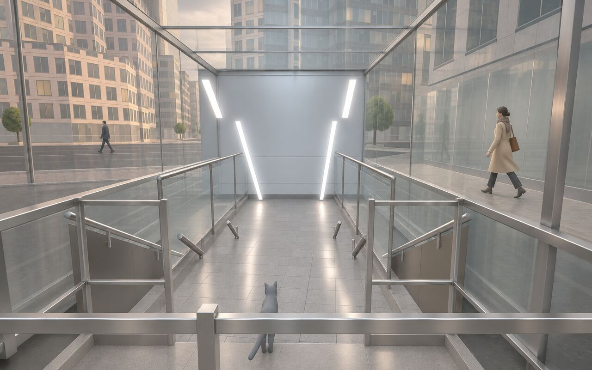
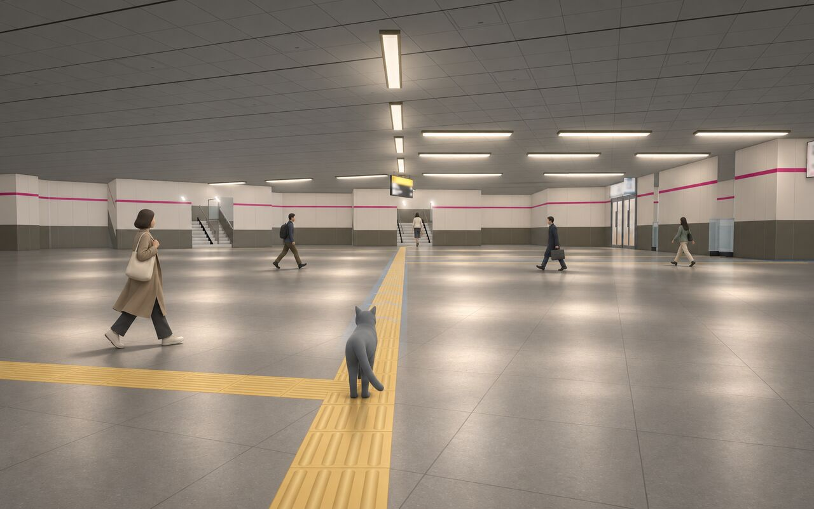
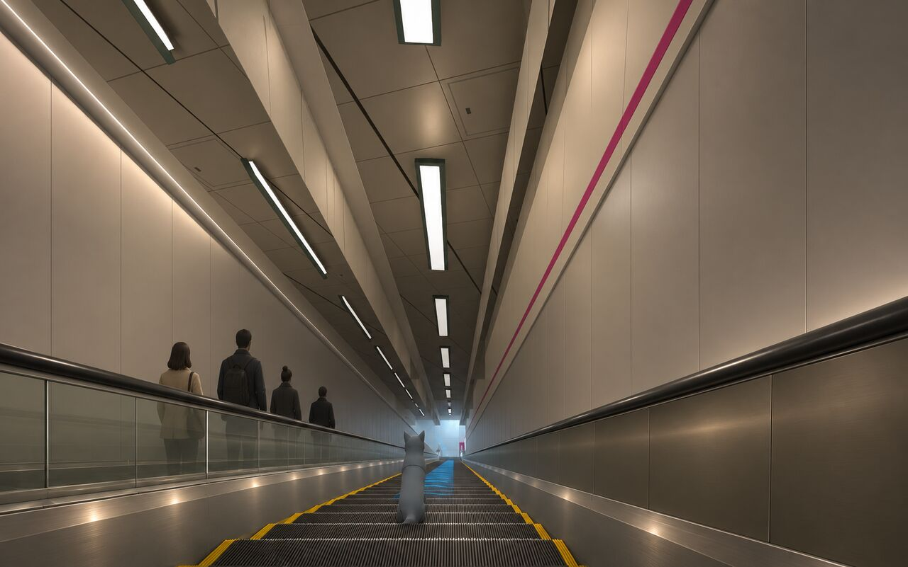
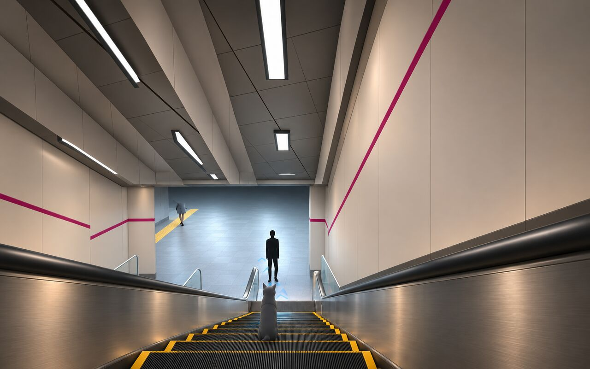

# Reference board: the Shinjuku slice

Companion to [direction.md](direction.md) and [slice-views.md](slice-views.md). Links only: third-party images are never copied into the repo. "Evidence" documents the real E27 station (materials, light, signs, layout feel). "Inspiration" is mood only and never a source for station facts.

Research pass 2026-11-11 04:4x JST (`cx-exec --search`, because oracle-ego was down). The licences below are as stated on each page at that time. The photographs were not yet inspected visually one by one: that review is the next step, and its notes go into the "what it shows" column.

## Truth flag: is the platform on B6 or B7?

Two photo route guides (refs 9 and 10) call the Oedo platform **B7**, with an escalator B7 → B4 and a long one B4 → B1. The game labels the platform floor B6 (`toei-nwd-m6`, render −42.87 m, from the E27 data). This may be a different floor-numbering convention, but it is a station fact. **It is not decided here**: raised to gteki-lead. Until then, no new in-game text adds a floor number for the platform.

## Evidence: Toei Oedo E27 Shinjuku

| # | Page | Author | Licence | What it shows / use |
|---|---|---|---|---|
| 1 | [Shinjuku — Toei Transportation](https://www.kotsu.metro.tokyo.jp/eng/subway_stations/shinjuku.html) | Tokyo Metropolitan Bureau of Transportation | unknown | official E27 station map; orientation |
| 2 | [Toei-Oedo-line Shinjuku-STA Platform](https://commons.wikimedia.org/wiki/File:Toei-Oedo-line_Shinjuku-STA_Platform.jpg) | MaedaAkihiko | CC BY-SA 4.0 | platforms 6/7, 2022: platform doors and ceiling treatment (slice-12) |
| 3 | [E27 Shinjuku station platform](https://commons.wikimedia.org/wiki/File:Toei-subway-E27-Shinjuku-station-platform-20191201-133812.jpg) | LERK | CC BY-SA 4.0 / 2.1 jp | platform edge, signs, lighting, 2019 |
| 4 | [Shinjuku Station-4](https://commons.wikimedia.org/wiki/File:Shinjuku_Station-4.jpg) | 江戸村のとくぞう | CC BY-SA 4.0 | platform interior proportions, 2018 |
| 5 | [Ōedo line — Shinjuku station — platform](https://commons.wikimedia.org/wiki/File:Oedo_line_-_Shinjuku_station_-_platform_-_Nov_2014.jpg) | nesnad | CC BY 3.0 | older platform view, 2014 (before/after doors) |
| 6 | [E27 Shinjuku station sign](https://commons.wikimedia.org/wiki/File:Toei-subway-E27-Shinjuku-station-sign-20191201-133658.jpg) | LERK | CC BY-SA 4.0 / 2.1 jp | station-name sign, multilingual hierarchy, magenta line identity |
| 7 | [Ōedo line — Shinjuku station entrance](https://commons.wikimedia.org/wiki/File:Oedo_line_-_Shinjuku_stn_-_entrance_-_Jan_14_2018.jpg) | nesnad | CC BY 3.0 | Oedo ticket-gate area and its signs (slice-05); not exit 1 |
| 8 | [Ōedo Shinjuku → Yamanote walk](https://honnne.com/blog/norikae-oedosenshinjuku/) | ほんねこ＠ホンネ不動産 | unknown | photo sequence of the long escalators up from the platform |
| 9 | [Ōedo Line to the east exit](https://1rankup.jp/shinjuku/oe-ee.html) | 林原和史 | unknown | step-by-step photos of the platform escalator and the B4 → B1 escalator (B7 label, see the truth flag) |
| 10 | [Shinjuku station 3D model](https://dailyportalz.jp/kiji/161122198124) | 林雄司 (model: 田村圭介 lab) | unknown | how the deep Oedo platform relates to the rest; vertical scale doubled, so connectivity only |

## Inspiration: other Japanese subways and real-time scenes

| # | Page | Author | Licence | Use |
|---|---|---|---|---|
| 11 | [Escalator at Shiodome, Oedo Line](https://commons.wikimedia.org/wiki/File:Escalator_at_Shiodome_Station_on_Toei_Subway_Oedo_Line_20250314_214557.jpg) | Epicgenius | CC BY-SA 4.0 | Oedo-era escalator shaft and balustrades (H3 mood) |
| 12 | [Shiodome Oedo concourse](https://commons.wikimedia.org/wiki/File:Shiodome_Station_Oedo_Line_Concourse_2015.jpg) | Wpcpey | CC BY-SA 4.0 (page also says CC BY 3.0) | concourse signs and circulation |
| 13 | [Higashi-shinjuku platform, Oedo](https://commons.wikimedia.org/wiki/File:Higashi-shinjuku_station_platform_(oedo_line).jpg) | Wirtz | CC BY-SA 3.0 | Oedo platform doors and proportions |
| 14 | [Higashi-shinjuku Fukutoshin platform](https://commons.wikimedia.org/wiki/File:Higashi-shinjuku_station_Fukutoshin_Line_platform.jpg) | PekePON | GFDL 1.2+ / CC BY-SA 3.0 | deep platform and escalator context (historic layout) |
| 15 | [Japanese City Pack (UE5)](https://vegaart.artstation.com/projects/XBykWR) | Kyrylo Sibiriakov | all rights reserved | real-time Tokyo subway assembly; look only |
| 16 | [SUBWAY STATION (UE5)](https://kalebnek.artstation.com/projects/8bnwam) | Kaleb Nekumanesh | all rights reserved | station material and rendering target; look only |
| 17 | [Re-Lighting: Subway Train — Japanese Mood](https://zeroidea.artstation.com/projects/EL11v0) | Adrien Louineau | all rights reserved | lighting study with breakdowns; look only |

## What the evidence does and does not settle

- **Not settled yet:** the fixture layout along the long escalator, the light colour temperature, glass versus opaque balustrade panels, and the wall and ceiling finishes. The style guide's materials are hypotheses until refs 2–4, 8, 9 and 11 are looked at. The first visual pass over them comes before the D6 blind test.
- **Magenta:** the evidence shows magenta in the E27 signs and line identity (ref 6). It does not show a continuous waist-height wall band, so the band in direction.md is artistic interpretation and is labelled as such.
- **Sequence:** the route is a series of deep movements and landings, not one uninterrupted descent. slice-views.md follows that (two escalators, B3 in between).

## Paint-overs, batch 1 (2026-11-11 04:42 JST)

AI paint-overs (OpenAI image_gen via Codex) of the 2026-11-09 GPU captures, to test the style guide. Prompts and tool details are in [paintovers/provenance.md](paintovers/provenance.md). The tool kept the camera and the mood but redrew some geometry, so these are **mood and material targets, not layout targets**. Verdicts are the director's and provisional until the Owner sees them.

| Image | Stands for | Keep | Reject |
|---|---|---|---|
| [po1-escalator2](paintovers/po1-escalator2.jpg) | H3, long escalator (slice-10) | steel skirts; clear glass with rim; black handrails; ribbed steps with yellow edges; standing riders on the up-run; a figure silhouetted at the landing; soffit lines along the axis | a second magenta stripe high on the wall; even lighting (the landing is not brighter or cooler, so the D6 question stays open) |
| [po1-b1-corridor](paintovers/po1-b1-corridor.jpg) | H2, B1 corridor (slice-04) | troffer pools on polished stone; varied walkers, no clones | magenta bands on pillars; invented tactile-paving route (only where evidence exists); drifted pillar rhythm and sign positions |
| [po1-escalator-platform-end](paintovers/po1-escalator-platform-end.jpg) | stand-in for H4 | glass, steel and handrail materials; riders | starburst troffers (they run parallel to the axis); an invented yellow arrow sign (sign faces stay abstract); the landing not distinctly cool |

## Hero target frames (2026-11-12)

These are the frames the game is judged against for the slice. Each is an AI paint-over (batch 2) of a 2026-11-12 GPU capture of the game: preset B, high tier, UI hidden. Prompts and provenance are in [targets/provenance.md](targets/provenance.md); the choice between variants is [direction.md D8](direction.md). Each list is what must change in the game to match. Verdicts are provisional until the Owner sees them.

### H1, first recognisable view (slice-01, exit 1 mouth)

- The chunky white box railings become slim brushed-stainless posts with glass infill.
- The floor becomes polished stone (roughness about 0.35) that reflects the strip lights.
- The washed-out white street becomes warm overcast daylight on the façades, and the mouth's exposure stops clipping.
- The canopy glass gets a visible frame and faint reflections instead of flat white.
- One or two pedestrians appear at street level.

### H2, main corridor landmark (slice-04, B1 corridor)

- Each troffer leaves a soft, separate pool on the floor; today the floor is one flat grey.
- The floor becomes polished stone with soft, elongated highlights, never a mirror.
- The walls become enamel panels with joints over a stainless baseboard and a shadow line.
- The overhead signs become the brightest things in frame.
- Three to five walkers appear, with different strides and distances.

### H3, escalator transition (slice-10, long escalator)

- The left balustrade, today an opaque grey slab with long streaks, becomes near-clear glass with a faint rim, with the up-run riders visible through it.
- The handrails become black rubber with a soft highlight instead of chrome streaks (the handrail follow-up from D7).
- The skirts become brushed stainless with small, low glints along the run.
- The walls become warm cream enamel with joints; the right lower wall stays dim but readable (#1184 v4).
- The far landing stays a bright, cool pool, as preset B already does.

### H4, platform arrival (slice-11, B6 landing)

- The landing floor gets separate troffer pools inside its cool pool; preset B gives the pool but no fixture pools.
- The handrails become black rubber, and the skirts brushed stainless with warm streaks.
- The figure on the landing reads as a clean dark silhouette against the light.
- The walls become brighter cream enamel with panel joints.
- The steps get crisp yellow edges.

## Still to come

- A visual pass over refs 2–4, 8, 9 and 11, noting fixture layout, balustrade type and finishes in the "what it shows" column.
