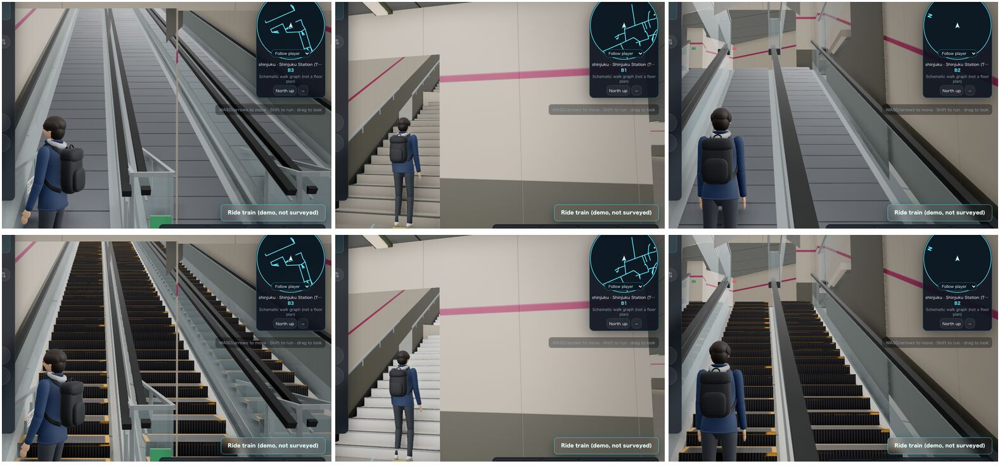
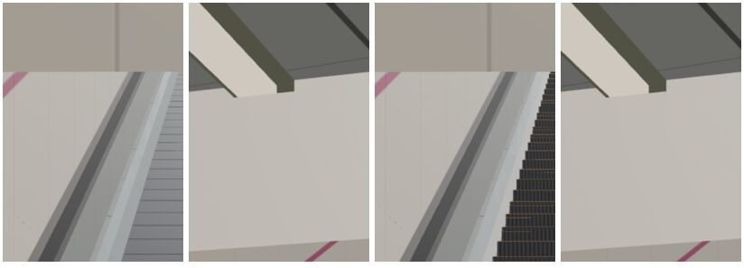
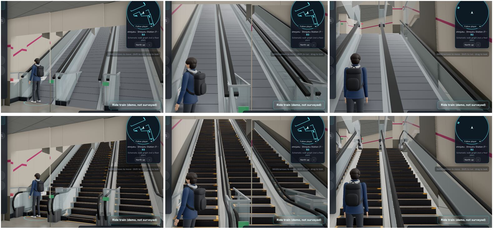
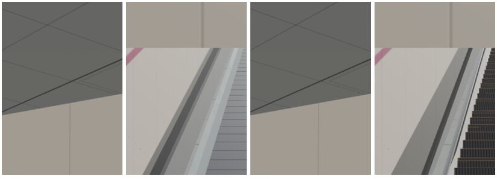
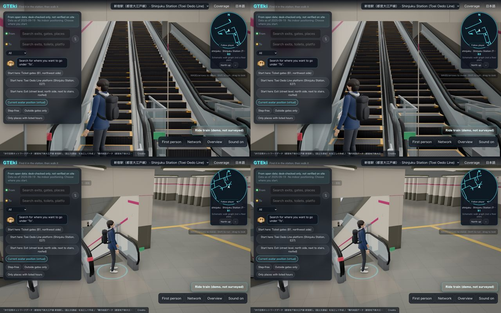

# Vertical transport: Blender reference vs. the live game

Date 2026-10-28 03:10 JST, base `origin/main` `9e1c1d37`. Step 1 of the vertical transport art pass: what separates `vertical_hero` ([style.md](../assets/style.md), `tools/blender/showcase/vertical_demo.json`, camera `hero`) from the escalators and stairs a player actually walks in the web game, ranked by visual gain per effort, and the spot chosen for the Golden Slice.

The 2026-10-22 look-gap report ([#94 part B](../qa/reports/2026-10-22-art-94-look-gap.md)) compared the kit pieces in a studio harness. Most of its explorer-side proposals (AgX, environment light, bloom threshold, walker shadows, baked kit AO) have shipped since. This report compares real station spots instead.

## Evidence

Reference: 

Live game, Shinjuku, desktop (1280×800, high tier): the m1–m3 escalator bank from its foot (wide and close), the Exit 1 stair flight, and the play view climbing the bank:

Phone (390×844, low tier: no composer, no GTAO, no shadows), the same three spots:

Captured with `tests/e2e/specs/21-vertical-shots.spec.ts` (fixed node, fixed camera, both tiers, plus a walk down and back up the bank). Numbers from the same run:

| Spot | Desktop draws / tris | Phone draws / tris |
| --- | --- | --- |
| bank foot (wide) | 231 / 341k | 100 / 159k |
| bank foot (close) | 220 / 337k | 80 / 158k |
| bank head | 207 / 341k | 80 / 159k |
| Exit 1 stair foot | 171 / 319k | 68 / 150k |

Walk: down the 30 m bank (the before run walked back up the same escalator; the spec now climbs the up escalator `2692fe`) in quarters on both tiers, `done` every time, never `stuck`, height linear from −7.85 m to −23.53 m (the ramp walk proxy). Frame time is pinned at the 60 Hz vsync (16.7 ms) on the dev Mac at every spot, so it's no use for comparison here. Draws and triangles are the cost measure.

## Where vertical transport comes from today

| | Shinjuku (real-time) | Ikebukuro (baked) |
| --- | --- | --- |
| Geometry | Procedural boxes per graph edge (`stations/shinjuku/scene/build.ts` 740–850): stair = one solid box per step plus a 75 mm nosing box; escalator = truss box, flat 0.384 m step slabs (instanced, animated), glass panel, box handrail, steel skirt, two indicator lamps | PLATEAU ubld mesh (`EF_35` → `stairs_ramps`, `EF_80` → `transport`), plus Lane E catalog dressing on surveyed anchors: 5 escalators (desktop), 21 stair rails (desktop), 61 nosings (both tiers) |
| Run truth | 24 stair and 21 escalator runs from verified MLIT E27 edges. Plan position is surveyed, heights are symbolic (30°) | Surveyed mesh. The graph has **no escalator edges**: escalators are colliders, not walkable |
| Walk | Every run is walkable (invisible ramp proxy). Both guided walks ride the m1–m3 and m3–m6 banks | Stairs walkable. Escalators not |
| Materials | Untextured `MeshStandardMaterial`: stair `#8d887d`, step slab `#6d7177` metal 0.7. `escStepEdge` (yellow) is defined and never used | Lightmapped canvas and normal maps on `stairs_ramps`; plain grey `transport`. Kit pieces have PBR maps and an AO atlas |
| Light | Hemisphere 0.85 + RoomEnvironment 0.55 + ≤ 8 points; no shadows on any run; no AO on runs (floor light-pool aoMap only) | Cycles lightmap 4k/2k on both tiers; kit dressing gets env only (no lightmap) |
| Kit | Kit swap off by default (`KIT_SWAP_DEFAULT=false`) and not loadable: `stations/shinjuku/gteki/assets/` doesn't exist, so the fitted catalog (`stations/shinjuku/kit/catalog.json`, 10 escalator / 22 stair / 1 gate entries) has never been built. Even when on, it only adds comb plates and newels | Live |

## Gaps, ranked by visual gain per effort

Gain is judged at the play view. "Phone" says whether the fix reaches the low tier.

| # | Gap (Shinjuku unless noted) | Reference | Game today | Fix (reuse first) | Gain | Effort | Phone |
| --- | --- | --- | --- | --- | --- | --- | --- |
| 1 | **Escalator steps read as a ramp** | Dark cleated treads, yellow demarcation on three sides, risers, two or three flat steps and a comb plate at each end | Flush grey slabs on a straight incline, no riser, no landing steps, no comb | Restyle the procedural steps in `build.ts`: cleat texture (canvas, like the existing tactile map), yellow edge with the unused `escStepEdge`, a riser face, flat steps at both ends | high | S | yes |
| 2 | **Escalator body has no form** | Glass balustrade on a steel shoe, black handrail running in a loop round rounded newels, skirt, comb plates, newel lamps | Glass panel and box handrail end square at the floor; no newel, no comb; truss reads as a grey slab | Build the Shinjuku catalog's escalator entries with `parts` balustrade + handrail + newel + comb (the generator behind `vertical_hero` and Ikebukuro batch A) and place them through the kit swap; drop the procedural glass panel, handrail and top rail on dressed runs (the steel skirt stays). Collision stays the station's run walls | high | M | yes (mobile tier) |
| 3 | **No contact darkening** | Strong AO under handrails, at skirts, at every step edge; sun shadow | Runs get neither shadows nor AO; the high tier only has screen-space GTAO; phones get nothing | Kit AO atlas on UV1 (already produced by the catalog build at `ao_res` 256) for the dressing; a baked gradient on the procedural truss, sides and step risers (vertex colour, no extra draw) | high on phone, medium on desktop | M | yes |
| 4 | **Stairs are monochrome blocks** | White treads, dark nosing with a highlight, stringers, rails on both sides with posts and extensions | Warm grey solid blocks, one wall rail, stringer is a dark band | Lighter tread finish from the palette (terrazzo `#C7C2B8` family), separate riser shade, nosing strip from the catalog (`stair_dressing` nosing), and post-mounted rails where a side has no wall | medium-high | S–M | yes |
| 5 | **Flat, sourceless light along the incline** | Light from ceiling fixtures; highlights run along bevels and the handrail | Even ambient; the escalator soffit is a blank plane | Linear luminaires from the kit (`fixtures.py` linear module) along the soffit over each dressed bank (a ceiling finish on drawn geometry, so no new structure), emissive only on phones; on desktop one or two of the existing ≤ 8 point lights moved to the bank | medium | M | partly (emissive) |
| 6 | Steel and glass read grey | Brushed steel, glass picks up the environment | Station-wide envMap at 0.55 overrides the authored 0.22 / 0.18 | Comes with #2 (kit materials keep their own `envMapIntensity`) | medium | — | yes |
| 7 | Signage at the vertical | Hanging exit sign over the bank | None at the bank | Only where the station's sign data has a sign there; the truth rules forbid inventing one. Out of the slice | low | — | — |
| 8 | Ikebukuro escalators | — | Dressed, but not walkable and on no guided walk | Not a slice candidate; the expansion plan reuses #1–#5 where they apply | — | — | — |

Post-processing is not a top gap: AgX, environment light, bloom threshold and GTAO already match the reference's intent on desktop. What's left is the phone tier's lack of AO, which #3 covers without a new pass.

## Golden Slice: Shinjuku m1–m3 escalator bank and the Exit 1 stairs

- **Spot.** The three parallel 30 m escalators on edges `e1fa65`, `2692fe` and `fd3365` (catalog entry `gteki_sj_escalator_2692fe08`), between the B1 gate level (m1) and m3. Then the three short Exit 1 stair flights (`b503c7`, `cebac0`, `03bd24`) at the start of the same walk.
- **Why this one.**
  - The runs are verified MLIT E27 edges with surveyed plan positions.
  - It's walkable today, and both guided walks use it: Exit 1 → Oedo platform rides `e1fa65` down, platform → Exit 2 rides `2692fe` up. So the slice is what players and the e2e walks see.
  - It's real-time. Kit pieces drop in as plain glTF metal-rough, which is the Shinjuku contract, with no rebake.
  - A bank of three escalators is the same composition as `vertical_hero`.
- **Known limit.** Heights are symbolic (30° from plan length), so the rise is the scene's, not surveyed. The catalog already records `dimension_basis: synthetic`.
- **Order.**
  1. Step restyle (#1) and stair finish (#4). These are procedural and land on all 45 runs at once.
  2. Catalog escalator dressing for the bank (#2, with its AO, #3).
  3. Luminaires over the bank (#5).
  4. Measure, then widen to the other 9 escalator entries and the stair entries within the kit budget (≤ +30 draws, ≤ +60k triangles, ≤ +3 MB geometry on phone).
- **Evidence for each batch.** Spec 21 rerun against the same spots on both tiers (draws and triangles against the before table), the walk down and up with no `stuck` and the same heights, the guided walk specs 03 and 12, and the route-clip audit.

## Two-station expansion (outline; full plan after the slice)

- **Shinjuku.** The slice code is per run, so #1 and #4 already cover every run. #2 and #5 widen entry by entry against the phone budget.
- **Ikebukuro.** Batch A already gives escalator dressing on desktop. Bring the escalator treatment to the low tier as a mobile bundle. Apply the stair finish to the PLATEAU `stairs_ramps` through its existing `patchLit("stairs")` shader (no rebake). Escalators stay non-walkable until the station lead adds verified escalator edges; that call belongs to the station lead.

## Plugins (none needed to proceed)

| Plugin | Concrete use here | Benefit |
| --- | --- | --- |
| Hard Ops / Boxcutter | Faster bevelled newel caps, comb plates and step cleats in `vertical.py` prototypes before porting to code | Iteration speed only; output stays generator code |
| Conform Object | Wrap tactile strips and nosings onto non-planar landings | Minor; our landings are planar |
| Cablerator | Handrail and cable runs along curves for prototyping the escalator handrail loop | Prototyping only |
| Realtime Materials | Quick PBR look-dev of tread, cleat and brushed-steel finishes before baking to the palette | Look-dev speed; shipped textures stay CC0/self-made |

## Batch 1 result (2026-10-28 04:35 JST): escalator steps and stair finish (#1, #4)

Same spots, same cameras, spec 21. Top row before, bottom row after. Desktop:

Phone (bank foot close, Exit 1 stair foot; before, before, after, after):

| Spot | Desktop draws / tris, before → after | Phone draws / tris, before → after |
| --- | --- | --- |
| bank foot (wide) | 231 / 341k → 235 / 372k | 100 / 159k → 102 / 171k |
| bank foot (close) | 220 / 337k → 214 / 365k | 80 / 158k → 82 / 171k |
| bank head | 207 / 341k → 211 / 375k | 80 / 159k → 82 / 172k |
| Exit 1 stair foot | 171 / 319k → 175 / 332k | 68 / 150k → 70 / 157k |

- **Walk.** Down `e1fa65` and up `2692fe` on both tiers: `done` at every quarter, never `stuck`. Heights match the before run to the centimetre.
- **Guided walks.** Spec 03's two Shinjuku walks (exit1-platform, platform-exit2) pass on desktop and phone.
- **Geometry.** +490,580 B and +2 meshes per scene.
- **Physics.** Walkable, colliders, camera blockers and explorer lists are byte-identical (scene-digest and kit-swap baselines). So the route-clip audit, which reads only those, cannot change.

## Batch 2 result (2026-10-28 05:35 JST): Lane E escalator dressing (#2, #3, #6). Golden Slice before/after

The Shinjuku kit swap is on by default for the escalator role only (`?kit=0` turns it off). It places Lane E's `escalator_dressing` (balustrade, handrail loop, newels, combs, baked AO) on 14 of 21 runs and hides the procedural glass panel, box handrail and top rail on those runs (the steel skirt stays, since the piece is built without skirts). Pieces are ordered longest run first, so both banks the guided walks ride (m1–m3 and m3–m6) are dressed. Of the 7 runs left procedural, 5 are dropped by the 3 MB geometry cap and 2 have angles outside the generator's range.

Same spots and cameras as the before run. Top row before (main `9e1c1d37`), bottom row after batches 1 and 2. Desktop:

Phone (bank foot wide and close; before, before, after, after):

| Spot | Desktop draws / tris, before → after | Phone draws / tris, before → after |
| --- | --- | --- |
| bank foot (wide) | 231 / 341k → 245 / 375k | 100 / 159k → 105 / 168k |
| bank foot (close) | 220 / 337k → 234 / 396k | 80 / 158k → 90 / 168k |
| bank head | 207 / 341k → 221 / 377k | 80 / 159k → 85 / 169k |
| Exit 1 stair foot | 171 / 319k → 175 / 281k | 68 / 150k → 70 / 131k |

- **Walk.** Down `e1fa65` and up `2692fe`, `done` at every quarter on both tiers, never `stuck`. Heights are identical to the before run.
- **Physics.** Walkable, colliders, camera blockers, spawn points, walls and explorer lists are identical with the swap on and off.
- **Kit report.** 6 draws, 42,720 triangles, about 2.45 MB measured geometry (2.99 MB at the planner's 70 B/tri estimate), 131 kB GPU textures. The bundle is 2.28 MB on disk.
- **Left for later.** The procedural indicator lamps now read as squares on the glass and should move to the kit's `indicators`. At the bottom comb a sliver of the animated step shows past the plate. Luminaires over the bank (#5) are batch 3.

## Batch 3 result (2026-10-28 13:25 JST): soffit luminaires and contact shade (#3, #5)

- **Contact shade (#3).** Vertex-colour darkening (`contactShade` in `build.ts`) on the escalator truss (dark under the skirt), the escalator step risers and the stair risers (dark towards the tread below). No AO pass or extra draw, so it reaches phones. The kit dressing keeps its own baked AO.
- **Luminaires (#5).** The visual escalator shell soffits now count as roofs for the instanced linear luminaires, adding 16 fixtures in the existing batch with no new draw. A per-run count of fixtures 2.4–5.3 m above the incline, main → batch 3: `4bee1c` 0→1, `27d3ed` 0→4, `42a9f8` 1→5, `d57306` 1→3, `88ef3d` 2→5, `4b7d94` 3→6, `904c66` 5→6, `296f67` 3→4. Correction to gap #5: the Golden Slice bank (`e1fa65`, `2692fe`, `fd3365`) already had 8 fixtures each from the station's own pitched soffits, so the slice's flat look comes from the light distribution, not missing fixtures.
- **Evidence.** Same spots and cameras as the final batch 2 run on main (`8cc81df7`). Left is main, right is batch 3, with the bank foot close up on top and the bank head below:

| Spot | Desktop draws / tris, main → batch 3 | Phone draws / tris, main → batch 3 |
| --- | --- | --- |
| bank foot (wide) | 245 / 378k → 245 / 379k | 105 / 169k → 105 / 170k |
| bank foot (close) | 224 / 397k → 234 / 400k | 90 / 170k → 90 / 170k |
| bank head | 221 / 381k → 221 / 382k | 85 / 170k → 85 / 171k |
| Exit 1 stair foot | 175 / 285k → 175 / 285k | 70 / 133k → 70 / 134k |

The bank-foot close draw count varies between runs: batch 2's own after run also measured 234.

- **Walk and physics.** Down `e1fa65` and up `2692fe` finish at every quarter on both tiers and never get stuck, at the same heights as main. The scene digest changes only in the instanced luminaire batch (+384 triangles). Collision, walkable, lists and every other visual set are byte-identical.
